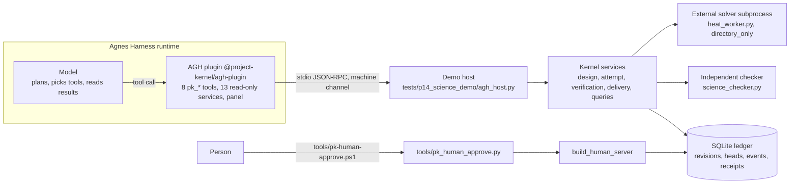
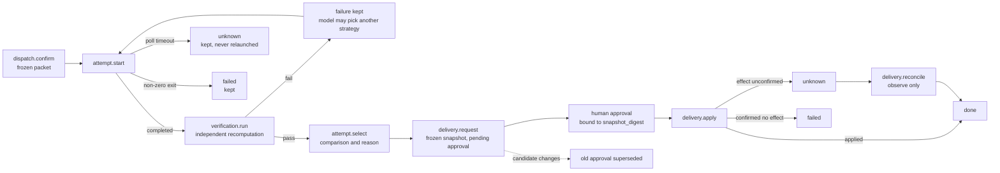

# Project Kernel: an external project ledger for AGH

Move an agent's memory and process out of its context into a structured ledger. The model queries it, an independent program re-checks results, a person holds the gate.

[中文](README.md) | Repo https://github.com/LGZX2233/xiaobai2233 | Landing page https://lgzx2233.github.io/xiaobai2233/ (once Pages is deployed) | Demo video {{VIDEO_URL}}

## Why this exists

An LLM agent doing a long research task keeps hitting the same walls:

- Attention decays. The longer the conversation, the easier it is to ignore early facts. By turn 40 the model may have "forgotten" that the grid search in turn 3 failed acceptance.
- Memory resets. Close the session and which strategies ran, with what result, and why one was chosen are gone.
- Mistakes repeat. A stalled solver is treated as "not run" and launched again; a timed-out write is treated as "not written" and written again, doubling an external effect.
- The run is a black box. The model says "alpha = 0.9, verified" and nobody can check it; nobody recorded who approved the delivery or which snapshot they saw.
- Records are scattered. Every conversation keeps its own notes, so reviewing project structure, tech debt, or where the model misunderstood means reading chat logs.

A bigger model helps with some of this. Where facts live and who gets to decide are not model-capability problems. Our position is to **work around** the model's limits, not to fix them. This project does not touch the Transformer and does not claim to improve the model.

The approach: put facts and process in an append-only ledger that can be read as of a past point in time. The model plans and uses tools to query it. The kernel only records, validates and blocks; it never plans. Results are recomputed by an independent checker. Delivery can only be released by a person through an entry the model cannot reach.

In the heat-conduction case: the stalled s3 is recorded as `unknown`, kept, and never relaunched automatically. s1 self-reports alpha = 0.3500 and fails the independent closed-form recomputation; it is kept as evidence. s2 gives 0.37286 and passes. The model writes down why it chose s2. Delivery stops at pending until a person types the first 8 hex characters of the snapshot digest in a terminal. Changing alpha to 0.9 is rejected; a machine-channel attempt to approve returns `UNSUPPORTED_COMMAND`.

**Status.** Historical kernel status `accepted_g2`, `release_approved=false` (no release approval). Evidence mode `test`. Isolation is `directory_only`, not an OS sandbox. The stdio JSON-RPC is our own protocol, not MCP. Verified on AGH only. The demo data is synthetic and deterministic, not a materials database.

## Pain point -> mechanism -> evidence -> status

Evidence points at code or tests in this repo. Rows without a mechanism are marked direction or goal.

| Pain point | Mechanism | Evidence | Status |
| --- | --- | --- | --- |
| Unclear agent execution records | Revision, head history, events, audit and receipt commit in one unit of work | `src/project_kernel/data/store/uow.py`; `tests/p15_innovation_showcase` step A | Implemented, tested |
| Long-context attention loss, no cross-session memory, rising cost | The model reads the ledger with `pk_state` / `pk_compare` / `pk_events`; `as_of_seq` reads history | `adapters/agh-plugin/index.mjs`; showcase step A (a frozen watermark still reads the old facts after restart, labelled `incomplete` / `projection_stale`) | Ledger reads: implemented, tested. Token savings: **not measured**. Context budgeting (KnowledgeService): implemented, not wired to RPC |
| Repeated mistakes, stalled tasks rerun | Poll timeout settles as `unknown`; same idempotency key returns the original receipt; reads never relaunch | `tests/p14_science_demo/science_executor.py`; showcase steps B, D | Implemented, tested |
| Self-reported results cannot be trusted | Independent closed-form recomputation; readings must match the fixed-seed dataset | `tests/p14_science_demo/science_checker.py`; `test_heat_inversion_flow.py` lines 86-91 | Implemented, tested |
| No exploration or comparison of options | Several strategies per task, each its own attempt and directory; `attempts.compare` keeps failures and unknowns; `attempt.select` stores comparison and reason | `tests/p14_science_demo`; `failures_retained`, `missing_usage_is_not_zero` assertions | Implemented, tested. Whether the model explores is up to the model in AGH |
| No company-style governance | Approval exists only on a separate human entry (`UNSUPPORTED_COMMAND` on the machine channel); approval is bound to the snapshot digest and superseded when the candidate changes; rules can only tighten | `src/project_kernel/interfaces/rpc/policy.py`, `bootstrap.py`; showcase steps C, E | Approval: implemented, tested. Isolation: `directory_only`, **not** an OS sandbox |
| Uncertain external effects | Delivery states `prepared -> claimed -> applying -> applied / failed / unknown`; `reconcile` only observes | `application/delivery/service.py`, `domain/delivery/effect.py`; showcase step F | Implemented, tested |
| Model lacks environment knowledge, reinvents wheels | `environment.report` sorts facts into satisfied / missing / unknown / too_old / not_checked | `application/environment_service.py`; showcase step G | Implemented, tested. "Fewer reinvented wheels" is **not measured** |
| Unclear requirements, no notion of the user's knowledge and ability | Requirements and acceptance items are exact versions; `requirements.coverage` is computed; the user profile is a descriptive document with no score | `application/design/`; `docs/records/user-learning-profile.md` | Requirements and coverage: implemented, tested. User knowledge and ability boundary: **document only**, no runtime service |
| Messy program structure, invisible tech debt | 23-node module tree plus trace / coverage / timeline views in the AGH panel | `docs/modules/registry.json`; `client/src/views/Structure.jsx` | Module tree: implemented, tested, but declared in documents, not generated at runtime. Coupling metrics: **design** only |
| Retaining data for later tuning | KnowledgeService; corpus (datasets, review, export authorisation) | `tests/p08_knowledge`, `tests/p09_corpus` | KnowledgeService: implemented, unit-tested, **not wired to RPC**. corpus: implemented, `enable_corpus` off by default |
| Hard multi-model, large-project interaction | Projects, requirements, designs and packets are exact-version objects; model-to-model exchange is design only | `application/design/`; `docs/architecture/agent-exchange-and-live-forms.md` | Versioned objects: implemented, tested. Exchange between models: **design** |
| Per-conversation records, low coupling | Module nodes reserve `conversation_refs` | `docs/modules/registry.json` (all empty; a test asserts no links were invented) | **Direction**, no mapping |
| Records interoperable across agent frameworks | Versioned stdio JSON-RPC plus frozen JSON Schemas | `contracts/v1/`, `interfaces/rpc/`, `bridge/protocol/`, `tests/p10_protocol` | Protocol: implemented, tested. Interoperability: **design goal**, verified on AGH only; not MCP |
| Form-based model-human exchange | Form-based exchange format, live forms | `docs/architecture/agent-exchange-and-live-forms.md` (states the channel is not implemented) | **Direction** |

## Architecture



Human approval does not pass through AGH's tool channel or the model. The plugin has no approval tool (`adapters/agh-plugin/test/tools.test.mjs` asserts no tool name contains approve or decide).



## Four pillars

| Pillar | Value in one line |
| --- | --- |
| Memory and records | Facts live in the ledger, not in the context; history is readable by watermark and survives restart |
| Trust and governance | The model's word is not enough: independent recomputation, human-only approval, snapshot-bound approval, tighten-only rules |
| Structure and visibility | Module tree, trace, coverage, timeline and environment report in the AGH panel for people to review |
| Integration | Versioned JSON-RPC with frozen schemas, run as an AGH plugin without changing AGH source |

<details>
<summary>Memory and records</summary>

- Immutable ledger: revision, head history, events, audit and receipts commit or roll back together (`data/store/uow.py`).
- Read watermark `as_of_seq`: a lagging watermark is labelled `completeness=incomplete`, `projection_stale=true` instead of posing as current (`data/queries/watermarks.py`, `service.py`).
- `unknown` is kept and never relaunched (`science_executor.py`, `application/attempt/service.py`).
- Idempotent receipts: replaying the same key returns the original receipt.
- Failures stay; missing usage is not zero (`total=None`, `missing_usage_is_not_zero=true`).
- Backup and restore are implemented and tested (`evidence/backup.py`, `tests/p05_evidence`); production recovery is not enabled.
</details>

<details>
<summary>Trust and governance</summary>

- Independent recomputation: `science_checker.py` ignores the solver's own number, recomputes `alpha = -ln(y/sin x)/T` from the 9 readings (median), and requires the readings to match the fixed-seed dataset to 1e-12.
- Human-only commands (`approval.decide`, `approval.revoke`, `decision.record`, `verification.record_review`, `dataset.review`, `knowledge.promote`) return `UNSUPPORTED_COMMAND` on the machine channel (`interfaces/rpc/policy.py`).
- Snapshot-bound approval; a changed candidate supersedes the earlier approval (showcase step E).
- Rules can only tighten: `rules.save` accepts `deny` only; `allow` and non-allow-listed paths return `INVALID_INPUT`.
- Delivery states and observe-only `reconcile` (`domain/delivery/effect.py`).
- Terminal confirmation (`tools/pk_human_approve.py`): lists pending deliveries and requires the person to type the first 8 characters of the snapshot digest; it refuses without a TTY. This proves a person looked at the screen; it is **not a security boundary**, since anyone who can log in to the machine can run it.
- Directory isolation only (`directory_only`), not an OS sandbox.
</details>

<details>
<summary>Structure and visibility</summary>

- 23-node module tree, single root, acyclic, relations resolvable (tested). `pk.tree` only extracts facts that the node documents state.
- Read-only queries behind the views: `project.trace`, `requirements.coverage`, `project.timeline`, `environment.report`.
- The AGH panel has 14 views: Overview, Design, Workspace, Structure, Requirements, Execution, Approvals, Environment, Versions, Events, Errors, Documents, Skill, Knowledge (`adapters/agh-plugin/client/src/views/`).
- Data sources are labelled live / document declaration / derived / design preview. The Knowledge view is entirely design-preview examples; both project skills are `not_validated`.
</details>

<details>
<summary>Integration</summary>

- Newline-framed JSON-RPC 2.0 (`kernel.initialize`, `kernel.command`, `kernel.query`) validated against frozen schemas in `contracts/v1`.
- Two entries with different capability sets: `build_server` (machine) and `build_human_server`.
- AGH plugin (version 0.3.1): tools `pk_state`, `pk_run_strategy {strategy_id}`, `pk_verify {strategy_id}`, `pk_compare`, `pk_select {strategy_id, reason}`, `pk_request_delivery {}`, `pk_apply_delivery {}`, `pk_events`; 13 read-only browser services (`pk.*`); the panel mounts in `workbench.panel`.
- Short arguments: the model passes only `strategy_id` and `reason`; the plugin remembers object references per session. `pk_state` returns a `guide` with the recommended order and "you cannot approve".
- Platform scope: verified on AGH only. Other frameworks (MCP, other IDE agents) are future work.
</details>

## Case: 1-D heat-conduction inverse problem

`u_t = alpha u_xx` on `[0, pi]`, zero at both ends, initial `sin x`, exact solution `u = exp(-alpha t) sin x`. Nine sensors at T = 0.5 with fixed-seed (20261013) Gaussian noise sigma = 0.005. True alpha = 0.37, relative tolerance 5%. Synthetic, deterministic data. The solver `heat_worker.py` is an explicit FTCS finite-difference scheme (NX = 41, dt = 0.002) run as a separate subprocess.

| Strategy | Method | alpha fit | Closed-form reference | vs reference | vs truth | Outcome |
| --- | --- | --- | --- | --- | --- | --- |
| s1 | grid search, step 0.05 | 0.35000 | 0.37859 | 7.55% | 5.41% | fail: outside 5% |
| s2 | golden section, 30 iterations | 0.37286 | 0.37859 | 1.51% | 0.77% | pass |
| s3 | stalled solver (sleep) | - | - | - | - | poll timeout, `unknown`, kept, not relaunched |
| forged | s2 with alpha changed to 0.9 | 0.9 | 0.37859 | - | - | rejected |

Measured on 2026-10-15 in a Linux sandbox by running `heat_worker.py` and `science_checker.judge` directly; the output is in [docs/submission/测试样例.md](docs/submission/测试样例.md) (Chinese).

## Three classes of test sample

| Class | Content | Expected |
| --- | --- | --- |
| Normal | golden section passes; coarse grid s1 completes but misses tolerance; s2 selected with a reason; delivery after human approval | s2 `passed=True`; s1 `passed=False`; delivery `applied` |
| Boundary | forged alpha = 0.9; machine-channel approval; candidate changed after approval; an `allow` rule; cross-project query | rejected; `UNSUPPORTED_COMMAND`; old approval `superseded`; `INVALID_INPUT`; `SCOPE_MISMATCH` |
| Failure | s3 stalls; same-key replay; repeated reads and compares; `reconcile`; restart | `unknown` kept and launch count unchanged; original receipt returned; no replayed write; watermark read unchanged |

```bash
python -m pytest -q tests/p14_science_demo tests/p15_innovation_showcase   # measured 2026-10-15: 7 passed
python -m pytest -q tests                                                  # measured 2026-10-15: 627 passed (about 80-90 s)
# in adapters/agh-plugin, with PK_PYTHON and PK_HOST_SCRIPT set:
node --test test/tools.test.mjs test/services.test.mjs test/polling.test.mjs   # measured: 16 passed
```

`test/panel.test.mjs` needs esbuild and React from a local AGH checkout (`AGH_ROOT`) and the panel is being reworked; treat its result as "re-run before submission". Assertions, line numbers and output: [docs/submission/测试样例.md](docs/submission/测试样例.md).

## What AGH does, and which models were used

- AGH is the agent runtime of the core task loop: it loads the plugin, hands the `pk_*` tools to the model, executes tool calls, returns results, and renders the panel. Planning, capability calls and feedback handling all happen inside AGH.
- The model decides which strategies to run and in what order, reads the independent check results (failures included), compares, selects a passing strategy with a reason, requests delivery and stops, applies delivery after a person approves, and checks the events. The kernel records, validates and blocks.
- One caveat on "reacting to failure": the kernel supports a model switching strategy after s1 fails, but the rehearsal records we have used a prompt asking to "run all available strategies", and the models ran all three before verifying. Those records do **not** show a failure-driven switch.

**Models, by evidence**

| Model | Status | Evidence |
| --- | --- | --- |
| DeepSeek, chosen by the team lead for the AGH run. The API's `/models` lists `deepseek-flash` and `deepseek-v4-pro`. The label "DeepSeek V4.1 Flash" is **not confirmed by the API**: pending the team lead's confirmation | Used for the AGH run. Two rehearsals outside AGH already exist: `deepseek-flash` drove the same `pk_*` tools and kernel over the chat-completions API, 9 API calls each, 29727 and 30515 total tokens, both selected s2 (alpha = 0.37286) and delivery `applied`. The human approval step in that rehearsal was done by an operator script calling `decide()`, not by the model | Rehearsal: `evidence/rehearsal/` (`prompt.md`, `summary.md`, `*.jsonl`). AGH run: `evidence/agh-run/`, whatever is in the repo; if absent, it does not exist yet |
| Agnes 3.0 Flash, id `agnes-3.0-flash`, provider `agnes-ai` in AGH | Verified through the API to return tool calls. Two rehearsals outside AGH exist (29393 and 30985 total tokens, both selected s2 and `applied`; in the first, the model called `pk_verify` on the stalled s3 and got a raw host error, after which the tool was changed, not the prompt; see `evidence/rehearsal/notes.md`). Whether it took part in an AGH run is decided only by records in `evidence/agh-run/` | Model definition in AGH source `packages/ai/src/adapters/pi/providers/agnes-ai.ts` |

Keys are entered only by the user in AGH settings and never stored in files. The kernel tests need no model or key.

## Quick start

Python 3.12+ and the full source tree are required (`contracts/v1` is not packaged into the wheel). `<kernel_next>` is your checkout.

**Windows PowerShell**

```powershell
cd <kernel_next>
py -3.12 -m venv .venv
.\.venv\Scripts\python.exe -m pip install -e ".[test]"
.\.venv\Scripts\python.exe -m pytest -q tests\p14_science_demo tests\p15_innovation_showcase
```

Inside AGH (needs Node.js 24+ and a built AGH; the three scripts live in `tools\`; their default AGH paths are the author's machine and can be overridden with `-Runtime`, `-AghHome`, `-Port`):

```powershell
powershell -NoProfile -ExecutionPolicy Bypass -File tools\install-agh-plugin.ps1   # once; type y when AGH asks Install ...? [y/N]
powershell -NoProfile -ExecutionPolicy Bypass -File tools\start-agh.ps1            # keep open; open http://127.0.0.1:5186 in a private window
powershell -NoProfile -ExecutionPolicy Bypass -File tools\pk-human-approve.ps1     # in another PowerShell window once the model has requested delivery
```

Add a model account in AGH settings, then paste the prompt from `evidence/rehearsal/prompt.md`. AGH shows its own tool-permission dialog when the model calls `pk_request_delivery` (allow it once; in our sandbox it timed out after about 60 seconds). That is AGH's confirmation and is separate from the kernel's human approval. After approving in the terminal, tell the model "approved, please apply the delivery". We only read the three `.ps1` scripts; we have not executed them on Windows.

**Linux / macOS**

```bash
cd <kernel_next>
python3.12 -m venv .venv && . .venv/bin/activate
pip install -e ".[test]"
python -m pytest -q tests/p14_science_demo tests/p15_innovation_showcase
python -m pytest -q tests
```

Manual plugin install into an isolated AGH instance: put `adapters/agh-plugin/docs/local-dev.profile.yaml` at `profiles/local-dev/profile.yaml` (the capability ceiling must include `services`), run AGH's `package add file:./adapters/agh-plugin` from the repo root, then `package trust` (check integrity and capability hash), `package enable`, `package status`. When the plugin does not run inside the repo, set `PK_KERNEL_ROOT` and `PK_PYTHON`, and if needed `PK_HOST_SCRIPT`, `PK_ROOT` (must be under the system temp dir or `.validation-tmp`), `PK_REGISTRY`, `PK_SKILLS_REGISTRY`. Exact AGH command lines depend on your AGH version.

## Relationship to existing tools

General comparison only; no claims about specific products.

- Agent memory features in general-purpose frameworks are commonly built on conversation summaries or vector retrieval and answer "what does the model remember". This project answers "what actually happened in the project": exact versions, sources, approvals and effects, readable as of a point in time. The two can coexist.
- Workflow and CI systems are good at scheduling and retry. This project deliberately does not rerun `unknown`, because rerunning when an external effect is unconfirmed can duplicate it.
- Experiment tracking and observability tools record parameters, metrics and traces. This project additionally treats "who chose which option, why, who approved, and which snapshot they saw" as first-class records that the model itself can query through tools.
- This is not a model improvement and not a general workflow engine; it is a ledger and a gate beside an agent runtime.

## Status matrix

| Implemented and tested | Implemented, not wired | Design / direction / not implemented |
| --- | --- | --- |
| Immutable ledger, read watermark, readable after restart | KnowledgeService (unit-tested in `tests/p08_knowledge`, not wired to RPC) | Model-to-model exchange, form-based human/model interaction |
| Multi-strategy attempts, comparison, explicit selection | corpus datasets and export (`enable_corpus` off by default) | Version-to-conversation links (`conversation_refs` all empty) |
| `unknown` kept and never relaunched; idempotent receipts | Two project skills (current versions `not_validated`) | Interoperability with other agent frameworks (AGH only) |
| Independent check, forged result rejected | Descriptive user profile (Markdown only, no runtime service) | OS-level sandbox (currently `directory_only`) |
| Human-only approval, snapshot binding, supersession | | Coupling metrics; runtime service for user knowledge and ability |
| Delivery states and observe-only reconcile | | Production evidence mode, production recovery, real pilot, MCP transport |
| Tighten-only rules | | Quantified token and cost savings |
| AGH plugin: 8 tools, 13 read-only services, 14-view panel | | |

Other notes: evidence mode `test`; synthetic data; kernel status `accepted_g2`, `release_approved=false`; `docs/assets/panel-*.png` are standalone renders with real kernel data, not screenshots inside AGH; whether AGH screenshots exist depends on whether `docs/assets/agh-*.png` are present.

## Roadmap

1. Archive the AGH session records and screenshots under `evidence/agh-run/` (DeepSeek; Agnes 3.0 Flash if re-recorded).
2. Wire KnowledgeService into RPC after fixing the promotion authorisation gap.
3. Write and separately accept a host adapter for a second agent framework.
4. Replace the synthetic data with a real source (materials or experiment database).
5. Provide an OS-level isolated execution provider.
6. Quantify token cost and correctness of "read the ledger" versus "long context", with honest sample sizes.
7. Build a real version-to-conversation mapping for `conversation_refs`.

## Submission index

| Item | Location |
| --- | --- |
| Submission form text (organiser template, Chinese) | [docs/submission/提交材料.md](docs/submission/提交材料.md) |
| Test samples with measured output | [docs/submission/测试样例.md](docs/submission/测试样例.md) |
| Run evidence and tool-call chain | [docs/submission/运行证据.md](docs/submission/运行证据.md) |
| Video script and recording checklist | [docs/submission/视频脚本.md](docs/submission/视频脚本.md), [docs/submission/录屏清单.md](docs/submission/录屏清单.md) |
| Landing page | [docs/index.html](docs/index.html) |
| Architecture and current state | [docs/architecture/kernel-architecture.md](docs/architecture/kernel-architecture.md), [docs/architecture/current-state.md](docs/architecture/current-state.md) |
| Plugin | [adapters/agh-plugin/README.md](adapters/agh-plugin/README.md) |
