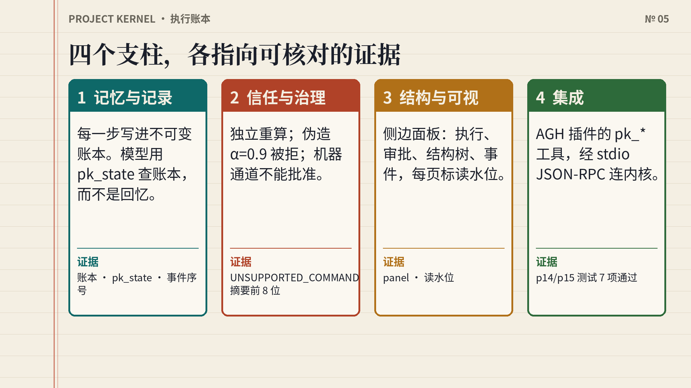
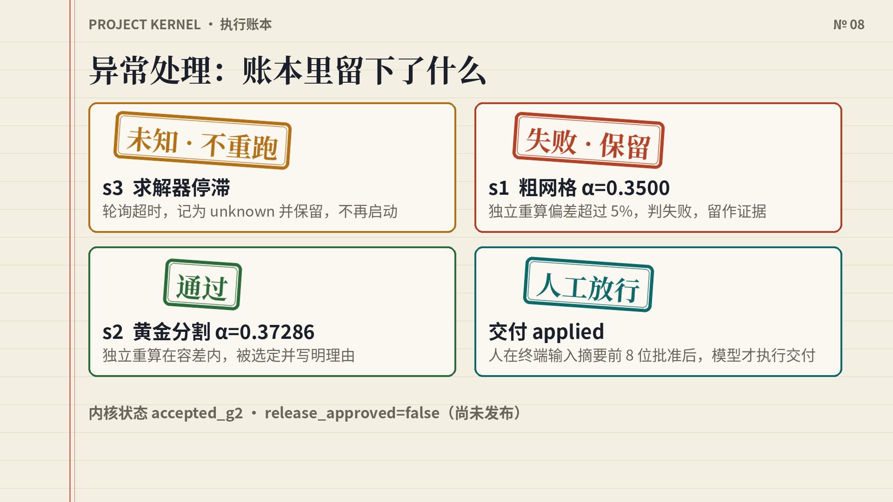
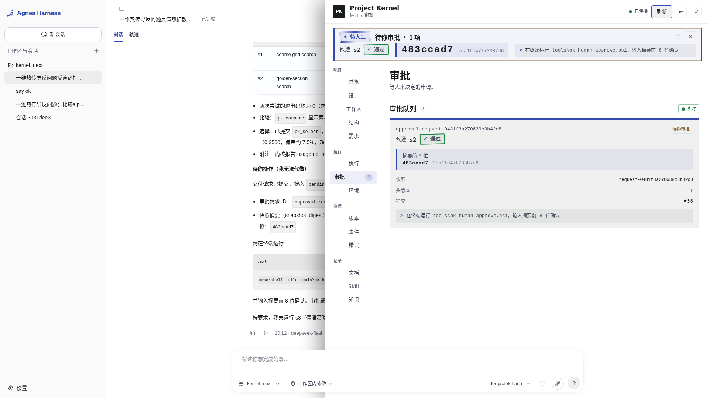
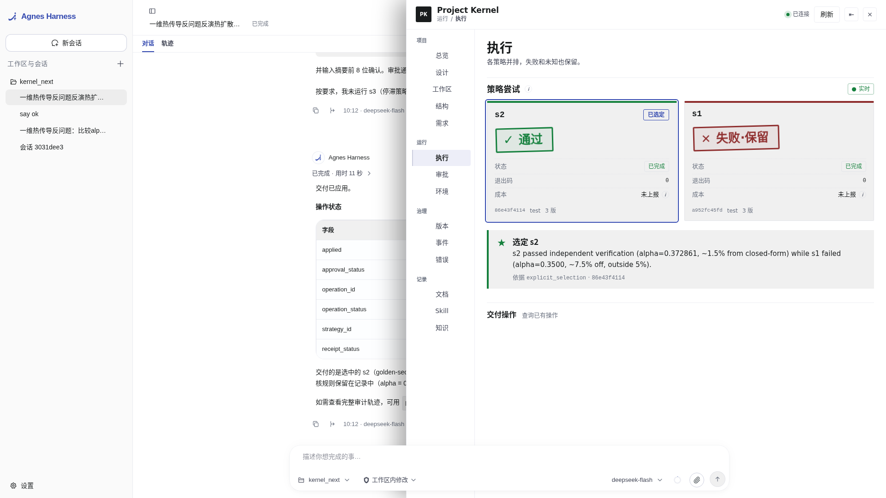
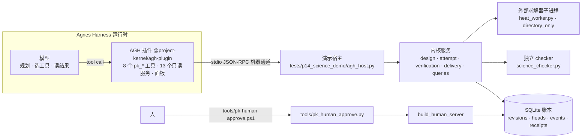
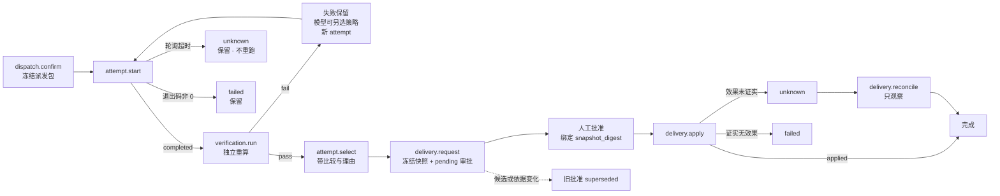

# Project Kernel：给 AGH 的外置项目账本

把 agent 的记忆和过程从上下文里搬出来，存成一份结构化账本。模型去查，程序去验，人来放行。

[English](README.en.md) ｜ 代码仓库 https://github.com/LGZX2233/xiaobai2233 ｜ 落地页 https://lgzx2233.github.io/xiaobai2233/ （部署后可用） ｜ 演示视频 {{VIDEO_URL}}

## 设计与创新一图看懂

**我们发现的问题 → 对应的机制**


**架构：模型规划，内核记账**：模型在 AGH 里规划并选工具；插件提供 pk_* 工具和侧边面板；内核只记录、校验、拦截。


**执行流：一次任务的完整流程**：多策略并列，独立校验，选定写理由，人工批准后才交付，最后对账。


**数据流：只进不改的一本账**：所有写入在同一事务进账本，读取标明读水位；面板给人看，模型按需查，不靠回忆。


**双层存储：项目整体 + 模块独立**：执行模型只读自己模块那份，上下文不用背整段历史；并回主库要验收、打包、去耦并由人确认。


**过程留存 → 复用，避免再犯**：skill 按四个维度评分复用，错误分类登记并附事后分析。


**四个支柱**



**异常处理：账本里留下了什么**



**AGH 实机画面**（官方 AGH 构建，DeepSeek 真实运行）






## 为什么要做这个

让一个 LLM agent 做真正的长流程任务，比如反演一个物理参数、换三种算法、挑一个交给人，它会反复撞上同几堵墙：

- 注意力会丢。对话越长，早期事实越容易被忽略。第 40 轮时，模型可能已经"忘了"第 3 轮那次网格搜索没通过验收。
- 记忆会断。关掉会话再打开，"试过哪些方案、结果如何、为什么选了这个"全部归零，只能重跑，或者重新读一大段聊天记录。
- 错误会重复。卡死的求解器被当成"没跑"再启动一次，超时的写入被当成"没写"再写一次，外部效果被悄悄翻倍。
- 过程是黑箱。模型说"α=0.9，已验证"，人无从核对；谁批准了交付、批准时看到的是哪份结果，没有记录。
- 记录是散的。每个对话各记各的，要回头看项目全貌、查技术债、看模型哪里理解错了，只能翻聊天记录。

更大的模型能缓解一部分，但"事实放在哪里、由谁裁决"不是模型能力问题。我们的定位是**绕开**模型的局限，不是**修好**它：这个项目不改 Transformer，也不声称提升了模型能力。

做法是把事实和过程放进一份只追加、可按时间点回查的账本。模型规划，并用工具查询账本；内核只记录、校验、拦截，不规划；结果由独立程序重算；交付只能由人从模型够不到的入口放行。

一次热传导反演在账本里是这样的（每一句都有对应测试，见下文）：卡死的 s3 记为 `unknown` 并保留，永不自动重跑；s1 自报 α=0.3500，被独立闭式重算判失败，作为证据保留；s2 α=0.37286 通过；模型写下选择理由；交付停在 pending，直到人在终端输入快照摘要的前 8 位。把 α 改成 0.9 再提交会被拒；机器通道想自己批准，返回 `UNSUPPORTED_COMMAND`。

**当前状态**：内核历史状态 `accepted_g2`，`release_approved=false`（没有发布批准）；证据模式 `test`；执行隔离是 `directory_only`，不是操作系统沙盒；自有 stdio JSON-RPC 不是 MCP；只在 AGH 上验证过；演示数据是合成的、确定的，不是材料数据库。

## 痛点 → 机制 → 证据 → 状态

"证据"列是仓库里能打开的代码或测试。没有机制的条目标"方向"或"目标"，不当作已完成。

| 痛点 | 机制 | 证据（代码 / 测试） | 状态 |
| --- | --- | --- | --- |
| agent 执行记录不清晰，是黑箱 | 每个命令在一个 UnitOfWork 里同时写入不可变 revision、head 历史、事件、审计和回执；面板"事件""执行"视图读取 | `src/project_kernel/data/store/uow.py`、`store.py`；`tests/p15_innovation_showcase/test_innovation_showcase.py`（步骤 A：`events.read` 按序，重启后可读） | 已实现并测试 |
| 长对话注意力丢失，跨会话记忆归零，成本上升 | 事实不放在上下文里：模型按需调用 `pk_state`、`pk_compare`、`pk_events` 读账本；`as_of_seq` 读水位可回看历史 | `adapters/agh-plugin/index.mjs`（工具）；showcase 步骤 A（冻结水位在重启后读到同一份旧事实，并标为 `incomplete`、`projection_stale`） | 读账本：已实现并测试。"降低 token 成本"：**未测量**。上下文预算（KnowledgeService）：已实现但未接入 RPC |
| 重复犯错：卡死的任务被重跑 | 轮询超时结算为 `unknown`，保留可查；同一幂等键返回原回执；查询和比较不会再次启动 | `tests/p14_science_demo/science_executor.py`；showcase 步骤 B、D（`executor.launches` 不变） | 已实现并测试 |
| 模型自报的结果不可信 | 独立 checker 用闭式解重算，并核对读数与固定种子数据集逐项一致 | `tests/p14_science_demo/science_checker.py`；`test_heat_inversion_flow.py` 第 86–91 行（伪造 α=0.9 被拒） | 已实现并测试 |
| 没有探索和比较方案 | 一个任务可派发多个策略，各自独立 attempt 与执行目录；`attempts.compare` 并列展示，失败和未知不丢；`attempt.select` 保存比较对象与理由 | `tests/p14_science_demo/test_heat_inversion_flow.py`；showcase 中 `failures_retained`、`missing_usage_is_not_zero` 断言 | 已实现并测试。是否主动探索取决于 AGH 里的模型 |
| 缺少公司式治理（审批、隔离） | 审批命令只存在于独立人工入口，机器通道返回 `UNSUPPORTED_COMMAND`；批准绑定快照摘要，候选变化后旧批准作废；规则只能收紧 | `src/project_kernel/interfaces/rpc/policy.py`（`HUMAN_ONLY_COMMANDS`）、`bootstrap.py`（`build_human_server`）；showcase 步骤 C、E | 审批：已实现并测试。隔离：`directory_only`，**不是**操作系统沙盒 |
| 外部效果是否发生不确定 | 交付状态 `prepared → claimed → applying → applied / failed / unknown`；`reconcile` 只观察，不重放写入 | `src/project_kernel/application/delivery/service.py`、`domain/delivery/effect.py`；showcase 步骤 F（对账时把 `export` 换成"再调用即失败"） | 已实现并测试 |
| 模型不了解环境，重复造轮子 | `environment.report` 把环境事实分为 satisfied / missing / unknown / too_old / not_checked | `src/project_kernel/application/environment_service.py`；showcase 步骤 G | 已实现并测试。"减少重复造轮子"本身**未测量** |
| 需求不清，不知道用户的知识与能力边界 | 需求与验收项精确版本化，`requirements.coverage` 计算覆盖；用户画像是描述式文档，不打分 | `src/project_kernel/application/design/`；`docs/records/user-learning-profile.md` | 需求与覆盖：已实现并测试。用户知识与能力边界：**仅文档**，没有运行服务 |
| 程序结构混乱，技术债看不见 | 23 节点模块树（需求、源码、版本、实现状态）加追溯、覆盖、时间线视图，在 AGH 面板"结构"里展示 | `docs/modules/registry.json`；`adapters/agh-plugin/client/src/views/Structure.jsx`；`test_module_tree_registry_is_a_tree_with_resolvable_relations` | 模块树：已实现并测试，但它是文档声明，不是运行时自动生成。耦合度量：**设计**（`docs/architecture/coupling-metric-boundary.md`，未实现） |
| 过程数据留存，供后续调优 | KnowledgeService（上下文预算、评分、提升）和 corpus（数据集、审核、导出授权） | `tests/p08_knowledge`、`tests/p09_corpus`；`docs/architecture/training-data-boundary.md` | KnowledgeService：已实现，有单测，**未接入 RPC**。corpus：已实现，`enable_corpus` 默认关闭 |
| 多模型、大项目交互困难 | 项目、需求、方案、派发包都是精确版本的对象；模型间交换（`model_exchange`）只有设计 | `src/project_kernel/application/design/`；`docs/architecture/agent-exchange-and-live-forms.md` | 版本化对象：已实现并测试。模型间交换：**设计** |
| 每个对话各记各的，耦合高 | 模块节点预留 `conversation_refs`，让版本对得上对话 | `docs/modules/registry.json`（全部为空，测试断言"没有编造对话关联"） | **方向**，没有映射 |
| 记录能在不同 agent 框架间互通 | 版本化 stdio JSON-RPC 加冻结 JSON Schema；Node 客户端 | `contracts/v1/`、`src/project_kernel/interfaces/rpc/`、`bridge/protocol/`、`tests/p10_protocol` | 协议：已实现并测试。互通：**设计目标**，只在 AGH 上验证过；自有协议不是 MCP |
| 人与模型沟通随意，没有标准表单 | 表单化交换格式、实时表单 | `docs/architecture/agent-exchange-and-live-forms.md`（文档写明"未实现 `model_exchange` 或实时表单通道"） | **方向** |

## 架构



人工审批不经过 AGH 的工具通道，也不经过模型。插件里没有审批工具（`adapters/agh-plugin/test/tools.test.mjs` 断言工具名里不含 approve 或 decide）。

执行流程（各状态分别持久化，不是一个虚构的全局状态机）：



## 四个支柱与创新点

每一项给出一句价值和代码位置。状态不是"已实现并测试"的，在括号里写明。

| 支柱 | 一句话价值 |
| --- | --- |
| 记忆与记录 | 事实在账本里，不在上下文里；历史可按水位回看，重启不丢 |
| 信任与治理 | 模型说了不算：独立重算、只有人能批准、批准绑定快照、规则只能收紧 |
| 结构与可视 | 模块树、追溯、覆盖、时间线、环境报告，在 AGH 面板里给人审阅 |
| 集成 | 冻结 Schema 的版本化 JSON-RPC，作为 AGH 插件运行，不改 AGH 源码 |

<details>
<summary>记忆与记录：6 项</summary>

- 不可变账本。revision、head 历史、事件、审计、回执在同一 UnitOfWork 里提交或回滚，没有半截记录。`src/project_kernel/data/store/uow.py`
- 读水位 `as_of_seq`。可以回看任意提交序号时的事实；落后的水位如实标 `completeness=incomplete`、`projection_stale=true`，不冒充当前。showcase 在任何 attempt 出现之前冻结水位，最后读到的仍是 0 个 attempt，关库重开后结果相同。`src/project_kernel/data/queries/watermarks.py`、`service.py`
- `unknown` 保留且不重跑。轮询超时的任务落为 `unknown`，之后的查询、比较、同键重放都不再启动它。`tests/p14_science_demo/science_executor.py`、`src/project_kernel/application/attempt/service.py`
- 幂等回执。同一 `idempotency_key` 重放返回原回执，不产生第二次效果。`uow.py`
- 失败不删，缺失不当零。`attempts.compare` 返回 `failures_retained`；没有用量数据时 `total=None`、`missing_usage_is_not_zero=true`。`src/project_kernel/data/queries/service.py`
- 备份与恢复。一致备份、校验、隔离副本恢复有实现与测试（`src/project_kernel/evidence/backup.py`、`tests/p05_evidence`），生产恢复未启用。
</details>

<details>
<summary>信任与治理：7 项</summary>

- 独立复算验收。checker 不信求解器自报的数字，用闭式解 `α = −ln(y/sin x)/T` 对 9 个读数取中位数重算，并要求读数与固定种子数据集逐项一致（误差 ≤1e-12）。`tests/p14_science_demo/science_checker.py`
- 人工专属命令。`approval.decide`、`approval.revoke`、`decision.record`、`verification.record_review`、`dataset.review`、`knowledge.promote` 只能走人工入口，机器通道返回 `UNSUPPORTED_COMMAND`。`src/project_kernel/interfaces/rpc/policy.py`
- 快照绑定的审批。批准的是冻结快照的摘要；候选内容变化后重新验收，旧批准变为 `superseded`，需要重新申请。`src/project_kernel/application/delivery/service.py`；showcase 步骤 E
- 规则只收紧。`rules.save` 只接受 `deny`；`allow` 和白名单之外的路径（如 `os.environ.SECRET`）返回 `INVALID_INPUT`；未知事实阻断而不是放行。`src/project_kernel/application/design/service.py`；showcase 步骤 C
- 交付状态与只观察的对账。`reconcile` 只查询真实目标，不重放写入。`src/project_kernel/domain/delivery/effect.py`
- 终端人工确认。`tools/pk_human_approve.py` 列出待批的交付，要求人亲手输入快照摘要前 8 位，检测不到终端就拒绝。这是"有人看过"的交互证明，**不是安全边界**：能登录这台机器的人也能运行它。`tests/p14_science_demo/test_human_approve_cli.py`
- 目录隔离。不同策略的执行目录不能相同或互为父子。这是 `directory_only`，不是操作系统沙盒。`tests/p14_science_demo/science_executor.py` 的 `capabilities()`
</details>

<details>
<summary>结构与可视：5 项</summary>

- 23 节点模块树，单根、无环，依赖可解析（有测试）。`pk.tree` 只提取节点文档里写明的事实。`docs/modules/registry.json`
- 只读视图的数据来自内核查询：追溯 `project.trace`、覆盖 `requirements.coverage`、时间线 `project.timeline`、环境 `environment.report`。`src/project_kernel/data/queries/`；showcase 步骤 G
- AGH 面板共 14 个视图：总览、设计、工作区、结构、需求、执行、审批、环境、版本、事件、错误、文档、Skill、知识。源码在 `adapters/agh-plugin/client/src/views/`。
- 数据来源分四类标注：实时、文档声明、派生、设计预览，避免把设计预览读成事实。其中"知识"视图全部是设计预览示例，两项项目技能的当前版本均为 `not_validated`。
- "设计"视图把每个痛点对应到机制、代码位置和状态，与本文的表同源。
</details>

<details>
<summary>集成：5 项</summary>

- 协议。换行分帧的 JSON-RPC 2.0（`kernel.initialize`、`kernel.command`、`kernel.query`），载荷由 `contracts/v1` 冻结 Schema 校验；解析递归上限、不可编码字符串、响应编码失败都有兜底。`src/project_kernel/interfaces/rpc/`
- 两个入口分开。机器通道 `build_server`，人工入口 `build_human_server`，权限集不同。`src/project_kernel/bootstrap.py`
- AGH 插件。8 个工具：`pk_state`、`pk_run_strategy {strategy_id}`、`pk_verify {strategy_id}`、`pk_compare`、`pk_select {strategy_id, reason}`、`pk_request_delivery {}`、`pk_apply_delivery {}`、`pk_events`；13 个只读浏览器服务（`pk.*`）；面板挂在 `workbench.panel`。`adapters/agh-plugin/index.mjs`
- 短参数。模型只传 `strategy_id` 和 `reason`，对象引用由插件按会话记住，减少模型抄写长 JSON 出错的机会；`pk_state` 返回的 `guide` 写明推荐顺序和"你不能批准"。`index.mjs` 的 `WORKFLOW_GUIDE`
- 平台范围。只在 AGH 上验证。其它框架（MCP、其他 IDE agent）是后续适配，不能据此称为已兼容。
</details>

## 案例：一维热传导反问题

问题：`u_t = α u_xx`，区间 `[0, π]`，两端为 0，初值 `sin x`，解析解 `u = e^{−αt} sin x`。在 T=0.5 处 9 个传感器读数，叠加固定种子（20261013）σ=0.005 的高斯噪声。真值 α=0.37，相对容差 5%。数据合成且确定。求解器 `heat_worker.py` 是显式 FTCS 有限差分（NX=41，dt=0.002），作为独立子进程运行。

| 策略 | 方法 | α 拟合值 | 闭式参考 | 距闭式参考 | 距真值 | 结论 |
| --- | --- | --- | --- | --- | --- | --- |
| s1 | 网格搜索，步长 0.05 | 0.35000 | 0.37859 | 7.55% | 5.41% | 失败：超出 5% |
| s2 | 黄金分割，30 次迭代 | 0.37286 | 0.37859 | 1.51% | 0.77% | 通过 |
| s3 | 求解器卡死（sleep） | — | — | — | — | 轮询超时，`unknown`，保留，不重跑 |
| 伪造 | 保留真实读数，把 s2 的 α 改成 0.9 | 0.9 | 0.37859 | — | — | 拒绝 |

以上数值是 2026-10-15 在 Linux 沙盒里直接运行 `heat_worker.py` 并调用 `science_checker.judge` 得到的，输出在 [测试样例](docs/submission/测试样例.md)。

## 三类测试样例

| 类别 | 内容 | 期望 |
| --- | --- | --- |
| 正常 | 黄金分割通过；粗网格 s1 完成但没达到容差；选择 s2 并写理由；人工批准后交付 | s2 `passed=True`；s1 `passed=False`；交付 `applied` |
| 边界 | 伪造 α=0.9；机器通道尝试批准；批准后候选变化；`allow` 规则；跨项目查询 | 验收失败；`UNSUPPORTED_COMMAND`；旧批准 `superseded`；`INVALID_INPUT`；`SCOPE_MISMATCH` |
| 失败 | s3 卡死；同键重放；反复查询比较；`reconcile`；重启 | `unknown` 保留且启动次数不变；返回原回执；不重放写入；水位读取结果不变 |

命令（在仓库根目录，已 `pip install -e ".[test]"`）：

```bash
python -m pytest -q tests/p14_science_demo tests/p15_innovation_showcase   # 2026-10-15 实测：7 passed
python -m pytest -q tests                                                  # 2026-10-15 实测：627 passed（约 80–90 s）
```

插件的 node 测试（在 `adapters/agh-plugin` 下，需要 `PK_PYTHON` 和 `PK_HOST_SCRIPT`）：`node --test test/tools.test.mjs test/services.test.mjs test/polling.test.mjs`，2026-10-15 实测 16 项通过。`test/panel.test.mjs` 需要本地 AGH 源码里的 esbuild 和 React（`AGH_ROOT`），面板正在改版，它的结果以提交前重跑为准。详细断言、行号和输出见 [测试样例](docs/submission/测试样例.md)。

## AGH 的作用与模型的位置

- AGH 是核心任务循环里的 agent 运行时：加载插件，把 `pk_*` 工具交给模型，执行工具调用，把结果返回给模型，渲染面板。规划、能力调用、反馈处理三步都在 AGH 里完成。
- 模型负责：读 `pk_state` 了解任务 → 决定跑哪些策略、什么顺序 → 读 `pk_verify` 的结果（失败也是结果）→ `pk_compare` → `pk_select` 选通过的策略并写理由 → `pk_request_delivery` 发起审批并停下 → 人批准后 `pk_apply_delivery` → `pk_events` 核对。顺序由模型决定。注意：内核支持"s1 失败后模型改跑别的策略"这条路径，但目前留下的预演记录里，提示词要求"把可用策略都跑一遍"，模型是先跑完三个再逐个校验的，所以记录**不能**证明"模型因失败而改变策略"；AGH 实机记录里是否出现，以 `evidence/agh-run/` 为准。
- 内核负责：记录、校验、拦截。不规划，不替模型决定下一步。

**用到了哪些模型（以证据为准）**

| 模型 | 状态 | 证据 |
| --- | --- | --- |
| DeepSeek（队长为 AGH 运行选定）。API `/models` 列出的 id 是 `deepseek-flash` 和 `deepseek-v4-pro`；队长使用的版本标签"DeepSeek V4.1 Flash"API 没有确认，**待队长确认** | AGH 实机运行用。AGH 之外已有两次预演：`deepseek-flash` 经聊天补全 API 驱动同一组 `pk_*` 工具和同一个内核，每次 9 次接口调用，总 token 29727 和 30515，两次都选 s2、α=0.37286、交付 `applied`；其中人工批准一步由操作员脚本调用 `decide()` 完成，不是模型 | 预演：`evidence/rehearsal/`（`prompt.md`、`summary.md`、`*.jsonl`）。AGH 实机：`evidence/agh-run/`，以仓库实际内容为准，没有就是还没有 |
| Agnes 3.0 Flash，id `agnes-3.0-flash`，AGH 内 provider `agnes-ai` | 已用 API 验证能返回工具调用。AGH 之外的预演里有两次 `agnes-3.0-flash` 记录（总 token 29393 和 30985，均选 s2、`applied`；第一次模型对卡住的 s3 调用 `pk_verify` 拿到宿主原始错误，之后改的是工具而不是提示词，见 `evidence/rehearsal/notes.md`）。是否参与过 AGH 运行，只看 `evidence/agh-run/` 里有没有对应记录 | 模型定义：AGH 源码 `packages/ai/src/adapters/pi/providers/agnes-ai.ts` |

密钥只由用户在 AGH 设置页填写，不进任何文件。内核测试不需要模型或密钥。

## 快速开始

需要 Python 3.12+，以及完整源码树（`contracts/v1` 没有打进 wheel，不能脱离源码树运行）。下面的 `<kernel_next>` 是你电脑上的仓库目录。

**Windows PowerShell**

```powershell
cd <kernel_next>
py -3.12 -m venv .venv
.\.venv\Scripts\python.exe -m pip install -e ".[test]"
.\.venv\Scripts\python.exe -m pytest -q tests\p14_science_demo tests\p15_innovation_showcase
```

在 AGH 里跑（需要 Node.js 24+ 和构建好的 AGH；三个脚本都在 `tools\`，脚本默认的 AGH 路径是作者电脑上的，可用 `-Runtime`、`-AghHome`、`-Port` 覆盖）：

```powershell
powershell -NoProfile -ExecutionPolicy Bypass -File tools\install-agh-plugin.ps1   # 只需一次；AGH 问 Install ...? [y/N] 时亲自输入 y
powershell -NoProfile -ExecutionPolicy Bypass -File tools\start-agh.ps1            # 窗口保持打开；浏览器无痕窗口访问 http://127.0.0.1:5186
powershell -NoProfile -ExecutionPolicy Bypass -File tools\pk-human-approve.ps1     # 模型请求交付后，在另一个 PowerShell 窗口里亲自批准
```

在 AGH 设置里添加模型账号后，粘贴 `evidence/rehearsal/prompt.md` 里的提示词。批准后回到 AGH，告诉模型"已批准，请执行交付"。完整步骤见 [录屏清单](docs/submission/录屏清单.md)。这三个 `.ps1` 脚本，本文作者只读过源码，没有在 Windows 上执行过，以实机为准。

**Linux / macOS**

```bash
cd <kernel_next>
python3.12 -m venv .venv && . .venv/bin/activate
pip install -e ".[test]"
python -m pytest -q tests/p14_science_demo tests/p15_innovation_showcase
python -m pytest -q tests
```

手动把插件装进 AGH（建议用隔离的 AGH 实例，不动日常实例）：把 `adapters/agh-plugin/docs/local-dev.profile.yaml` 放到该实例的 `profiles/local-dev/profile.yaml`（能力上限需含 `services`），在仓库根目录用 AGH 的 `package add file:./adapters/agh-plugin`，再 `package trust`（核对 integrity 与 capability hash）、`package enable`、`package status`。插件不在仓库内运行时，设置 `PK_KERNEL_ROOT`、`PK_PYTHON`，必要时 `PK_HOST_SCRIPT`、`PK_ROOT`（必须在系统临时目录或 `.validation-tmp` 下）、`PK_REGISTRY`、`PK_SKILLS_REGISTRY`。AGH 的具体命令行写法以所用 AGH 版本为准。

## 与现有方案的关系

这里只做一般性比较，不评价具体产品。

- 通用 agent 框架里的记忆功能，常见做法是对话摘要或向量检索，回答"模型记得什么"。本项目回答"项目里实际发生了什么"：精确版本、来源、审批和效果，可按时间点回查。两者可以并存。
- 工作流和 CI 系统擅长调度与重试。本项目刻意不自动重跑 `unknown`，因为外部效果是否发生没有证实时，重跑可能造成重复写入。
- 实验跟踪和可观测性工具记录参数、指标和调用链。本项目额外把"谁选了哪个方案、为什么、谁批准的、批准时看到的是哪份快照"作为一等记录，并让模型自己通过工具查询它。
- 本项目不是模型能力的提升，也不是通用工作流引擎；它是挂在 agent 运行时旁边的账本和闸门。

## 现状矩阵

| 已实现并测试 | 已实现，未接通 | 设计 / 方向 / 未实现 |
| --- | --- | --- |
| 不可变账本、读水位、重启后可读 | KnowledgeService（有单测 `tests/p08_knowledge`，未装配进 RPC） | 模型间交换、表单化人机交互 |
| 多策略 attempt、比较、显式选择 | corpus 数据集与导出（`enable_corpus` 默认 false） | 版本与对话关联（`conversation_refs` 全空） |
| `unknown` 保留且不重跑；幂等回执 | 两项项目技能（当前版本均为 `not_validated`） | 跨 agent 框架互通（只验证过 AGH） |
| 独立验收、伪造拒绝 | 描述式用户画像（仅 Markdown，无运行服务） | 操作系统级沙盒（现为 `directory_only`） |
| 人工专属审批、快照绑定、批准作废 | | 耦合度量；用户知识与能力边界的运行服务 |
| 交付状态与只观察的对账 | | 生产模式证据、生产恢复、真实试点、MCP 传输 |
| 只收紧的规则 | | token 与成本节省的量化测量 |
| AGH 插件 8 个工具与 13 个只读服务；14 视图面板 | | |

其它说明：证据模式 `test`；演示数据是合成数据；内核历史状态 `accepted_g2`、`release_approved=false`；面板截图 `docs/assets/panel-*.png` 是独立渲染（真实内核数据），不是 AGH 内截图；是否已有 AGH 内截图以 `docs/assets/agh-*.png` 是否存在为准。

## 路线图

1. 把 AGH 实机运行的会话记录、截图归档到 `evidence/agh-run/`（DeepSeek；Agnes 3.0 Flash 若补录）。
2. 把 KnowledgeService 装配进 RPC，先处理提升授权的缺口再开放。
3. 为第二个 agent 框架写宿主适配，并单独验收。
4. 用真实数据源（材料或实验数据库）替换合成数据。
5. 提供操作系统级隔离的执行 provider。
6. 量化"读账本 vs 长上下文"的 token 与正确率差异，样本数如实标注。
7. 给 `conversation_refs` 做真实的版本到对话映射。

## 提交材料索引

| 材料 | 位置 |
| --- | --- |
| 提交表单文本（按赛方模板） | [docs/submission/提交材料.md](docs/submission/提交材料.md) |
| 测试样例（正常 / 边界 / 失败，含实测输出） | [docs/submission/测试样例.md](docs/submission/测试样例.md) |
| 运行证据与工具调用链 | [docs/submission/运行证据.md](docs/submission/运行证据.md) |
| 视频脚本、录屏清单 | [docs/submission/视频脚本.md](docs/submission/视频脚本.md)、[docs/submission/录屏清单.md](docs/submission/录屏清单.md) |
| 落地页 | [docs/index.html](docs/index.html)（GitHub Pages 部署后为 https://lgzx2233.github.io/xiaobai2233/ ） |
| 架构与现状 | [docs/architecture/kernel-architecture.md](docs/architecture/kernel-architecture.md)、[docs/architecture/current-state.md](docs/architecture/current-state.md) |
| 插件说明 | [adapters/agh-plugin/README.md](adapters/agh-plugin/README.md) |
| 演示视频 | {{VIDEO_URL}} |
