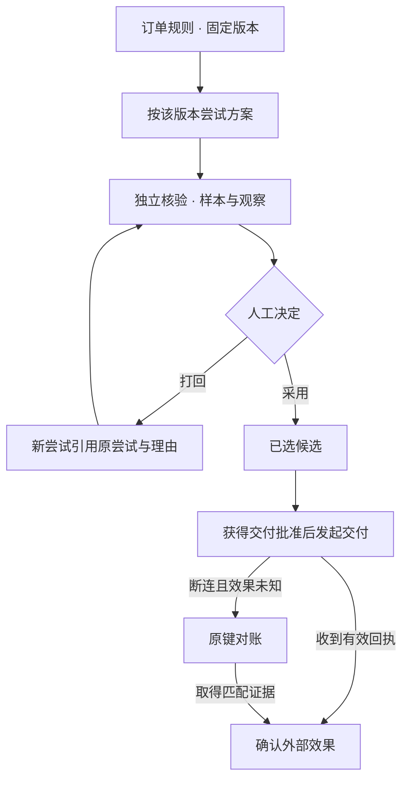
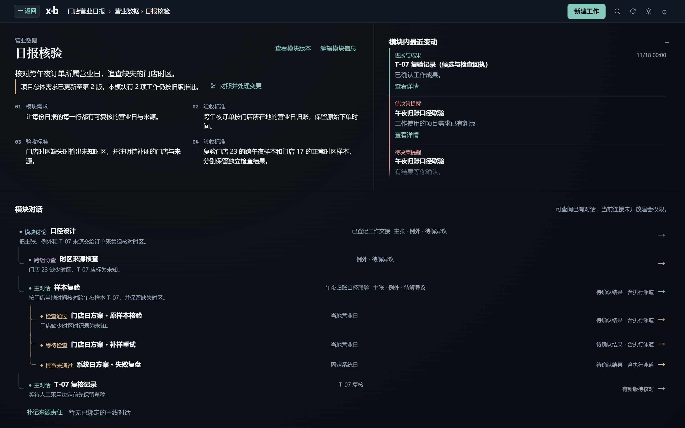
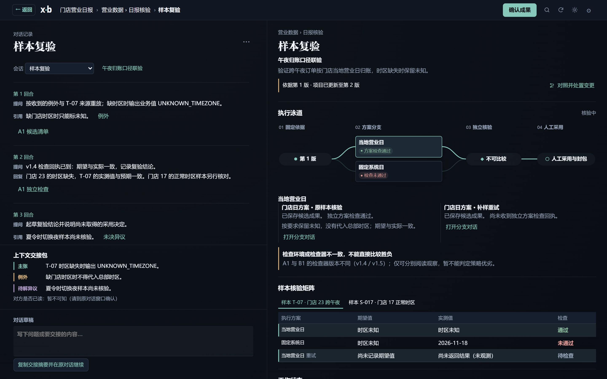
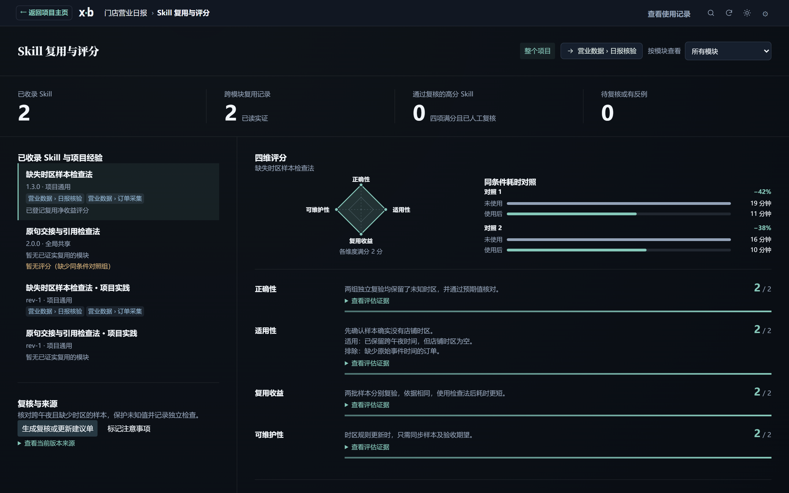
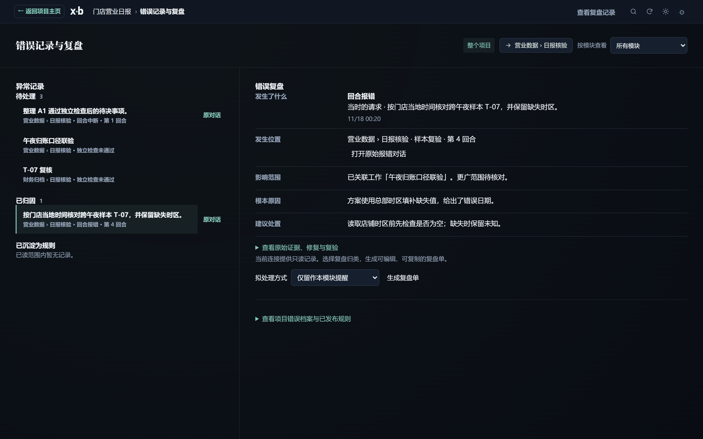

# xiaobai v0.50.0

**xiaobai 是一套由人主导的开源项目协作 Skill，配有独立运行的内核与工作台。** 它面向一种越来越常见的工作方式：一个人带着几个 AI 会话，分头维护同一个项目。人定目标、划模块、决定采用哪个版本。模型可以自主计划、动手和提出异议。到了第二天，换人或换模型，大家仍能查清昨天为什么这样决定。

xiaobai 的前身是一份个人编程学习记录，后来作者开始尝试用 AI 做项目。写一个函数时，人还能从头读完它的输入和输出；当同一条规则散到采集、计算和报表三个模块里，困难就变了。代码可以各自通过测试，三个模块却可能在回答三个不同的问题。xiaobai 想让维护者仍然读得懂整个项目，也让后来接手的助手拿得到当初的要求、试错的来由和已经验证过的方法。

**先选用到哪一层。** 一个人和一个助手，就可以从记录 Skill 开始：留住需求原话、关键决定和下一位要核实的事。并行修改让“各自按哪一版做”成为问题时，再接入 SQLite 内核，给工作、核验和决定留下可回读的版本。需要人比较两份方案、打回重试或换会话接手时，可以打开 DSH 工作台。模型、工具权限和会话仍由原来的宿主提供。 [阅读公开记录 Skill](skills/kernel-maintain-records/SKILL.md)

[下载 Windows x64 发行包](https://github.com/LGZX2233/xiaobai2233/releases/download/v0.50.0/xiaobai-v0.50.0-win-x64.zip) · [本地 MCP 接入](docs/integration.md)

[从需求走到交接](#从一条需求走到交接) · [模块与双文档](#把一个项目拆开做再合到同一版) · [四大设计取舍](#四大路径选择) · [工作台画廊](#工作台画廊) · [安装与接入](#校验安装与接入) · [实测](#t1-实测参数) · [路线图](#接下来的计划)

## 视频演示

**60 秒精华 · v4 普通话讲解**

https://github.com/user-attachments/assets/690a2e16-ca1d-43ce-ac36-573eaa2d2e87

从一条营业日规则看懂模块分工、双文档、对话交接与人工采用。

[仓库内 1080p60 原片](media/xiaobai-v0.50-teaser-v4-zh-voice.mp4) · [Release 下载](https://github.com/LGZX2233/xiaobai2233/releases/download/v0.50.0/xiaobai-v0.50-teaser-v4-zh-voice.mp4) · [双语解说词](media/transcript-v4.md) · [分镜与实测口径](media/storyboard-v4.md) · [观看完整讲解](#完整讲解)

## 为什么需要项目账本

### 长任务里容易混淆的三件事

| 维护者遇到的情形 | 真正要找回的东西 |
|---|---|
| 同一段长对话越改越偏；另开一个会话又得从头解释 | 前者要找本轮偏离的约束，后者要找最初的需求原话、例外和未决项。有版本、能回到原文的记录同时服务这两种查找。 |
| 两位助手都修好了自己的模块，合起来却算错；两份测试还都绿了 | 找到各自实际使用的需求、接口与样本，再检查交界处。有两个候选时，保留未选方案和选择理由，方便将来在前提改变时重查。 |
| 助手说“完成”，负责人却不知道是否已经生效 | 执行者能回答试了什么，独立核验者能回答观察到什么，人能回答同意了哪个具体候选，只有交付方的回执能回答目标端实际发生了什么。 |

## 从一条需求走到交接

一家门店有一笔订单，按 UTC 算在周五，按当地时间已是周六。业务方要求改为按门店营业日归账。日报组手里的回归按第一版设计跑过，财务组已经按第二版规则准备结算。接手者可以沿这四个动作把两边对上。

| 在工作台做什么 | 做完后能回答什么 |
|---|---|
| 从首页验收条款聚焦架构图，打开订单、日报和财务的模块页 | 谁提供时区，谁计算营业日，谁消费结果？有疑问应回到哪个模块？ |
| 从具名工作打开版本对照，比较固定依据与现行要求，再返回原草稿 | 旧结果按哪版还成立？切到第二版后需要重新验哪条样本？ |
| 在具体对话选择候选，打开跨午夜样本的期望、实测和检查者 | 门店缺时区时，两种方案能比较吗？缺项保留“未知”，可以带给下一段对话。 |
| 在获授权的宿主中打回或采用，再从账本回读决定 | 人采纳了哪一版、为何重试、后续还有谁要行动？外部生效继续查交付回执。 |

记录工作从所属模块或已指派事项开始。新需求、授权、实质决定，以及会影响后续工作的阻塞或未知操作，应在依赖它们的工作开始前留存。日常记录可以在自然检查点合并。**模块收尾由执行模型做三步**：找到权威现状原文，按已取得的证据更新结论和待验范围，从原入口读回并交给下一位。原文因权限或版本冲突暂时无法更新时，在工作记录注明原因、证据和接手方，标记 `pending_sync`。宿主自动回写仍待验证。 [项目记录 Skill](skills/kernel-maintain-records/SKILL.md)

## 四大路径选择

### 1. 宿主运行助手，账本保存项目事实，人作关键裁决

| 谁负责 | 日常职责 | 遇到问题时找哪里 |
|---|---|---|
| Agent 宿主 | 运行模型和原生工具，管理模型供应商、会话、沙箱与工具权限，执行已授权的宿主操作 | 打开原生对话或宿主日志，查看实际调用及结果 |
| xiaobai 内核与 Skill | 保存项目记录及其精确版本，提供按需读取、写入冲突检查、人审与交付回执 | 从工作台或授权工具打开对应工作，核对版本、证据和状态 |
| 人 | 定目标、边界和验收口径，在可信入口作采用、打回或批准决定 | 核对候选、样本及待验项后，留下决定的理由 |

另一种接入方式是更换整个 Agent 框架，把对话和项目状态收进同一宿主。xiaobai 以独立进程运行，通过标准 MCP stdio 接入兼容客户端，DSH 另有原生项目入口。团队可以继续使用原来的模型、工具和权限体系，接入时需配置独立存储路径、主体和能力。宿主决定何时调用工具，原生工具的执行与恢复仍由宿主负责。工作台里看得到的记录和可提交的动作，取决于宿主授权及已配置的写入方。

### 2. 项目现行版本与工作的固定依据分别记录

聊天摘要或只保留最新版的文档维护起来简单，但同一条测试结论会失去它实际适用的输入。SQLite 账本保留不可变修订，工作里的引用能回到确切记录。提交修改需要提供读取时的版本（CAS）。旧基线发生冲突时，重新读取并核对新旧差异后，再决定如何提交。这要求团队显式处理版本偏移，代价是多一次核对，收益是旧工作和并行修改的依据都能查清。

### 3. 先定位模块，再花上下文预算读原文

一次性把全部资料交给助手，省去了按需查找的调用，但简单任务也要加载完整项目。xiaobai 先给 L0 项目目标、目录和模块关系，再按需取 L1 模块、工作和精确正文。也可用确定性状态卡，在预算内带出相关状态。跨模块核验仍须展开所涉及的关系和原文，预算无法容纳全部依据时，应保留缺口。compact 工具面与分层读取的测量各有样本和口径，详见下方 T1 数据。授权仍由宿主配置，资料目录只是定位入口。

### 4. 让工作按范围进入轻、中、重三种路径

| 路径 | 何时用 | 到哪里算完成 |
|---|---|---|
| **轻：普通工作** | 解释现有口径，补一条局部样本，或在组内讨论一项调整 | 执行者可按简短目标自主计划，无须新建正式任务或额外填一套表单。确认工作成果与实际依据后结束工作，并在有模块现状变动时按三步回写。 |
| **中：仅设计** | 这轮只需要确定营业日规则和验收样本，由后续工作负责实施 | 正式任务已到待派发阶段，有有效的范围确认，且尚无执行、验收或交付事实时，可以用 `task.complete_scoped` 记录设计完成。完成的是本轮设计范围，实施及上线仍各自等待结果。 |
| **重：正式执行与交付** | 涉及跨模块采用、多个候选独立核验，或有正式交付要求 | 由操作者明确启动，确认范围后登记尝试，按需要派发候选、独立核验，随后由可信人类入口作决定，并根据实际交付效果收尾。实际发起交付写入前，内核核对绑定候选与目标的有效批准，应用由配置的交付方负责。 |

统一走重流程便于逐项审计，给日常修正带来的协调成本也高。全部留在自由对话里则省事，但分歧、核验和外部效果难以回读。按风险启用正式流程后，团队仍需判断什么时候升级，并安排独立核验和人工决策。正式链上，Attempt 回答「试了什么」，Verification 回答「独立检查观察到什么」，Approval 回答「人批准了哪份目标与方案」，Delivery 回答「外部实际上发生了什么」。工作台里的采用记录可以先于交付出现。

## 把一个项目拆开做，再合到同一版

假设周五只改一条规则：“跨午夜订单按门店当地营业日归账。”财务需要一个可结算的日期，日报需要一个可展示的日期，订单采集能提供原始时间和门店信息。先在项目需求里保留业务方的原话，再区分已确认的验收条件和团队的推断。比如“没有门店时区时该怎么办”需要单独裁定。三个模块可以从这里划出各自负责的输入、输出和不处理的事项。以后再有人修改归账函数，沿依赖可以找到需要一起复验的消费者。

### 双文档让模块自治，也让公共约定有处可查

| 谁维护 | 写什么 | 跨午夜订单里的例子 |
|---|---|---|
| L0 项目文档 | 业务意图、整体需求、共同约束、模块间接口，以及正式采用的模块版本组合 | 明确“营业日”的含义、哪些模块使用它、缺门店时区时应保留未知。财务和日报引用同一条款。 |
| L1 模块文档 | 本模块职责、输入输出、局部设计、验收样本，以及采用的确切项目条款版本 | 日报写清读取哪个日期字段、如何展示未知、用哪些订单复验。改变报表排序只需改日报的记录；改变营业日定义则要回到项目条款。 |

项目升到第二版时，按第一版跑过的测试仍回答第一版的问题。日报负责人可以对照两版，说明理由，把模块依据切到第二版。即便日报的职责正文一字未改，这次选择也值得留下一条修订。旧候选保留原依据，新候选按新口径复验。当前内核在同一个 SQLite 项目库中保存这两层的逻辑归属和精确引用。按需加载上下文是它的一个收益，团队能清楚决定**哪份原文该改、由谁改**同样重要。

### 为什么一个模块值得保留多段对话

同一个日报模块里，“确定营业日口径”和“复验夏令时样本”可以分开推进。一段对话负责解释需求，另一段专心找反例。一项跨模块工作保留主责方，参与模块可以承接具体问题。交接时带上原回合和当时的版本，并分别写明**主张、例外、仍待回答的异议**。例如“按门店日期归账”是主张，“缺时区先留未知”是例外，“夏令时回拨那一小时是否重复”才是接手人要查的问题。共享范围随授权确定，能阅读原对话和能把内容发给其他组分别授权。

会话数量、尝试数量、可交付的版本数量可以各不相同。两份候选 A、B 可以有不同取舍。如果取 A 的日期算法、B 的缺值处理组成 C，C 应保留两个来源，并独立跑一遍交界处的样本。内核支持同模块双亲封包，项目正式采用时再固定各模块入选的具体包。安装版 DSH 的打回、采用和账本回读已有隔离项目实测；跨宿主自动协商、完整合包到外部上线的链路仍需分别验证。

### 错误怎样变成能交给下一组的能力

一次报错先留下发生位置、输入、版本和可观察结果。例如一条订单少算一天，可能是时区缺失，也可能是日报又做了一次换算。相同报错可以帮助找原回合，根因要靠能区分两种解释的样本确认。一旦团队取得证据，才适合把“先核对时区来源，再对照跨日样本”写成有版本的方法，同时留下排除条件和反例。

下一组可以发现这个 Skill，核对前提，再决定本次是否使用。要回答它是否拓展了团队能稳妥承接的工作，还要看**这次实际用了什么、独立核验观察到什么、相同条件下省了多少工作**。正确性、适用性、复用收益和可维护性各有证据；缺少公平对照时，收益保留为空。新反例可以缩小适用范围并触发修订，先前在哪些条件下成功仍然可查。

### 工作做久了，谁获得什么

对维护者，收益应当体现在能亲自接手：从项目图里找到某条规则的主人，点开一个反例，看懂为什么这次需要补证，并能改变采用决定。对执行模型，一次失败可以变成下次有用的起点，例如先查时区来源，再判断跨日订单。对项目，一个模块可以换实现，其他模块仍能沿原接口、样本和版本判断要不要跟着改。

原始回合、项目里已复验的方法、可在另一项目分享的 Skill，面对的是三种读者。日报组可以先试用自己的检查方法；要推荐给下一个项目，还要写明前提、反例和允许分享的范围，并保留对照结果。L0/L1 回答“这份资料归谁维护”，共享范围回答“这个方法可以给谁用”。维护者偏好的解释方式另行处理。对方法的评价始终落在方法与证据上。

### 换一个场景也能用这套分工吗

以反推材料热扩散系数为例。人先给定观测数据和误差容限，助手可以让两种搜索方法各交一个参数。独立程序拿同一组观测重新计算误差。如果一种方法没有达到容限，另一种运行中断，记录应分别说明“未达标”和“结果未知”。将来有人放宽容限，前一个结果还值得拿来重算。保存容限、输入、候选和复算结果，就能让新会话继续这项工作。

### 语义模型可以在这里学习判断哪一步值得做

设想一个模型接到“日报少算了一天”。项目账本可以给它三个有依据的选择：读这项工作固定的需求，找负责时区输入的模块，或申请复验一条具体样本。每个动作都有对象、范围和可检查的结果。如果输入缺失，它还可以指出缺口，请人裁定。今天，宿主运行模型和工具，内核已能保存行动依据、核验、人审与交付效果。这些记录构成“语义模型执行底座”的工程起点。

下一步可先试一个外部选择器，只评估它能否找到正确模块、识别该补的证据、减少无效调用。实验要固定任务、模型、预算与判据，按任务谱系留出测试集，并把额外读写和收尾计入成本。只有通过复核、具有授权且来源可追溯的样本才适合进一步研究；可选语料服务默认关闭。选择器是否更有效、动态后训练能否让模型泛化到新项目，仍是开放的研究问题。

[查看工作台实拍](#工作台画廊) · [查看公开契约示例](contracts/v1/examples.json) · [项目记录 Skill](skills/kernel-maintain-records/SKILL.md) · [研究计划与检验方法](#接下来的计划)

## 核心创新

沿一次正式工作的记录往回读，可以看到候选为何被打回、采用依据是哪份样本，以及哪一步还在等外部系统回执。



### 未知效果先对账

如果已发出的交付请求在超时后没有回执，重新写一次也许会追加一份重复制品。xiaobai 将效果留为 `unknown`，用原幂等键和原操作身份查询回执及交付方的观察结果。匹配该操作和摘要的成功证据才能确认效果。仍缺证据时保留未知、等待对账，系统禁止自动重放未知写入。这样会延长个别收尾，但在故障恢复和换会话后，接手者仍能追查最初的操作。

## 工作台画廊


顶部为深色项目首页。以下为同一版工作台的高清实拍截图，点击可查看原图。

| 浅色项目简报与空间拓扑 | 模块变动与三级对话树 |
|---|---|
|  |  |
| **具体对话中的方案分叉与样本核验** | **版本差异与原位人审** |
|  |  |
| **Skill 四维评分与耗时对照** | **错误记录与原对话入口** |
|  |  |

## T1 实测参数

| 测量项 | 观测结果 | 样本或条件 |
|---|---|---|
| 完整回归 | **2,636/2,636 通过** | Kernel 1,967、Hannes 558、DSH 71、Bridge 20、Edge 故障 20 |
| MCP 工具数 | 56 → 6（减少 89.3%） | 同配置的 legacy → compact |
| 输入 Schema | 21,524 → 1,666 估算 Token（减少 92.3%） | 86,095 → 6,662 字节 |
| L0/L1 分层读取 | 29,757 → 8,075 估算 Token（减少 72.9%） | 8 模块项目，全量文本对比按需读取 |
| 确定性状态卡 | 429 / 1,200 估算 Token | 所选模块返回量 / 预算 |
| SQLite WAL P95 | 目录读 0.083 ms，CAS 写 1.016 ms | 读写各 100 次，SQLite 3.49.1 |
| Edge 故障与冲突 | 20/20 通过，0 崩溃 | 0 未捕获页面异常，3/3 个注入 409 场景按预期处理 |

工具面对比使用同一可写聚合配置，统计 SDK 工具发现返回的输入 Schema。上下文对比使用同一项目水位与确定性计数器，Token 数为估算。延迟为单机热连接连续读写，包含校验和投影。故障注入使用真实 Edge、生产工作台入口及可控宿主故障。报告保留配置、计数方法、运行环境和各次延迟样本。[机器可读报告](public-benchmark.json)

发行校验另行比对 25 个协议摘要输入。ZIP 内包含 31 份协议 JSON，冻结 v1 的协议信封版本为 1.0.0。[发行验证回执](https://github.com/LGZX2233/xiaobai2233/releases/download/v0.50.0/RELEASE-VERIFY.json) · [冻结 v1 契约示例](contracts/v1/examples.json)

## v0.50.0 的发行范围

公开仓提供接入文档、契约、记录 Skill、演示素材与基准报告。Windows x64 ZIP 随附 CPython 3.12 wheel、MCP 接入、DSH 与 Hannes 扩展以及 Node 协议桥。发行包在新的虚拟环境中完成安装、MCP 工具发现、写入后重开账本核对，并在本机 DSH 测试路由用真实浏览器检查工作台加载。 [Windows x64 发行说明](docs/release.md)

画廊来自 v0.50.0 对应的 Stage 2.2，用生产工作台入口加载具名示例项目。视频还包含安装版 DSH 在隔离项目中的打回与采用操作，结果经重开账本确认。该测试使用受控的本机应答和候选样本，交付仍等独立回执。真实项目的多宿主全链、生产环境和外部交付方各有待验条件。

## 校验、安装与接入

使用 Windows x64 和 64 位 CPython 3.12。从同一 Release 下载 [Windows x64 ZIP](https://github.com/LGZX2233/xiaobai2233/releases/download/v0.50.0/xiaobai-v0.50.0-win-x64.zip) 与 [SHA256SUMS.txt](https://github.com/LGZX2233/xiaobai2233/releases/download/v0.50.0/SHA256SUMS.txt)，在 PowerShell 运行 `Get-FileHash ./xiaobai-v0.50.0-win-x64.zip -Algorithm SHA256`，核对清单中同名文件的摘要。打开一个新虚拟环境，在 ZIP 所在目录运行以下三行。

```powershell
Expand-Archive ./xiaobai-v0.50.0-win-x64.zip ./xiaobai-v0.50.0-win-x64
cd ./xiaobai-v0.50.0-win-x64
python -m pip install "project_kernel-0.50.0-cp312-cp312-win_amd64.whl[mcp]"
```

在解压目录也可用随包提供的 `./install.ps1` 完成第三步，它会核对环境和 wheel 摘要，再安装 MCP 依赖并执行 `pip check`。

在支持 MCP stdio 的客户端，将命令指向该虚拟环境的 Python，加载宿主控制的项目配置，完成 initialize 后调用 tools/list。授权范围决定可见工具。DSH 用户可从原生项目入口登记项目并打开工作台。[MCP 配置与 DSH 插件入口](docs/integration.md) · [完整安装说明](docs/release.md) · [v0.50.0 Release](https://github.com/LGZX2233/xiaobai2233/releases/tag/v0.50.0)

## 接下来的计划

最值得回答的三个问题是：换一个人能快多少接手？简单改动为记录多付出的成本有多高？旧经验在相似任务中会在哪些条件下误导模型？下面按可以验收的工作安排。

| 阶段 | 计划交付 | 怎样检验 |
|---|---|---|
| **近期：完整走通宿主流程** | 完善工作台里的跨模块交接、固定依据和待办恢复。整理 DSH 与 Codex 的接入步骤和各自可用的能力。 | 在有 3–4 个相互依赖模块的实际项目中，从登记、原生会话、版本变更和证据查看，一路走到人工决定、交付回执及下一会话接手。记录真实入口、权限与失败恢复，保留可独立回读的结果。 |
| **中期：验证长期协作是否减少返工** | 建立跨会话和多 Agent 协作的对照任务，试验稳定项目契约与模块自治的架构、从精确记录重建和压缩上下文、用相近经验处理新任务，以及按用户可更正或撤回的偏好调整表达。 | 在同一任务、模型、预算和判据下，对照原生助手与成熟工作流。分别测跨模块返工、约束遗漏、相近经验误用造成的负迁移、包括重建与收尾在内的完整请求成本和任务质量。个人适配看解释是否更易用，使用相同的权限和验收标准。 |
| **研究：形成可审查的语义数据并试验学习** | 用经过授权、脱敏和人工复核的记录整理需求、尝试、核验与效果的样本，先验证面向结构化项目记录的专用语义学习器，包括检索、上下文选择、变更影响预测和过程核验，再评估动态后训练与原生语义模型。 | 按任务谱系切分训练和评测数据，去重并复核泄漏。把未知效果、环境故障及未定根因留在相应记录中，个人偏好与训练语料隔离。比较独立留出任务上的质量、成本及失败类型，以对照实验确定是否有净收益。 |

## 完整讲解

**165 秒主片 · v4 普通话讲解**

一笔跨午夜订单串起订单、日报与财务三个模块。沿时间线可以看到换版前后谁负责哪份文档、多人怎样留下反例，以及模型还需要哪些证据才能判断下一步。

https://github.com/user-attachments/assets/f3ed2938-e918-4e83-9aa5-e5ef3a0b5a90

[仓库内 1080p60 原片](media/xiaobai-v0.50-launch-v4-zh-voice.mp4) · [Release 下载](https://github.com/LGZX2233/xiaobai2233/releases/download/v0.50.0/xiaobai-v0.50-launch-v4-zh-voice.mp4) · [双语解说词](media/transcript-v4.md) · [分镜与实测口径](media/storyboard-v4.md) · [分镜图](https://github.com/LGZX2233/xiaobai2233/releases/download/v0.50.0/xiaobai-video-v4-storyboard.png)

本公开仓的契约、Skill 与文档采用 MIT 许可。完整编译版的使用条件见发行 ZIP 根目录的 `RELEASE-LICENSE.txt`。[MIT 许可全文](LICENSE)
