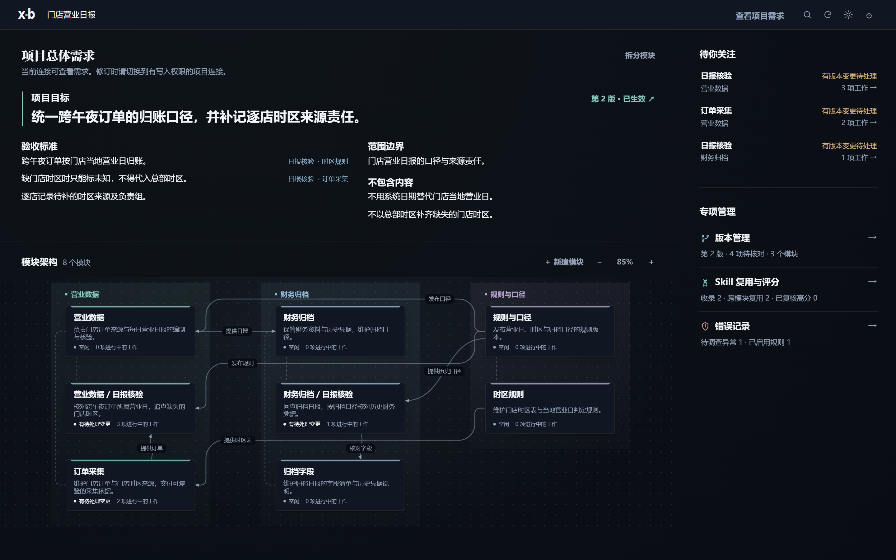
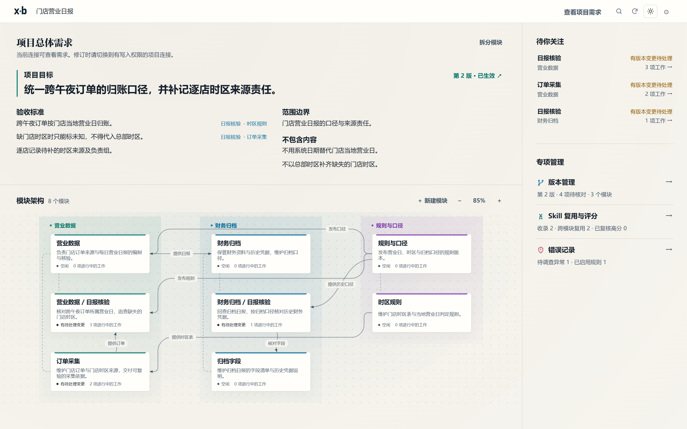
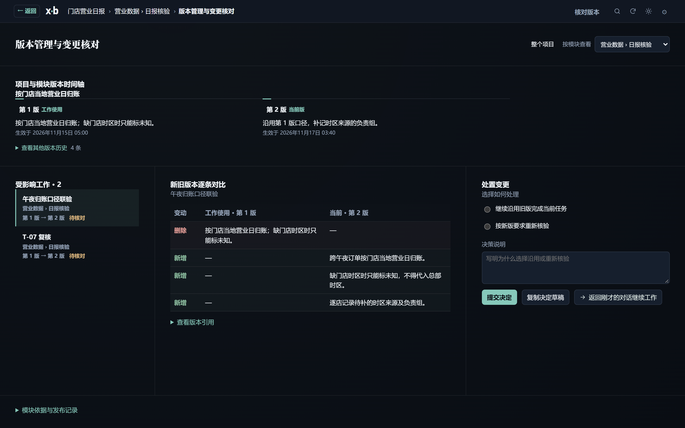

# xiaobai v0.50.0

让跨模块的 AI 协作有一本可以核对的项目账。保留现有助手，从一条需求追到模块、对话、版本、核验样本和最终采用决定。

[观看 165 秒介绍](https://github.com/LGZX2233/xiaobai2233/releases/download/v0.50.0/xiaobai-v0.50-launch-1080p60.mp4) · [下载 Windows x64 发行包](https://github.com/LGZX2233/xiaobai2233/releases/download/v0.50.0/xiaobai-v0.50.0-win-x64.zip) · [项目公开仓](https://github.com/LGZX2233/xiaobai2233) · [本地 MCP 接入](docs/integration.md)



## 为什么需要项目账本

一项订单规则在第 2 版改了。对话还在按第 1 版推进，另一个模块已经引用了新口径。接手的人需要知道这次工作固定了哪份原文、哪条样本验过、谁有权决定切换版本。

长期协作会在四处失真。目标在多次转述后发生认知漂移。模块各自更新，工作固定版本与项目现行版本错位。局部修改背上整套审批流程，重大决策却可能由同一执行者提出并自证。对话结束后，经验、分歧和一次写入的外部效果很难追查。xiaobai 把这些问题分别交给版本依据、执行记录、独立核验和人工裁决。

## 四大路径选择

| 路径 | 常见做法 | xiaobai 的选择 | 可以怎样核对 |
|---|---|---|---|
| 01 接入形态 | 更换整个 Agent 框架，项目状态依附单一宿主 | 独立 Sidecar 内核，通过标准 MCP stdio 接入 Codex、Claude Code 等兼容客户端，DSH 另有原生项目工作台 | 从宿主发起初始化，读取当前获准的工具 |
| 02 事实与版本 | 交接一段聊天摘要，下一轮猜测它对应的版本 | SQLite 保存不可变修订。本次工作的固定依据（Pinned Basis）与当前版本分别记录；CAS 检查写入者读到的旧水位 | 在版本页比较两个版本，由人决定沿用或切换并重验 |
| 03 上下文供给 | 每轮都把全项目文本交给模型 | L0 先读项目目标与目录，L1 按需取模块及状态卡。可写聚合样本有 6 个 compact 工具，状态卡预算 1,200 个估算 Token | 选中需求查看相关模块，在结构化结果中核对读取范围 |
| 04 执行与裁决 | 所有任务都填同一份表，或让执行者自行确认结果 | 普通执行无表单自主计划，仅设计工作按范围收尾，正式执行分开记录尝试、核验、批准与交付。**收尾三步回写模块现状**：找原文 → 改结论 → 读回交接，受阻标 `pending_sync` | 在具体对话追溯分支、样本与采用依据；在模块现状原文核对结果。当前由执行模型按规范办理，宿主自动回写仍待验证 |

## 核心创新

**同一项工作保留两条版本线。** 账本同时回答“这次执行依据哪一版”和“项目现在是哪一版”。需求更新后，人可以先比较差异，再决定哪些工作需要重验。并发写入遇到旧水位时会被拦截。

**每个结论有自己的证据。** Attempt 记录执行尝试，Verification 记录独立核验，Approval 记录人的裁决，Delivery 记录交付效果。方案已采用时，交付仍可等待外部回执。遇到效果未知（`unknown`）的操作，先按原幂等键对账，保留重开后可核验的结果。

**知识回到下一次工作能找到的位置。** 模块现状写明已经证实的结论、证据与待验边界。Skill 分开记录正确性、适用性、复用收益和可维护性，缺失对照时保留空项。错误记录可回到产生它的具体对话。[项目记录 Skill](skills/kernel-maintain-records/SKILL.md)

## 工作台画廊

顶部为深色项目首页。以下为同一版工作台的高清实拍截图，点击可查看原图。

| 浅色项目简报与空间拓扑 | 模块变动与三级对话树 |
|---|---|
|  |  |
| **具体对话中的方案分叉与样本核验** | **版本差异与原位人审** |
|  |  |
| **Skill 四维评分与耗时对照** | **错误记录与原对话入口** |
|  |  |

## T1 实测参数

| 测量项 | 观测结果 | 样本或条件 |
|---|---|---|
| 完整回归 | **2,636/2,636 通过** | Kernel 1,967、Hannes 558、DSH 71、Bridge 20、Edge 故障 20 |
| MCP 工具数 | 56 → 6（减少 89.3%） | 同配置的 legacy → compact |
| 输入 Schema | 21,524 → 1,666 估算 Token（减少 92.3%） | 86,095 → 6,662 字节 |
| L0/L1 分层读取 | 29,757 → 8,075 估算 Token（减少 72.9%） | 8 模块项目，全量文本对比按需读取 |
| 确定性状态卡 | 429 / 1,200 估算 Token | 所选模块返回量 / 预算 |
| SQLite WAL P95 | 目录读 0.083 ms，CAS 写 1.016 ms | 读写各 100 次，SQLite 3.49.1 |
| Edge 故障与冲突 | 20/20 通过，0 崩溃 | 0 未捕获页面异常，3/3 个注入 409 场景按预期处理 |

工具面对比使用同一可写聚合配置，统计 SDK 工具发现返回的输入 Schema。上下文对比使用同一项目水位与确定性计数器，Token 数为估算。延迟为单机热连接连续读写，包含校验和投影。故障注入使用真实 Edge、生产工作台入口及可控宿主故障。报告保留配置、计数方法、运行环境和各次延迟样本。[机器可读报告](public-benchmark.json)

发行校验另行比对 25 个协议摘要输入。ZIP 内包含 31 份协议 JSON，冻结 v1 的协议信封版本为 1.0.0。[发行验证回执](https://github.com/LGZX2233/xiaobai2233/releases/download/v0.50.0/RELEASE-VERIFY.json) · [冻结 v1 契约示例](contracts/v1/examples.json)

## 校验、安装与接入

使用 Windows x64 和 64 位 CPython 3.12。从同一 Release 下载 [Windows x64 ZIP](https://github.com/LGZX2233/xiaobai2233/releases/download/v0.50.0/xiaobai-v0.50.0-win-x64.zip) 与 [SHA256SUMS.txt](https://github.com/LGZX2233/xiaobai2233/releases/download/v0.50.0/SHA256SUMS.txt)，在 PowerShell 运行 `Get-FileHash ./xiaobai-v0.50.0-win-x64.zip -Algorithm SHA256`，核对清单中同名文件的摘要。打开一个新虚拟环境，在 ZIP 所在目录运行以下三行。

```powershell
Expand-Archive ./xiaobai-v0.50.0-win-x64.zip ./xiaobai-v0.50.0-win-x64
cd ./xiaobai-v0.50.0-win-x64
python -m pip install "project_kernel-0.50.0-cp312-cp312-win_amd64.whl[mcp]"
```

在解压目录也可用随包提供的 `./install.ps1` 完成第三步，它会核对环境和 wheel 摘要，再安装 MCP 依赖并执行 `pip check`。

在支持 MCP stdio 的客户端，将命令指向该虚拟环境的 Python，加载宿主控制的项目配置，完成 initialize 后调用 tools/list。授权范围决定可见工具。DSH 用户可从原生项目入口登记项目并打开工作台。[MCP 配置与 DSH 插件入口](docs/integration.md) · [完整安装说明](docs/release.md) · [v0.50.0 Release](https://github.com/LGZX2233/xiaobai2233/releases/tag/v0.50.0)

## 宣传视频

[](https://github.com/LGZX2233/xiaobai2233/releases/download/v0.50.0/xiaobai-v0.50-launch-1080p60.mp4)

**165 秒主片**从三个问题开始。四组工作台实拍分别回答如何按需供给上下文、固定版本依据、由人裁决和复用已有经验，最后展示 T1 实测与安装步骤。**60 秒精华版**保留四支柱、实机采用与实测总账。[主片 MP4](https://github.com/LGZX2233/xiaobai2233/releases/download/v0.50.0/xiaobai-v0.50-launch-1080p60.mp4) · [精华版 MP4](https://github.com/LGZX2233/xiaobai2233/releases/download/v0.50.0/xiaobai-v0.50-teaser-60s.mp4) · [12 格分镜](https://github.com/LGZX2233/xiaobai2233/releases/download/v0.50.0/storyboard-contact-sheet.png)

本公开仓的契约、Skill 与文档采用 MIT 许可。完整编译版的使用条件见发行 ZIP 根目录的 `RELEASE-LICENSE.txt`。[MIT 许可全文](LICENSE)
