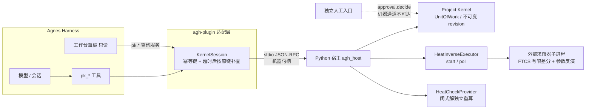
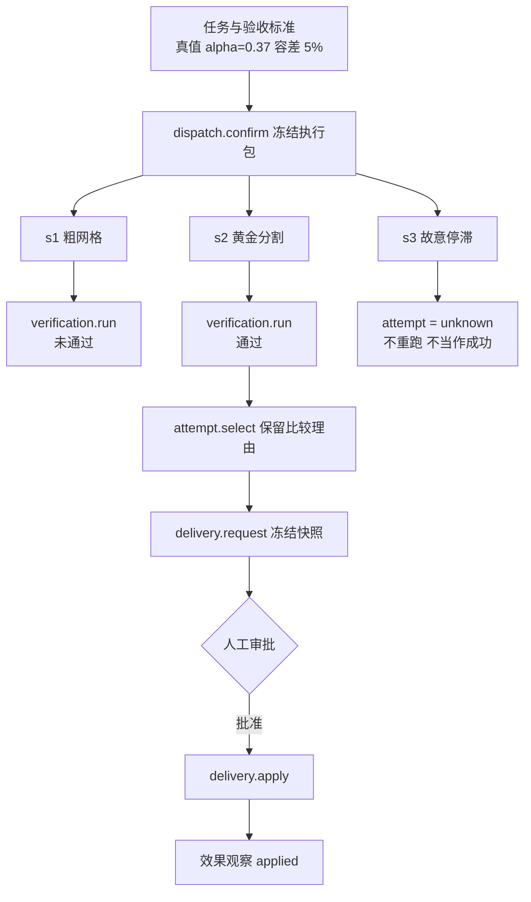

# 演示视频用图(仅含已实现并测过的部分)

## 1. 分层与信任边界

## 2. 一次任务的执行流

## 3. 三类测试样本与对应机制

| 样本 | 输入 | 预期 | 机制 |
| --- | --- | --- | --- |
| 正常 | 黄金分割 | 验收通过,交付 applied | 独立校验器 + 人工审批 |
| 边界 | 伪造 alpha_fit=0.9 | 验收不通过 | 校验器自行重算,不信求解器自报 |
| 边界 | 机器通道 approval.decide | UNSUPPORTED_COMMAND | 人工专属命令 |
| 失败 | s3 停滞超时 | attempt=unknown,启动次数不增加 | 未知结果不自动重放 |

## 说明
- 证据模式为 test,求解器是真实子进程,隔离级别 directory_only,不是操作系统沙盒。
- 内核自测通过,验收状态为 accepted_g2,release_approved=false。
- 本文件不含:attempt 级对账、AGH 内的真实运行结果、人工审批的 AGH 侧入口,这些尚未实现或未验证。
