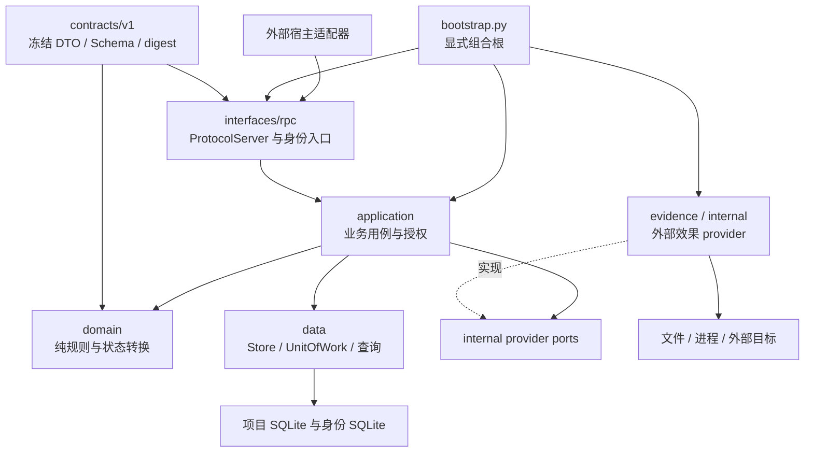
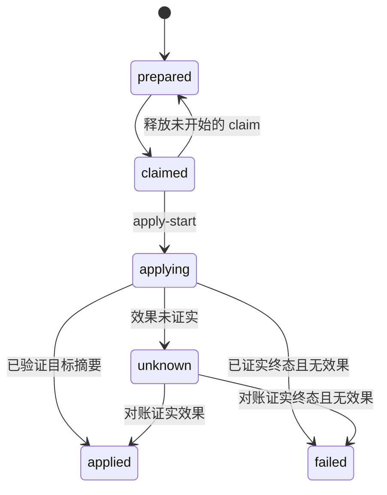
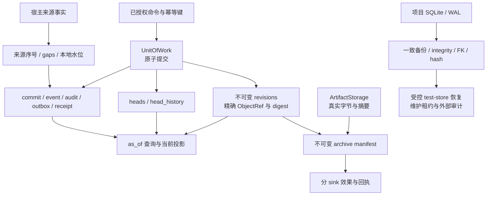
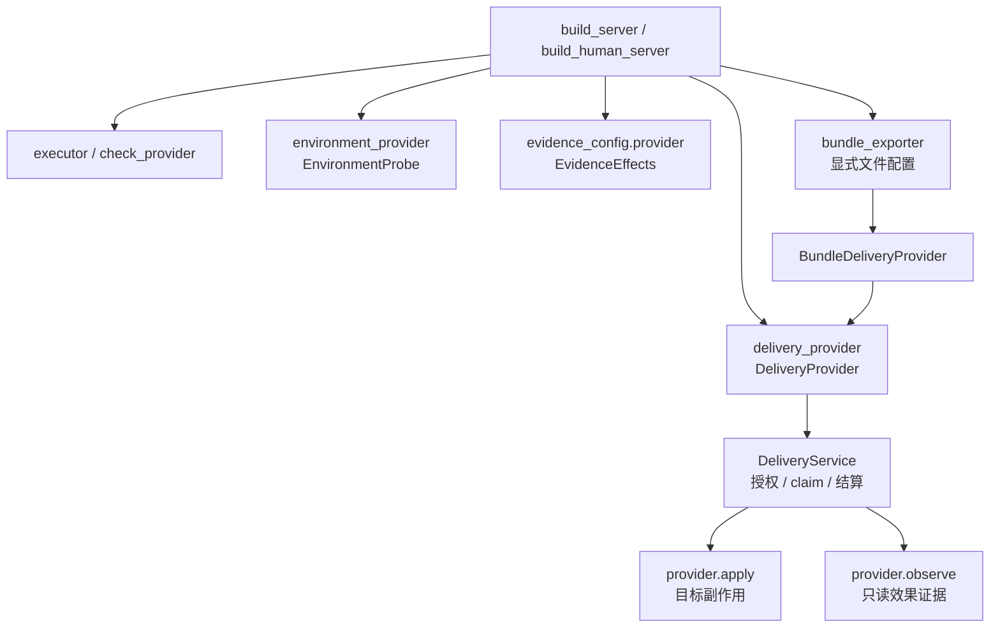
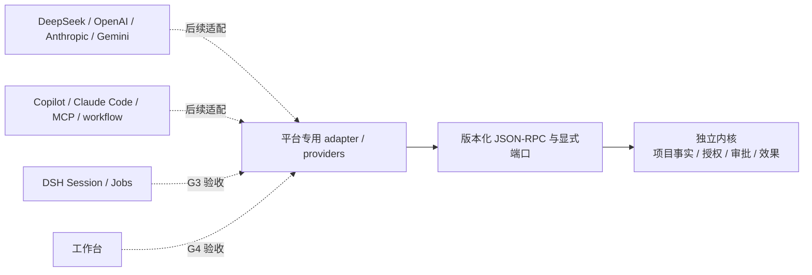

# Project Kernel 架构与平台适配

`kernel_next` 是独立的 Python 3.12+ 内核。执行流负责需求、方案、派发、尝试、验收、审批和交付；项目数据负责身份、版本、来源、审计、证据和查询。DSH 适配层与工作台属于另一个项目，通过已冻结的协议和显式 provider 接入。

整体定位是上下文工厂与执行编排：核心保存权威事实，消费者按明确水位投影，宿主提供外部执行与效果观察。完整模型请求组装尚不是已接线能力。消费者一致性、代码管理映射和训练数据分工分别见[消费约定](consumer-consistency.md)、[SCM 效果](scm-effect-mapping.md)、[训练职责](training-data-boundary.md)；具体判断与限制见[本次复核](../reviews/2026-10-12-boundary-review.md)。

本页定义组件职责与数据流；[内核现状](current-state.md)记录接受范围、配置入口和部署限制，[设计审查](../reviews/2026-10-10-design-review.md)记录未处理的问题。

需要从零实现完整目标流程时，从[复现总指南](reproduction-blueprint.md)进入数据、编排、上下文与验收四章。R1 是新增参考规格，包含字段、事务、状态、架构图和失败恢复；其新增能力尚未实现，不等同于本页所述现有 v1 行为。

## 分层与依赖

领域规则不访问 SQLite、文件、进程或模型 SDK。`bootstrap.py` 把运行依赖传给 application；没有动态 provider registry。`ports/ports.py` 保留冻结 v1 服务接口，`internal/provider_ports.py` 与 `internal/delivery_provider_ports.py` 定义当前应用层消费的效果接口，两者不是同一组 API。

项目库由 Store/UnitOfWork 管理，身份库由 IdentityRegistry 与身份回执账本管理。跨库 project.bind 保存项目域意图和身份域结果，随后结算；这不是单个跨库事务。具体实现与冻结服务 Protocol 的签名不全相同，外部适配器需要核对当前消费端。

`DeliveryService` 仍负责项目 Store 的版本写入、审批、CAS、epoch 和结算；交付路径及导出文件读取归 provider。该拆分隔离外部交付效果，不表示应用层已经完全移除直接 SQL。当前限制以[第四轮验收报告](../acceptance/G2-round4-report.md)和[本轮限制](../acceptance/G2-round4/limitations.md)为准。

## 执行流与审批

这是用例图；TaskPhase、AttemptStatus、ApprovalStatus、DeliveryState 各自持久化，不能合成一个虚构的全局状态机。失败修复产生新 attempt，保留原方案、输入引用、输出和失败事实。零必需验收项、旧候选、`skipped`、`unknown` 和生产模式中的模拟证据均不能作为通过依据。人工决定必须由可信 human entry 提交，并绑定当前快照摘要；模型声明的角色不产生审批权限。

执行目录按实际路径而非 execution_root ID 隔离。不同 task 或 strategy 的目录不能相同或互为父子；running/unknown 保留历史 root revision 的目录占用，终态同策略可在原目录创建新 attempt。生产快照核验已落盘 attempt 和 packet 模式；需求、方案、规则关键发布触发独立批准失效事务，原决定或交付回执的重放保持原值，查询保持只读。

组合根的 RPC 发布 handler 在确认提交后刷新审批；直接调用 DesignService 不附带这一刷新。决定、claim 与 apply-start 仍核对当前依据。业务入口同步调用 executor/checker/provider，宿主负责运行调度、provider 生命周期和连接关闭；持久的 accepted 回执不能替代这些宿主职责。

交付操作使用实际的 `DeliveryState`：

`accepted` command receipt 只证明操作已接受。provider 返回或超时不能单独证明外部效果；`unknown` 保持可查询、可对账，不自动重放写入。旧 epoch 的结算只能留下审计，不能改变当前操作。

## 数据留档与恢复

revision、head history、事件、outbox 和命令回执在同一 UnitOfWork 中提交或回滚。来源身份、序号范围和缺口保留原义，未知用量不能转成零。查询采用明确读水位；旧数据缺少可还原事实时报告不可用，不用当前投影补造历史。

制品按实际字节和摘要验证，交付快照与归档清单引用精确版本。各 sink 的成功、失败、未知与来源水位分别保存；本地连续水位不代表真实宿主已 flush。repair 修复归档 sink，不再次执行任务或交付。

归档同时记录采集请求与本地就绪状态；暂时的来源 gap 可在补齐后由显式 repair 重算，显式 false 保持未完成。公开 archive.status 将来源未完成计入 partial/gaps，host final flush 缺证明时继续 not_configured。

可写的 file-backed Store 持有共享维护租约至连接关闭；受控替换需要所有内核写连接关闭后的独占租约，保留原库和备份之后的历史，并另写恢复审计。当前恢复只允许显式 test stores；直接 SQLite 客户端不参加租约，生产恢复未启用。

## Provider 显式装配

`KernelServices`、`build_server` 和 `build_human_server` 接受 `delivery_provider=`。文件部署可传 `bundle_exporter=`，组合根将其包装为 `BundleDeliveryProvider`；二者同时配置会抛出 `ValueError`。不配置交付 provider 时，交付命令返回 `CAPABILITY_UNAVAILABLE`，不会创建默认文件目标。直接构造用例服务使用 `DeliveryService(store, provider=..., artifact_storage=...)`。

provider 声明 `sink_ids`，并通过 `target_matches()` 检查冻结目标。`apply()` 执行交付，`observe()` 读取效果；应用层验证操作身份、目标摘要和终态证据。文件 provider 独占导出路径定位及文件校验。观察异常保留未知结果和已有回执，重放、查询及 reconcile 不重复调用 `apply()`。自定义交付 provider 不自动提供 archive/backup/restore；这些需要单独的 evidence provider 配置。

缺失执行、验收、环境或证据能力按真实配置报 `CAPABILITY_UNAVAILABLE`；核心命令仍可出现在 `initialize.supported_commands` 中。未注册的可选入口不公布，调用返回 `UNSUPPORTED_COMMAND`。`InvocationContextRegistry` 负责可信句柄，不是 provider registry；当前组合根没有汇集实际 provider_capabilities。

身份 provision/reconcile 由独立的 `build_identity_server` 提供，项目 bind 在配置 `identity_registry` 后提供。corpus 入口由 `enable_corpus` 开启，默认关闭，依赖 policy/purpose/sink；legacy 由 `legacy_config` 开启，只允许测试模式的不可变快照。knowledge 模块有独立 API，但没有组合根装配或 RPC handler，不能由模块存在推断已经可用。

## RPC 异常处理

协议服务在 UTF-8 JSON 解析与响应编码处处理输入错误。JSON 解码器超过递归上限时返回 `-32700` 解析失败；JSON 转义展开后，所有字符串值和对象键也须可 UTF-8 编码，未配对代理码同样拒绝。深度上限沿用解码器限制，与 frame 字节预算分别生效。

响应 id 只回显符合冻结 v1 正则的值；原请求仍由 Schema 校验，不修改后再放行。处理器结果不能序列化时返回 `-32603 Internal error` 并保留安全 id；兜底也编码失败时返回固定 ASCII、null id 响应。响应过大继续使用原 `CAPABILITY_UNAVAILABLE` 分支，不截断内容或重复执行业务效果。

本次修复只经过静态复核和语法核对，没有运行测试；修复与实际提交以[RPC 任务](../records/tasks/2026-10-10-rpc-resilience.md)为准，历史 G2 仍使用原条件和证据。

## 平台适配

内核具有可适配不同平台的事实模型、端口和协议基础。当前自有 stdio JSON-RPC 不是 MCP transport；任何列出的平台都不能因此称为已兼容。每个宿主需要单独验收会话和任务映射、工具事件、取消、来源 append/flush、沙盒级别、可信身份、人审回调、重连及重启对账；模型的文本或工具调用不能替代这些事实。

G2 对应独立内核的冻结 AC12–32、AC37–38、AC43、AC45，第四轮状态为 accepted_g2；AC43 使用 test 身份和真实临时 subprocess。真实 DSH 属 G3，前端属 G4，生产恢复和真实试点后置。它们的缺失限制部署声明，不能直接作为 G2 阻断理由。当前接受依据见[第四轮条件裁决](../acceptance/G2-round4/checks.json)；第三轮[G2 证据映射](../reviews/2026-10-09-round3/g2-evidence-map.md)和[平台评估](../reviews/2026-10-09-round3/platform-g2-assessment.md)保留当时的观察。

## 文档导航与持续记录

[模块树](../modules/README.md)用稳定节点 ID 导航源码、需求、接受条件和变更记录；导航父子、运行依赖和相关关系分别定义，允许空及多对多，本轮没有对话关联。节点图不替代业务账本，也不为导航整齐而拆分事务或增加包。

[持续记录](continuous-records.md)以 Markdown 和项目 skill 维护任务/项目总结、术语错误、学习资料及无评分用户画像。更新跟随工作检查点和用户纠正，没有自动监听或运行 RPC。用户知识熟悉度未知时保留未知；已有 knowledge ScoreEngine 与该文档用途分离。

[规则扩展](pluggable-rules.md)复用声明式条件和现有规则版本，不执行任意代码或覆盖核心权限。自动摘要、宿主对话映射与运行上下文注入仍需后续接口及接受；本轮不训练、不导出或上传语料。
