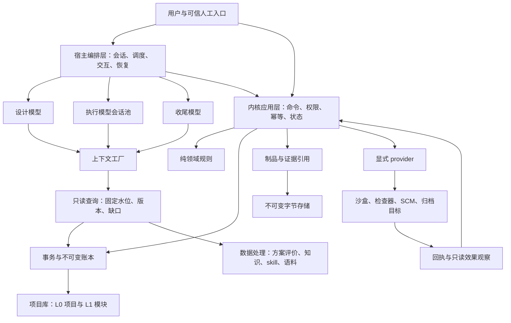
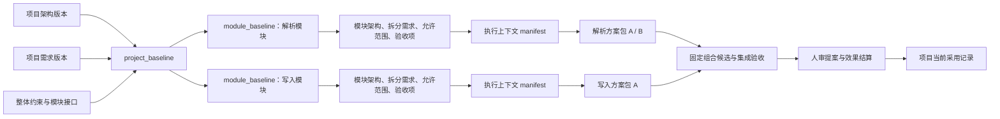
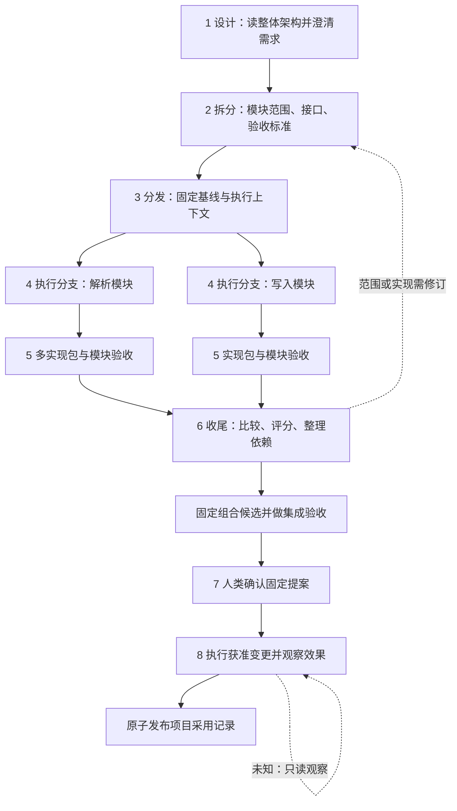

# 从零复现：上下文工厂与多模型执行编排

文档版本：1.0.0；日期：2026-10-12（Asia/Shanghai）。需求：[REQ-BOUNDARY-13](../requirements/2026-10-12-kernel-boundaries.md)。源码参照：`16410c9fbf4a8507445b4603e371e701614e4499`。本文及四个章节组成 **R1 参考实现规格**，描述可供模型实现的目标系统；新增对象、接口与流程尚未实现或行为验收，`release_approved=false`。

## 1. 读完后应该能实现什么

目标是让设计模型读取整个项目的架构和需求，向用户澄清不确定事项，拆出可独立执行的模块范围与验收标准；宿主分发并行执行对话，执行模型在真实能力已声明的沙盒中尝试多种实现；模型通过任务表单与问答交换信息，并将实现封装为固定版本的模块方案包。收尾模型比较测试结果、给方案评分、整理模块职责和依赖，准备一个经过集成验收的采用提案。按用户已选的 **路线 A**，人类确认提案后，宿主执行明确获准的主库变更，内核依据真实效果回执发布项目采用记录。

项目整体与模块独立分别拥有架构和需求。设计与收尾主要读项目视图，执行模型主要读模块视图及其引用的项目约束。任何角色都可以在权限内查询事实和提出问题；问答有明确版本，不能靠聊天中的“我记得”代替执行依据。

未通过、未采用、失败、拒绝及未知的过程都可能有留存价值。保存资料、模型推荐、人类批准、外部效果发生、项目采用记录发布是五件不同的事。实现必须使调用方能逐项判断。

这套规格足以用于建立单项目、多个模块、模块内多实现的参考系统。精确复制当前冻结 v1 的二进制和 wire 行为不是本文目标；现有系统的部署条件与已知缺口由[内核现状](current-state.md)拥有。

## 2. 唯一阅读入口与章节分工

首次实现按下表顺序阅读；执行某个子任务时，保留总指南和该章节的精确版本，再选相邻章节，不必每次加载全部历史记录。

| 顺序 | 章节 | 实现者读完须能回答 |
| --- | --- | --- |
| 0 | 本页 | 系统做什么、谁负责什么、哪些决定已确认、R1 采用什么配置 |
| 1 | [数据对象与事务](reproduction/01-data-and-transactions.md) | 每类对象保存什么、谁是权威、引用如何固定、何时提交、崩溃后保留什么 |
| 2 | [执行编排与交互](reproduction/02-orchestration.md) | 如何拆需求、分发、隔离、多方案尝试、验收、人工确认与并入 |
| 3 | [上下文与数据处理](reproduction/03-context-and-evaluation.md) | 如何构造可再现输入、比较方案、解释度量、记录失败、管理知识与样本 |
| 4 | [实施与验收](reproduction/04-build-and-acceptance.md) | 从空目录按什么顺序建设、各步骤产物与负向验收、如何接真实宿主 |
| 5 | [迁移适配接口](reproduction/05-migration.md) | 如何把其他进行中项目扫描/归纳/映射进内核执行流，备份目标与初始版本如何落 |

字段和事务以前两章的定义为准；第三章拥有输入组装、评分及数据消费规则；第四章拥有实现切片与验收场景。原来的六份设计页保留设计理由与候选对照，R1 将其中一种实现路径具体化。若有冲突，先修正文档并记录决定，不能在代码里静默选择另一解释。

## 3. 用户决定与 R1 实现选择

| 主题 | 已明确的目标或决定 | R1 参考实现采用的办法 |
| --- | --- | --- |
| 角色 | 设计、执行、收尾模型分工；模型可相互提问 | 宿主为各角色建立独立会话和工具授权，角色只是工作分工 |
| 收尾身份 | 路线 A：模型评分审阅，人类确认最终纳入 | 提案固定内容和目标；可信人类入口产生决定，模型无法伪造 |
| 数据分层 | 项目整体与模块独立各有架构及需求 | 单项目 SQLite 内按范围逻辑分区；制品字节存于独立内容寻址目录 |
| 并行 | 设计模型分发并行执行；执行允许多方案 | 首版单层分发，每模块至少一分支，每分支可产生多 attempt、多方案包 |
| 嵌套 | 用户尚未决定多层分支嵌套 | R1 不提供嵌套入口，遇到嵌套需求明确拒绝并返回未支持；未来另作版本设计 |
| 物理分库 | 尚未决定 | R1 同库便于原子发布；物理分库是后续可替换部署，不伪造跨库原子性 |
| 正式纳入 | 已验收、已打包、已去耦确认 | 固定组合候选、集成证据和人类决定；真实外部效果成立后发布采用指针 |
| 未采用包 | 即使不使用也可能保存 | 显式留存记录和可配置保留策略；不得自动成为当前采用版本 |
| 表单 | 可实时更新交互 | 编辑暂态由宿主管理，有意提交才成为版本事实；并发提交用 CAS |
| 评分 | 比较不同实现；skill 评价限定适用范围 | 方案评价、知识使用积分、skill 四维评价分别建模；skill 结果仅用于数据处理 |
| 执行接入 | 沙盒与公司代码管理提供执行能力 | 显式注入执行、检查、制品和 SCM provider；缺能力明确失败 |

R1 中“必须”表示实现本参考方案须遵守的规则，不表示用户已经批准所有未来业务策略或某一次真实交付。评分权重、并发上限、资源预算、保留期等部署参数须声明、版本化并校验；示例数值不自动成为生产默认值。

## 4. 总体组件与依赖

图中的箭头表示调用或数据依赖，不能当作权限继承。模型输出必须通过有类型的命令入口；模型在内容里写 `human=true` 没有授权效果。数据处理读取事实并生成有来源的报告；报告本身不发起执行或批准。

| 层 | 拥有的职责 | 交给其他层的责任 |
| --- | --- | --- |
| 内核领域层 | 前后置条件、允许转换、验收约束、三值/未知语义 | SQLite、文件、进程、网络和模型调用 |
| 内核应用层 | 授权检查、事务组织、持久操作身份、批准依据校验、效果结算 | 模型何时运行、UI 如何推送、未知多久提醒 |
| 内核数据层 | 不可变版本、指针历史、审计、回执、可重建索引、固定水位查询 | 模型输出质量判断、人工批准 |
| 上下文工厂 | 选择精确材料、组装固定请求、预算、来源和排除记录 | 代替用户理解需求、保证模型输出相同 |
| 宿主编排层 | 角色会话、队列与并发额度、真实工具调用、实时消息、重启后观察 | 绕过内核写业务表或假定超时没有外部效果 |
| provider | 宣明实际能力；执行限定动作；提供真实回执和只读观察 | 自授权限、改变批准目标、将未知伪装为成功 |
| 数据处理 | 评分、度量、失败解释、知识与候选样本构造 | 用 skill 分数控制路由、执行、审批、自动重试或晋升 |

从实现依赖看，应用层使用领域规则及数据/provider 接口；领域层不能反向依赖应用层。上下文工厂作为读取和请求构造服务，可由宿主调用，不能因为 knowledge 尚未装配就假设完整请求记录已经存在。

## 5. 项目与模块两套材料如何对应

L0、L1 表示资料范围，不是可信等级。模块产生的失败记录同样可以是已经提交的真实事实；项目当前采用是经过收敛的选择。模块基线引用固定项目基线，不能每次读取 `latest` 就让执行范围悄然变化。

新项目先由宿主将用户原始目标及已有架构保存为初始项目基线 P0，标记 `readiness=clarifying`，列出 `blocking_questions`；首个设计上下文就能引用已存在的事实。设计侧澄清后发布可派发基线，要求 `readiness=dispatchable`、阻断问题为空、项目及模块验收完整。设计准备状态不授予最终采用权限。

设计模型负责把整体需求映射到模块要求及可核验条目，包含跨模块接口、共同约束和集成验收归属。执行模型若需要扩大范围，通过表单或问答提出变更；设计侧更新基线后，宿主显式决定哪些工作重启、哪些证据仍可使用。旧版本与原测试保持原含义。

## 6. 从需求到采用的八个阶段

循环返回会创建新的版本、尝试或提案；不能覆盖原失败事实。八个阶段是工作流阅读顺序，各对象保持自己的状态机，不合并成一个能掩盖多分支进度的全局字符串。

## 7. 哪些不变式决定系统是否成立

1. **事实不可覆盖。** 已提交 revision 和被引用制品字节不可原地修改；纠正产生新版本。
2. **读取可定位。** 任何验收、评分、批准和模型请求都能定位精确材料；digest 必须对应可读取字节。
3. **权限来自可信入口。** 角色、提示词、表单值和模型意见均不能产生人工身份。
4. **一个命令一个持久语义。** 同主体与同幂等键同输入返回原回执，不重复副作用；不同输入冲突。
5. **指针更新带前置版本。** 同时编辑或收敛不能靠后写覆盖前写；CAS 冲突有明确结果。
6. **外部意图先于外部动作。** 持久准备及 apply-start 完成后才能调用有副作用 provider；持有数据库写事务时不等待网络或模型。
7. **未知不等于无效果。** 超时、断网或进程失联后保留 unknown；观察不能再次执行写入。
8. **评分不能替代验收。** 必需项失败、缺失或未知时，软评分再高也不能进入可批准提案。
9. **批准绑定固定依据。** 模块整理、候选字节、关键需求、目标或集成证据变化会需要新提案和确认。
10. **保存不等于采用。** 未选包可保存，只有正式采用记录更新项目当前结果。
11. **并行不破坏资源隔离。** 目录、外部资源及 provider 能力必须分别检查，目录不同不等于 OS 沙盒。
12. **skill 接口只做数据处理。** 记录适用范围与完整失败分析，不给用户打分，不驱动执行或自动晋升。

## 8. 共同例子：CSV 导入工具

这是说明数据与阶段关联的教学场景，测试规模和指标由例子给出，不作为部署默认参数。项目目标是按固定记录格式导入 CSV；解析错误必须可定位；写入失败不能留下半批数据；同一次导入重试不得重复写入。

| 设计材料 | 固定内容 |
| --- | --- |
| 项目约束 | 输入字符集与 CSV 规则、错误表示、事务提交语义、资源预算和数据访问范围 |
| `module.parser` | 将字节流转换为固定 Record 流，负责语法/字段校验；不能直接写数据库 |
| `module.writer` | 接受 Record 流和导入身份，负责事务与幂等；不能自行改变解析规则 |
| 模块接口 | Record 字段/类型、错误分类、取消约定、版本兼容；由两侧共同引用固定定义 |
| 解析方案 | `parser-memory` 与 `parser-stream`；可由一个分支顺序试验，也可由两个独立分支并行 |
| 写入方案 | `writer-batch`；它与解析方案是合作模块，不参与“只能选一个包”的全局竞争 |
| 组合候选 | 选择一个解析实现和写入实现后，固定代码树与构建依赖，执行跨模块测试 |

收尾可能选择 `parser-stream + writer-batch`，并保留 `parser-memory` 供分析。若整理公共类型改变了两包的实际字节，就产生新包及新组合候选，重跑受影响模块测试和集成测试；不能复用旧包摘要上的批准。人类查看的是最终组合候选、目标分支及期望前置提交，而不是会继续变化的工作目录。

## 9. “已完成”分几个层次

这些节点是不同事实；箭头表示达到最终采用时必须经过的依赖，不表示前一步自动触发后一步。SCM 已变更而本地发布失败时，应显示“外部效果成立，项目采用发布待结算”；不能显示完全失败并自动重推，也不能提前显示主库采用完成。

候选留存、模块验收、组合验收、人审决定、外部效果和正式采用均应有独立查询入口。实时前端可显示暂态，但权威展示使用已提交水位；模型使用固定上下文，两者可能刷新到不同水位，见[消费者一致性](consumer-consistency.md)。

## 10. 与当前代码衔接时的特别要求

当前 v1 `ObjectRef` 是 `project_id/object_type/object_id/revision_id`，digest 是其他字段拥有的 64 位十六进制内容；R1 为从零实现定义了带 `store_id/revision/digest` 的参考引用，两者不能直接混传。参考命令属于新规格，不能添加到冻结 `contracts/v1` 后声称向后兼容。扩展现有仓库时先实现明确的转换与新版本入口，见[实施章节](reproduction/04-build-and-acceptance.md)。

现有多 attempt、事务账本、归档、验收和审批机制是可复用基础，完整分支/方案包/组合采用流程尚未接线。knowledge 未装配核心 RPC，corpus 默认关闭，SCM provider 和真实宿主接受尚缺。当前 release 状态、RPC 静态修复、打包资源限制和测试证据以[现状](current-state.md)为准；本指南不重新宣称这些已有验证。

## 11. 给实施模型的任务指令

> 先读本总指南与四个章节，输出你要实现的 R1 范围、对象依赖和验收映射。保持已选路线 A、不可变事实、精确版本、同事务回执、未知不重放和 skill 仅数据处理。按实施章节的顺序完成最小闭环，再扩展并行、多方案、交互和真实 provider。多人执行按文件与接口所有权分工，先冻结共同数据格式。新增实现必须报告实际执行的检查、失败根因、尚未知项和当前能力清单；不能把设计文字、合成通过或模型“已完成”当作真实宿主效果。遇到本文明确待定的生产策略，可以实现 R1 参考配置并标明选择，不能替用户打开模型审批、嵌套分支或任意外部写权限。

实施交付包含可运行源码、schema 版本、配置与启动说明、provider 能力声明、最小场景、失败恢复步骤、验收证据和已知限制。仅交付架构图或函数桩不算实现闭环；本次文档任务则以四章齐全、可交叉追踪和静态检查为交付范围。
