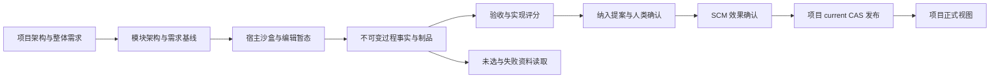
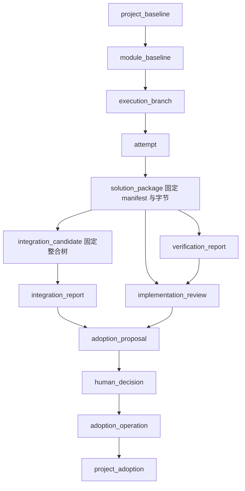
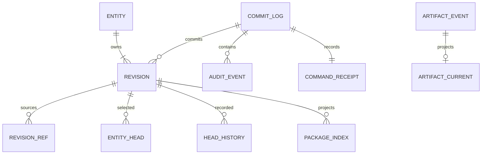
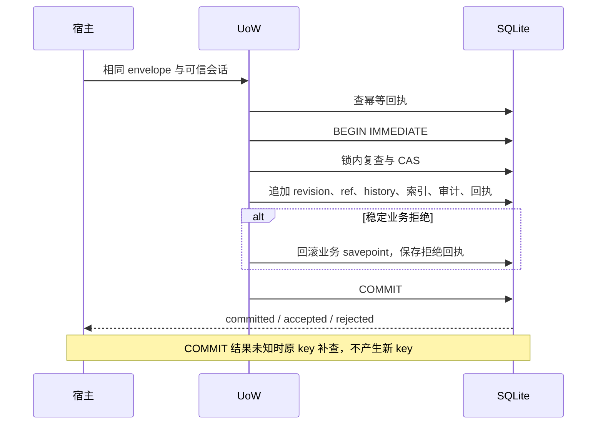
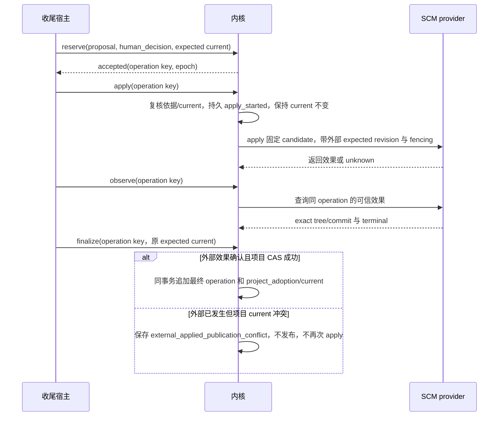

# R1 数据、事务与外部效果参考规格

文档版本：1.0.0；日期：2026-10-12（Asia/Shanghai）。本页是 **R1 参考实现规格（建议，未实现、未行为验证）**，属于[从零复现指南](../reproduction-blueprint.md)。它规定一个可复现的数据实现，不代表当前内核已经具有这些对象或接口，不改变冻结 `contracts/v1`，`release_approved=false`。

用户已选择路线 A：模型提出评分、审阅与纳入建议，人类确认最终正式纳入。R1 为便于复现采用单项目 SQLite 内项目/模块逻辑分层、单层 fan-out；物理分库、多层嵌套仍未替用户作最终决定。宿主执行调度和对账，不假设内核存在后台 worker。评分与 skill 方法评价留在数据处理侧，不自动触发执行或批准。

## 1. 数据范围与权威

项目整体保存架构、整体需求、模块关系与正式采用的包清单；模块独立保存模块架构、拆分需求、执行范围、验收标准与方案过程。R1 将两者放在同一数据库，通过 `module_id`、精确引用和读取权限区分范围，不复制两份互相覆盖的事实。

| 数据类别 | 持久化方式 | 能否成为项目当前结果 |
| --- | --- | --- |
| 编辑中的代码、表单与模型草稿 | 沙盒/宿主工作区暂态 | 不能，仅展示为编辑中 |
| 已提交基线、问答、失败、unknown、测试、评分、未选方案 | 不可变 revision、审计与内容寻址制品 | 保存本身不能正式采用 |
| 已获人类确认、外部效果确认且项目 CAS 成功的采用版本 | 不可变 `project_adoption` + `current` 指针 | 是，唯一正式采用声明 |
| 类型索引、当前看板和事件摘要 | 可从权威记录重建的投影 | 不能单独产生新事实 |

未采用包可以留存，是否保留其全部字节、保留期限和删除政策需另行配置与验收；不得从“可留存”推导“所有包永久保留”。删除制品前须保留采用/未选状态、必要摘要和不可用原因，不将缺失字节假称仍可复现。



## 2. 公共类型与引用

R1 JSON 使用 UTF-8、禁止重复键、NaN/Infinity、未配对代理字符，摘要采用 JCS 后的 SHA-256。整数范围为 `0..9007199254740991`，revision 为其中的正整数；SQLite 可存更大整数不意味着 JSON/JCS 可精确表达。未知值使用显式 `null` 并给出原因，不使用空串或零代替。

| 类型 | 表示与校验 |
| --- | --- |
| `Id` | 非空字符串，R1 建议 `[A-Za-z0-9][A-Za-z0-9._:-]{0,127}`；对象身份由内核创建并在回执返回 |
| `Digest` | `sha256:` 加 64 位小写十六进制；制品摘要对实际字节计算 |
| `Revision` / `Seq` | 正整数 / 非负整数，范围同上；`as_of=0` 为无提交视图 |
| `Timestamp` | UTC RFC3339 字符串；排序和水位依据提交序，不能用 provider 时间替代 |
| `ObjectRef` | 必须包含 `project_id,store_id,object_type,object_id,revision,digest`，不能用 current 或仅 object_id 替代 |
| `ArtifactRef` | 必须包含 `digest,size,media_type`；size 为非负整数，存储路径不由模型指定 |
| `ExpectedHead` | 必须包含 `object_type,object_id,pointer,expected_revision`；revision 为正整数或 `null`，null 表示要求该指针不存在 |
| `TargetSpec` | 必须包含 `provider_id,repository_id,target_ref,expected_external_revision,candidate_tree_digest,effect_kind,remote_id,mapping_spec`；外部版本为字符串或 null（要求目标不存在），effect_kind 为 local_commit/remote_ref_update，remote_id 为 string 或 null，mapping_spec 为 ArtifactRef |
| `backup_manifest` | 迁移 local_backup 形态专有，必须包含 `target_spec_ref:ObjectRef; baseline_ref:ObjectRef; entry_tree:JSON; tree_digest:Digest; verify_state:verified\|mismatch\|unknown`；entry_tree 每项 `{path,mode,digest}`，tree_digest 对 entry_tree 的 JCS 规范化计算；不可变，仅 verify_state 为观察水位；由宿主写备份后上报 tree/digest 由内核登记比对，mismatch 保留缺口不自动补写（详见 [05 迁移](reproduction/05-migration.md)） |

对象 revision 摘要定义为 `sha256(JCS({schema_version:"R1",project_id,store_id,object_type,object_id,revision,payload}))`。提交序、主机路径与可变投影不参与摘要；同一对象的新 revision 不得复用旧摘要。引用解析先验证 project/store 身份，再读取精确 revision、复算摘要，最后校验类型和要求的水位。

```json
{
  "project_id": "project-demo",
  "store_id": "store-demo",
  "object_type": "solution_package",
  "object_id": "package-01",
  "revision": 1,
  "digest": "sha256:aaaaaaaaaaaaaaaaaaaaaaaaaaaaaaaaaaaaaaaaaaaaaaaaaaaaaaaaaaaaaaaa"
}
```

示例摘要是占位值，执行验收必须从实际内容计算。冻结 v1 的 `ObjectRef` 当前为 `{project_id,object_type,object_id,revision_id}`，其中 revision_id 为字符串，见[现有 DTO](../../../src/project_kernel/contracts/dto.py)。R1 是新参考格式：适配器需要独立的 v1 revision_id ↔ R1 revision 映射、store 身份核对与摘要核对，禁止直接增字段后冒称仍兼容 v1。

## 3. 核心对象字段

每个 revision 必须有 envelope：`schema_version="R1"`、对象身份、正整数 revision、摘要、提交序、可信 `principal_id`、命令身份和 payload。payload 表中列出的字段全部必需；`T|null` 表示字段必须出现但可为 null，`T[]` 可为空，标有“至少一项”者不能为空。未列字段拒绝；演进需新的 schema_version 和适配规则。角色由可信宿主关联，payload 中的角色不能授予权限。

### 3.1 基线与分发

| 对象 | 必需 payload 字段与类型 | 额外约束 |
| --- | --- | --- |
| `project_baseline` | `title:string; architecture:ArtifactRef; requirements:Requirement[]; acceptance:Acceptance[]; module_ids:Id[]; constraints:ArtifactRef[]; readiness:clarifying\|dispatchable; blocking_questions:string[]; previous_ref:ObjectRef\|null` | Requirement 为 `{id:Id,text:string,acceptance_ids:Id[]}`；整体 requirement id 唯一；dispatchable 要求 blocking_questions 为空 |
| `module_baseline` | `module_id:Id; project_baseline_ref:ObjectRef; architecture:ArtifactRef; requirement_ids:Id[]; local_requirements:Requirement[]; scope:Scope; acceptance:Acceptance[]; dependency_refs:ObjectRef[]; previous_ref:ObjectRef\|null` | requirement_ids 必须属于所引用项目基线；模块局部需求与整体需求对应关系留在 architecture |
| `dispatch_batch` | `project_baseline_ref:ObjectRef; module_baseline_refs:ObjectRef[]; branch_ids:Id[]; dispatch_constraints:ArtifactRef[]; status:open\|paused\|closed` | 至少一项模块基线，branch_ids 无重复；R1 不包含嵌套分发 |
| `execution_branch` | `dispatch_ref:ObjectRef; module_baseline_ref:ObjectRef; context_ref:ObjectRef\|null; strategy_label:string; execution_scope:Scope; acceptance_ids:Id[]; root_lease_id:Id\|null; assigned_agent_id:Id\|null; status:open\|assigned\|running\|paused\|completed\|cancelled` | 执行范围是模块 scope 的子集；assigned 后 context_ref 必须非空；一个分支可以顺序提交多个方案包 |
| `attempt` | `branch_ref:ObjectRef; module_baseline_ref:ObjectRef; context_ref:ObjectRef; root_lease_id:Id; provider_id:Id; operation_key:Id; epoch:Revision; handle:JSON\|null; status:prepared\|starting\|running\|succeeded\|failed\|cancelled\|unknown; output_refs:ArtifactRef[]; usage:Usage\|null; error:Failure\|null` | provider 观察关联同一 operation_key/epoch；实际执行上下文精确留存；失败和 unknown 不能写成 succeeded |

`Scope={read_roots:string[],write_roots:string[],allowed_commands:string[],required_sandbox_level:directory_only|os_sandbox}`；路径由宿主解析并限于授予范围，命令规则是宿主/provider 可验证的能力限制，不能仅靠字符串描述宣称 OS confinement。`Acceptance={id:Id,requirement_ids:Id[],kind:automated|human_review,required:boolean,procedure:ArtifactRef}`；至少一个 required 验收项，零必需项不能通过。

初始项目基线 P0 可设为 clarifying，固定用户初始目标、暂定架构与 blocking_questions，供第一个设计上下文读取；P0 的 acceptance 可为空。P0 不能派发执行。设计服务校验整体需求、模块范围、依赖接口与验收标准完备后产生 dispatchable 基线，其 acceptance 至少一个 required 项，所有 requirement.acceptance_ids 必须解析；dispatch_batch.open 只能引用此状态且无阻塞问题。集成报告检查项目完整 required 集合，模块报告检查模块集合；R1 不额外要求每个基线发布都经过人类批准。派发后修改需求产生新 revision，不能回写 P0 或继续将旧验收宣称覆盖新要求。初始 SCM 基准内容必须写入固定 architecture/constraints 制品，由设计服务检查其必需字段。

`Usage={cpu_ms:Seq|null,wall_ms:Seq|null,input_tokens:Seq|null,output_tokens:Seq|null,unknown_reason:string|null}`；任何未知项需有 unknown_reason。`Failure={code:Id,message:string,cause_refs:ObjectRef[],root_cause_state:confirmed|hypothesis|unknown,analysis:ArtifactRef|null}`；分析须包括触发、直接原因、根因证据、影响、已做修复与未验证项，不能将假设写成复现结果。

### 3.2 包、验收与审阅

| 对象 | 必需 payload 字段与类型 | 额外约束 |
| --- | --- | --- |
| `solution_package` | `module_id:Id; module_baseline_ref:ObjectRef; branch_ref:ObjectRef; attempt_refs:ObjectRef[]; manifest:PackageManifest; package_digest:Digest; retention_state:retained\|metadata_only` | 至少一个 attempt；manifest 和所有提交字节先固定；package_digest 为 JCS(manifest) 摘要 |
| `verification_report` | `package_ref:ObjectRef; module_baseline_ref:ObjectRef; acceptance_ids:Id[]; check_results:CheckResult[]; evidence_refs:ArtifactRef[]; result:passed\|failed\|incomplete\|unknown; provider_id:Id; operation_key:Id; error:Failure\|null` | 检查覆盖 required 项；human_review 的 passed 需要可信人类证据，不以模型评分替代 |
| `implementation_review` | `package_ref:ObjectRef; verification_refs:ObjectRef[]; context_ref:ObjectRef; rubric:ArtifactRef; rubric_version:Id; comparison_spec:ArtifactRef; evaluator:ModelSpec; dimensions:Dimension[]; status:comparable\|incomplete\|incomparable; unknown_reason:string\|null; recommendation:prefer\|retain\|reject\|undetermined; limitations:string[]; comparison_set:ObjectRef[]; reviewer_agent_id:Id` | 模型意见；comparison_spec 固定环境/工作负载/预算；非 comparable 必须说明原因；不得修改包或 verification，不使用知识/skill 分数 |
| `integration_candidate` | `project_baseline_ref:ObjectRef; module_package_refs:ObjectRef[]; integration_attempt_refs:ObjectRef[]; tree_manifest:PackageManifest; tree_digest:Digest; target:TargetSpec` | 至少一个模块包；整合若改字节必须生成新候选及新摘要，不能沿用原包测试代表整合测试 |
| `integration_report` | `candidate_ref:ObjectRef; project_baseline_ref:ObjectRef; check_results:CheckResult[]; evidence_refs:ArtifactRef[]; result:passed\|failed\|incomplete\|unknown; provider_id:Id; operation_key:Id; error:Failure\|null` | 必需集成检查全覆盖，固定 candidate.tree_digest，不能跨候选复用 passed |

`PackageManifest={format:"R1",files:FileEntry[],entry_points:string[],dependency_refs:ObjectRef[]}`；`FileEntry={relative_path:string,digest:Digest,size:Seq,mode:"0644"|"0755",media_type:string}`，相对路径无 `..`、无绝对路径、无 NUL，规范化后唯一、按字典序排序。R1 禁止符号链接，若后续支持须另列规则。字节摘要与权限均固定，重建树时不读取沙盒 current。

`CheckResult={acceptance_id:Id,status:passed|failed|unknown|not_run,evidence_refs:ArtifactRef[],human_decision_ref:ObjectRef|null,details:string}`；required 的 unknown/not_run 都不能 passed。`Dimension={name:Id,value:number|null,max:number,confidence:low|medium|high|null,unknown_reason:string|null,basis_refs:ObjectRef[],explanation:string}`，value 必须在 `0..max`，max>0，未知 value 保留 null 并注明原因。confidence 描述证据支持程度，不是正确概率。分数用于候选比较，不能覆盖验收失败；rubric 的标准、权重、证据适用范围必须版本化。

`integration_candidate.tree_digest = sha256(JCS(tree_manifest))`，并且必须等于 `target.candidate_tree_digest`；它固定组合内容，不是 Git tree OID。方案 `package_digest` 与组合 tree_digest 各自按自己的 manifest 计算，不能因为某包是组合的一部分就直接复用它的摘要。两类 manifest 均按文件条目顺序规范化，entry_points 按字典序去重，dependency_refs 按完整身份、revision、digest 排序且拒绝重复。

每份验证报告的 evidence_refs 至少包含一份可信检查执行清单 ArtifactRef，其 JSON 为 `{format:"R1-check-evidence",mode:"test"|"production",provider_id,provider_version,run_id,subject_ref,acceptance_ids,procedure_refs,environment_manifest,input_refs,output_refs,execution_terminal}`。subject_ref 为包或组合候选精确引用，procedure_refs/environment_manifest/input_refs/output_refs 使用 ArtifactRef；environment_manifest 固定工具版本、资源配置和实测能力。该清单由已认证检查 provider 结算，模型自行上报的相同字节不能取得其可信来源。采用所需 mode 来自可信项目部署配置，不能由命令 payload 降级；production 不接受 test、未知来源或缺少执行终态证明的通过声明。制品 hash 只能证明内容，不能单独证明生产执行身份。

### 3.3 人类确认与正式采用

| 对象 | 必需 payload 字段与类型 | 额外约束 |
| --- | --- | --- |
| `adoption_proposal` | `project_baseline_ref:ObjectRef; module_package_refs:ObjectRef[]; candidate_ref:ObjectRef; integration_report_ref:ObjectRef; implementation_review_refs:ObjectRef[]; coupling_evidence_refs:ArtifactRef[]; rationale:ArtifactRef; target:TargetSpec; expected_adoption_revision:Revision\|null` | 包清单须与 candidate 完全一致；集成报告 passed；target 与 candidate 固定目标一致 |
| `human_decision` | `subject_ref:ObjectRef; decision:approve\|reject\|revoke\|attest; acceptance_ids:Id[]; basis_refs:ObjectRef[]; target:TargetSpec\|null; human_principal_id:Id; attestation_id:Id; reason:string; replaces_ref:ObjectRef\|null` | 只能由可信人类会话生成；approve/reject/revoke 对 proposal，attest 对 package/candidate 的人工检查；最终批准绑定 proposal、candidate 摘要、目标与依据 |
| `adoption_operation` | `proposal_ref:ObjectRef; decision_ref:ObjectRef; target:TargetSpec; expected_adoption_revision:Revision\|null; provider_operation_key:Id; epoch:Revision; status:reserved\|applying\|unknown\|external_confirmed\|published\|failed\|cancelled\|external_applied_publication_conflict; apply_started_seq:Seq\|null; observations:EffectObservation[]; error:Failure\|null` | 预期 current 在 reserve 时固定；同一个 operation key/epoch 的未知结果不自动重新 apply |
| `project_adoption` | `proposal_ref:ObjectRef; candidate_ref:ObjectRef; module_package_refs:ObjectRef[]; operation_ref:ObjectRef; external_revision:string; tree_digest:Digest; previous_adoption_ref:ObjectRef\|null` | object_id 固定为 `project`；只有 finalize 可更新其 current；operation 外部效果确认后同事务 CAS 发布 |

`EffectObservation={provider_id:Id,provider_operation_key:Id,epoch:Revision,target:TargetSpec,outcome:present|absent_final|unknown,external_revision:string|null,tree_digest:Digest|null,terminal:boolean,evidence_refs:ArtifactRef[],observed_at:Timestamp}`。present 还必须证明目标、固定 tree_digest 与终态；目标当前没有出现但执行未确认终止只能 unknown，不能 absent_final。外部 commit/tree 由 SCM 适配器提供可信证据，文件字节摘要和 SCM 成功的映射不能凭字符串相等推定。

human_decision.attest 的 acceptance_ids 至少一项，并且必须来自所引用 package/candidate 的固定验收基线；approve/reject/revoke 的该数组必须为空。CheckResult 只有在其 acceptance_id 被可信 attest 明确覆盖时才能使用该引用，不能用同一个未限定检查的“已审阅”章通过所有人工项。每个批准主题由内核维护唯一 decision 对象身份，后续 reject/revoke/approve 追加其 revision 并 CAS 更新 current；任何旧 approve 的适用性须核对该主题最新有效决定，不能按随机 ID 或调用方自选对象绕过撤回。模型准备的提案不会生成这个可信决定。

TargetSpec.repository_id/remote_id 由可信宿主配置解析为确定仓库和远端；target_ref 为完整 SCM 引用（Git 场景如 `refs/heads/main`），不得用工作目录或短分支名代替目标身份。local_commit 的 remote_id 必须 null，成功指本地指定 ref 的条件更新；remote_ref_update 的 remote_id 必须非空，成功要求指定远端 ref 已指向确认 commit，不以“本地 commit 已生成”代替推送成功。mapping_spec 固定相对路径、mode、内容过滤与 SCM tree/manifest 双向核验规则及终态判据。R1 基线仅支持常规文件、明确的 0644/0755、不执行过滤转换；LFS、submodule、symlink 和改字节的 clean/smudge/filter 一律拒绝，不能在映射时静默改变 pinned 字节。

### 3.4 表单、问答和模型上下文

| 对象 | 必需 payload 字段与类型 | 额外约束 |
| --- | --- | --- |
| `form_submission` | `form_id:Id; task_refs:ObjectRef[]; module_baseline_refs:ObjectRef[]; form_version:Revision; schema:ArtifactRef; fields:JSON; previous_ref:ObjectRef\|null; submitted_by:Id` | object_id 固定为 form_id，current 是完整已提交快照；fields 按精确 schema 制品校验，编辑按键停留暂态 |
| `model_exchange` | `exchange_id:Id; kind:question\|answer\|close; question_ref:ObjectRef\|null; answer_refs:ObjectRef[]; participant_agent_id:Id; participant_role:design\|execution\|closing; context_ref:ObjectRef; body:ArtifactRef; status:open\|answered\|closed\|cancelled` | question.question_ref=null；answer 引用已有 question；close 引用已有问答，不预先造双向引用 |
| `context_manifest` | `consumer_role:design\|execution\|closing; as_of:Seq; project_baseline_ref:ObjectRef; module_baseline_refs:ObjectRef[]; selected_refs:ObjectRef[]; artifact_refs:ArtifactRef[]; policy_digest:Digest; renderer_version:Id; compiler_spec:ArtifactRef; model_spec:ModelSpec; budget:Budget; selection:SelectionEntry[]; request_artifact:ArtifactRef; rendered_digest:Digest; gaps:string[]` | 固定模板、排序、计量、模型参数与实际请求；缺失关键事实拒绝派发，不将空值拼成已知 |

`ModelSpec={provider_id:Id,model_id:string,model_version:string|null,parameters:JSON,parameters_schema:ArtifactRef,version_unknown_reason:string|null}`；parameters 按固定 schema 校验，模型版本不可知时原因必填，不宣称相同请求能产生同输出。`Budget={input_limit:Seq,output_reserve:Seq,measured_input:Seq,counter_version:Id,mode:exact|estimated,margin:Seq,counter_spec:ArtifactRef}`；input_limit 为模型上下文总容量，通过条件是 `measured_input+output_reserve+margin<=input_limit`；estimated 必须说明固定计量规则与安全余量，exact 时 margin 可为 0。`SelectionEntry={ref:ObjectRef,disposition:included|excluded,reason:string,priority:Seq}`。compiler_spec 固定模板、字段顺序、计量与截断规则；selection 记录排除原因，included refs 与 selected_refs 一致，必要输入不能靠预算截掉。request_artifact 保存最终模型请求体的 JCS UTF-8 字节，provider 认证凭证不属于模型请求体，不入库；rendered_digest 必须等于 request_artifact.digest。上下文构造、对比标准与实际请求示例见[上下文与评价](03-context-and-evaluation.md)。

R1 不设置 `model_reviewer` 审批主体，model_exchange 的 participant_role 是审计标签。模型收到新的范围答复时，需生成新 module_baseline，再以新分发或明确变更关联继续，不覆盖旧方案依据。

## 4. 无环引用与制品固定顺序



图中箭头表示“先存在 → 后产生且引用前者”。包不得含未来 verification/review refs；后验报告只能反向引用固定包。integration_candidate 不含未来集成报告，proposal 才汇集候选、报告和审阅。评分后的包若改字节，生成新包并重验重评。正式采用 revision 引用先追加的最终 operation revision，operation 不再反向引用未来 adoption。

每个对象 revision 从 1 连续递增，事务内分配，回滚不消耗版本。所有 ObjectRef 边必须指向更早提交，或同事务中 ordinal 更小的 revision；解析器拒绝自引用和未来引用，FK 存在性检查不能单独保证这一规则。ID 列表不是精确内容引用，不能替代基线和证据 refs。

## 5. SQLite 表、索引与防写规则

R1 打开单项目库时校验 project/store 身份，启用 `foreign_keys=ON`、WAL、`synchronous=FULL`；busy timeout 由宿主配置，超时返回可重试失败。模型和 provider 不持有 SQL 连接。以下 DDL 是建议的最小完整骨架；业务 payload 校验由对应 R1 schema 执行，不把 `json_valid` 当成业务校验。

```sql
CREATE TABLE project_meta (
  singleton INTEGER PRIMARY KEY CHECK(singleton=1),
  project_id TEXT NOT NULL, store_id TEXT NOT NULL,
  schema_version TEXT NOT NULL CHECK(schema_version='R1'),
  next_commit_seq INTEGER NOT NULL CHECK(next_commit_seq>=1)
);
CREATE TABLE schema_migration (
  version INTEGER PRIMARY KEY CHECK(version>0),
  checksum TEXT NOT NULL, applied_at TEXT NOT NULL
);
CREATE TABLE commit_log (
  commit_seq INTEGER PRIMARY KEY CHECK(commit_seq>0),
  command_id TEXT NOT NULL UNIQUE, principal_id TEXT NOT NULL,
  committed_at TEXT NOT NULL
);
CREATE TABLE entity (
  object_type TEXT NOT NULL, object_id TEXT NOT NULL,
  module_id TEXT, created_seq INTEGER NOT NULL REFERENCES commit_log,
  PRIMARY KEY(object_type,object_id)
);
CREATE TABLE revision (
  object_type TEXT NOT NULL, object_id TEXT NOT NULL,
  schema_version TEXT NOT NULL CHECK(schema_version='R1'),
  revision INTEGER NOT NULL CHECK(revision>0), digest TEXT NOT NULL,
  commit_seq INTEGER NOT NULL REFERENCES commit_log,
  ordinal INTEGER NOT NULL CHECK(ordinal>=0),
  principal_id TEXT NOT NULL, payload_json TEXT NOT NULL CHECK(json_valid(payload_json)),
  PRIMARY KEY(object_type,object_id,revision),
  UNIQUE(object_type,object_id,revision,digest), UNIQUE(commit_seq,ordinal),
  FOREIGN KEY(object_type,object_id) REFERENCES entity,
  CHECK(length(digest)=71 AND substr(digest,1,7)='sha256:'
        AND substr(digest,8) NOT GLOB '*[^0-9a-f]*')
);
CREATE INDEX idx_revision_seq ON revision(commit_seq,ordinal);
CREATE TABLE revision_ref (
  from_type TEXT NOT NULL, from_id TEXT NOT NULL, from_revision INTEGER NOT NULL,
  role TEXT NOT NULL, position INTEGER NOT NULL CHECK(position>=0),
  to_type TEXT NOT NULL, to_id TEXT NOT NULL, to_revision INTEGER NOT NULL,
  to_digest TEXT NOT NULL,
  PRIMARY KEY(from_type,from_id,from_revision,role,position),
  FOREIGN KEY(from_type,from_id,from_revision) REFERENCES revision,
  FOREIGN KEY(to_type,to_id,to_revision,to_digest)
    REFERENCES revision(object_type,object_id,revision,digest)
);
CREATE INDEX idx_ref_reverse ON revision_ref(to_type,to_id,to_revision,role);
CREATE TABLE entity_head (
  object_type TEXT NOT NULL, object_id TEXT NOT NULL, pointer TEXT NOT NULL,
  revision INTEGER NOT NULL, commit_seq INTEGER NOT NULL REFERENCES commit_log,
  PRIMARY KEY(object_type,object_id,pointer),
  FOREIGN KEY(object_type,object_id,revision) REFERENCES revision
);
CREATE TABLE head_history (
  object_type TEXT NOT NULL, object_id TEXT NOT NULL, pointer TEXT NOT NULL,
  commit_seq INTEGER NOT NULL REFERENCES commit_log, revision INTEGER NOT NULL,
  PRIMARY KEY(object_type,object_id,pointer,commit_seq),
  FOREIGN KEY(object_type,object_id,revision) REFERENCES revision
);
CREATE INDEX idx_head_asof ON head_history(object_type,object_id,pointer,commit_seq DESC);
CREATE TABLE command_receipt (
  principal_id TEXT NOT NULL, idempotency_key TEXT NOT NULL,
  input_digest TEXT NOT NULL, command_id TEXT NOT NULL UNIQUE,
  command_name TEXT NOT NULL, status TEXT NOT NULL,
  receipt_json TEXT NOT NULL CHECK(json_valid(receipt_json)),
  commit_seq INTEGER NOT NULL REFERENCES commit_log,
  PRIMARY KEY(principal_id,idempotency_key)
);
CREATE TABLE audit_event (
  commit_seq INTEGER NOT NULL REFERENCES commit_log, event_index INTEGER NOT NULL,
  event_type TEXT NOT NULL, payload_json TEXT NOT NULL CHECK(json_valid(payload_json)),
  PRIMARY KEY(commit_seq,event_index)
);
CREATE TABLE artifact_event (
  digest TEXT NOT NULL, commit_seq INTEGER NOT NULL REFERENCES commit_log,
  event_index INTEGER NOT NULL, state TEXT NOT NULL,
  size INTEGER NOT NULL CHECK(size>=0), media_type TEXT NOT NULL, details_json TEXT NOT NULL,
  PRIMARY KEY(digest,commit_seq,event_index),
  CHECK(state IN ('staged','ready','quarantined','unavailable'))
);
CREATE TABLE artifact_current (
  digest TEXT PRIMARY KEY, commit_seq INTEGER NOT NULL, event_index INTEGER NOT NULL,
  state TEXT NOT NULL, size INTEGER NOT NULL, media_type TEXT NOT NULL,
  FOREIGN KEY(digest,commit_seq,event_index) REFERENCES artifact_event
);
CREATE TABLE branch_index (
  object_type TEXT NOT NULL CHECK(object_type='execution_branch'),
  object_id TEXT NOT NULL, revision INTEGER NOT NULL, commit_seq INTEGER NOT NULL,
  module_id TEXT NOT NULL, dispatch_id TEXT NOT NULL, state TEXT NOT NULL,
  PRIMARY KEY(object_id,revision),
  FOREIGN KEY(object_type,object_id,revision) REFERENCES revision
);
CREATE INDEX idx_branch_dispatch ON branch_index(dispatch_id,commit_seq,object_id,revision);
CREATE TABLE package_index (
  object_type TEXT NOT NULL CHECK(object_type='solution_package'),
  object_id TEXT NOT NULL, revision INTEGER NOT NULL, commit_seq INTEGER NOT NULL,
  module_id TEXT NOT NULL, branch_id TEXT NOT NULL, package_digest TEXT NOT NULL,
  PRIMARY KEY(object_id,revision),
  FOREIGN KEY(object_type,object_id,revision) REFERENCES revision
);
CREATE INDEX idx_package_module ON package_index(module_id,commit_seq,object_id,revision);
CREATE TABLE operation_index (
  object_type TEXT NOT NULL CHECK(object_type='adoption_operation'),
  object_id TEXT NOT NULL, revision INTEGER NOT NULL, commit_seq INTEGER NOT NULL,
  state TEXT NOT NULL, target_lock_key TEXT NOT NULL, provider_operation_key TEXT NOT NULL,
  PRIMARY KEY(object_id,revision),
  FOREIGN KEY(object_type,object_id,revision) REFERENCES revision
);
CREATE INDEX idx_operation_state ON operation_index(state,commit_seq,object_id,revision);
CREATE TABLE target_guard (
  target_lock_key TEXT PRIMARY KEY, operation_id TEXT NOT NULL UNIQUE,
  epoch INTEGER NOT NULL CHECK(epoch>0), provider_operation_key TEXT NOT NULL UNIQUE
);
CREATE TABLE adoption_reservation (
  singleton INTEGER PRIMARY KEY CHECK(singleton=1),
  operation_id TEXT NOT NULL UNIQUE, epoch INTEGER NOT NULL CHECK(epoch>0),
  provider_operation_key TEXT NOT NULL UNIQUE
);
CREATE TABLE root_guard (
  root_lease_id TEXT PRIMARY KEY, branch_id TEXT NOT NULL,
  canonical_path TEXT NOT NULL UNIQUE, active_attempt_id TEXT, epoch INTEGER NOT NULL
);
CREATE TABLE host_work (
  work_id TEXT PRIMARY KEY, kind TEXT NOT NULL, subject_ref_json TEXT NOT NULL,
  operation_key TEXT NOT NULL UNIQUE, epoch INTEGER NOT NULL CHECK(epoch>0),
  request_json TEXT NOT NULL CHECK(json_valid(request_json)),
  status TEXT NOT NULL CHECK(status IN ('pending','leased','observe','finished')),
  holder TEXT, lease_until TEXT, attempt_count INTEGER NOT NULL CHECK(attempt_count>=0),
  last_error_json TEXT, created_seq INTEGER NOT NULL REFERENCES commit_log,
  updated_seq INTEGER NOT NULL REFERENCES commit_log,
  CHECK(json_valid(subject_ref_json)),
  CHECK(last_error_json IS NULL OR json_valid(last_error_json))
);
CREATE INDEX idx_host_work_claim ON host_work(kind,status,created_seq,work_id);
```

类型索引必须有正常写入和读取路径。每张类型索引的 object_type 使用对应类型 CHECK，精确外键指向 revision；不能只有 DDL 而不写入，或正常查询继续绕过索引扫全部 revision。

`entity.module_id` 在创建后不可变，null 仅用于项目级对象；类型、字段与模块归属由对象注册表校验。全库对象类型使用第 3 节闭集，不允许模型任意发明类型。adoption_reservation 是每项目唯一持久纳入占用，阻止不同 proposal 并发 apply；target_guard/root_guard 限定目标与执行目录。三者是协调锁，不是新业务事实，必须与 operation/attempt 意图同事务建立，未知效果保持占用，不能用 TTL 或进程退出自动释放。

host_work 是宿主队列的持久协调表，不是额外 revision 类型。R1 默认形态为宿主自有持久队列，内核不持有该表；当部署选择宿主与内核共享同一 SQLite 库时，可启用下述可选协调投影，但必须满足三条边界约束，避免宿主调度状态固化进内核不可变库：(1) 可变列白名单——仅 status/holder/lease_until/attempt_count/last_error_json/updated_seq 允许 UoW 更新，request_json/subject_ref_json/operation_key/epoch/kind/created_seq 创建后不可变；(2) 对账规则——宿主重启或多宿主竞争以宿主自有队列为调度权威，内核 host_work 仅为同事务镜像投影，镜像与宿主队列冲突时以宿主队列为准并重新对齐，不以镜像放行外部重放；(3) 业务结论仍只从 attempt/report/operation 与审计读取，host_work 不替代权威事实。允许的 kind、请求 schema、领取与重连规则由[编排规格](02-orchestration.md)定义。检查意图与 pending 工作项同 UoW 提交，结果报告与 finished 更新同 UoW 提交；领取后解析 subject 精确引用并核对可信 provider。lease_until 只允许恢复调度占用，不证明外部尚未执行：过期工作先进入 observe，不能重放未知执行或交付。kind 不得被模型任意扩展，工作项不替代 attempt/report/operation 的权威事实。

模型调用使用 kind=model_call、subject=context_manifest。请求和响应字节保存在制品存储，调用开始、观察、工具结果以不可变 audit_event 记录；host_work.status 仅为调度投影，不是模型调用原始历史。事件字段、工具回执关联和多轮请求重建由[模型调用记录](03-context-and-evaluation.md)定义；模型 SDK 超时不会授权重发工具或产生第二次交付。

对 `schema_migration,commit_log,entity,revision,revision_ref,head_history,command_receipt,audit_event,artifact_event` 安装拒绝 UPDATE/DELETE 的触发器；更新业务状态只能追加 revision。指针、guard 与类型投影仅允许 UoW 更新，禁止应用绕过 UoW 直接 SQL。project_meta 的 project/store 身份不可更新，next_commit_seq 仅由命令事务推进。迁移按版本顺序执行并保存 checksum，已经提交的迁移不得回写。每个迁移及其登记同一数据库事务提交，开启 WAL 等不能放入迁移事务的连接配置单独校验，不计作业务提交。

```python
for table in immutable_tables:
    for verb in ("UPDATE", "DELETE"):
        connection.execute(f"CREATE TRIGGER no_{table}_{verb.lower()} BEFORE {verb} ON {table} "
                           "BEGIN SELECT RAISE(ABORT, 'immutable_record'); END")
```

上述 table 是实现内固定白名单，不能插入模型传入表名。投影重建以固定 `as_of` 读取 revision，按对象类型提取字段到新的 shadow tables，核对行数/引用与摘要后在短写事务切换；不修改 revision、业务 head、commit_seq 或回执。切换时必须再次核对库的最大提交序仍等于重建水位；若期间发生新写入，拒绝切换并重新构建，不能用旧投影覆盖较新的行。需要确定完成的维护窗口可由宿主暂停新写入；R1 不隐含在线增量追赶机制。单条重建错行必须报告并中止切换，不能静默跳过。



## 6. 命令、幂等与 CAS

命令名称作为调用路由字段，envelope 必须为 `{command_id,idempotency_key,project_id,expected_heads,payload}`。principal 和 human 能力从可信会话获取，不能从 payload 覆盖。客户端创建命令身份/幂等键，内核创建业务对象身份。重试保持整个 envelope 不变。

```json
{
  "command_id": "command-adoption-finalize-01",
  "idempotency_key": "adoption-finalize-01",
  "project_id": "project-demo",
  "expected_heads": [
    {"object_type": "project_adoption", "object_id": "project", "pointer": "current", "expected_revision": 3}
  ],
  "payload": {"operation_id": "adoption-operation-01"}
}
```

回执必需字段：`command_id,command_name,status,commit_seq,event_cursor,result_refs,operation_id,error`。status 为 committed/accepted/rejected；operation_id 和 error 可为 null。accepted 只表示外部操作意图已持久化，不能表示运行或发布成功。event_cursor 为 `{commit_seq,event_index}`，是本次提交的最后事件；拒绝也分配 commit_seq，仅记录拒绝，不更新业务 head。

幂等键作用域为 `(可信 principal_id,项目 store,idempotency_key)`，R1 不设 TTL。input_digest 对 `JCS({command_name,command_id,project_id,expected_heads,payload})` 计算；expected_heads 按类型/id/pointer 排序且拒绝重复。相同 key 相同输入返回原回执，不再次执行 provider；输入不同返回 IDEMPOTENCY_CONFLICT，不覆盖原回执。

command_id 在项目库内唯一。调用方以新键重复使用已有 command_id 时，在业务写入前返回 COMMAND_ID_CONFLICT；不得挪用另一主体的旧回执。对象创建接口的 payload 不接受自选 object_id，current CAS 针对已存在的关联基线或事先分配的身份；`project_adoption/project` 等保留身份由内核维护。参数/身份错误和幂等冲突在无法建立新命令身份时返回入口错误，不声称已有新 commit_seq。

```python
def execute(command_name, envelope, trusted_session):
    validated = validate_r1_request(command_name, envelope, trusted_session)
    replay = lookup_receipt(validated.principal, validated.key)
    if replay is not None:
        return match_input_or_conflict(replay, validated.input_digest)
    begin_immediate()
    try:
        replay = lookup_receipt(validated.principal, validated.key)  # 锁内复查
        if replay is not None:
            rollback()
            return match_input_or_conflict(replay, validated.input_digest)
        seq = allocate_commit_seq_inside_transaction()
        append_commit_log(seq, validated)
        savepoint("business")
        try:
            compare_all_expected_heads(validated.expected_heads)
            validate_exact_refs_and_authorization(validated)
            changes = decide_without_external_io(validated)
            append_revisions_refs_and_artifact_events(changes, seq)
            update_heads_with_cas_and_append_history(changes, seq)
            maintain_typed_projections_and_guards(changes, seq)
            outcome = changes.outcome
        except StableBusinessRejection as failure:
            rollback_to_savepoint("business")
            outcome = rejected(failure)  # 无部分业务状态，仍保存拒绝事实
        append_audit_and_receipt(seq, validated, outcome)
        commit()
        return outcome.receipt
    except TransientOrUnexpectedFailure:
        rollback_if_possible()
        raise  # 不把数据库忙或内部异常固化为业务拒绝
```

savepoint 必须在新 commit_log 后，拒绝回滚业务变更而保留本次提交身份。CAS 更新存在指针时使用 `UPDATE ... WHERE revision=expected_revision`，rowcount 必须为 1；不存在指针时仅 INSERT，唯一键冲突为 HEAD_CONFLICT。一个事务每个指针最多更新一次，追加对应 head_history。涉及 project_adoption 的发布只能在 finalize，其他命令触碰该 current 必须拒绝。



COMMIT 报错且不能证明回滚时返回 COMMIT_OUTCOME_UNKNOWN，重开身份相同的库按原 key 查询。没有回执不等于外部没有效果；provider 已调用场景仍按持久 operation 对账。参数解析、身份校验和路由错误可以在事务前拒绝，不制造已提交业务事实。

## 7. 精确历史读取与正常性能路径

读事务开始后固定 `as_of` 为该快照已提交最大 seq，指定未来水位拒绝。精确引用要求 revision.commit_seq<=as_of；不存在历史版本或当前物理制品损坏时报告缺口，不能读取更新版本补齐。project/store 匹配是引用与分页的前置条件。

```sql
SELECT revision FROM head_history
 WHERE object_type=? AND object_id=? AND pointer=? AND commit_seq<=?
 ORDER BY commit_seq DESC LIMIT 1;
SELECT commit_seq,event_index,event_type,payload_json FROM audit_event
 WHERE (commit_seq>? OR (commit_seq=? AND event_index>?)) AND commit_seq<=?
 ORDER BY commit_seq,event_index LIMIT ?;
```

事件游标是 `(seq,event_index)`，不能只有 seq，否则同事务余下事件会漏读；每页继续沿首次固定水位。分页 token 包含 project/store/query/filter_digest/as_of/cursor 并由宿主密钥认证，跨项目/过滤器/水位重放拒绝。真实现有 `events_read` 已支持游标与水位，见[查询源码](../../../src/project_kernel/data/queries/service.py)，但 R1 token/对象格式仍属新规格。

| 查询/写入 | R1 路径 | 禁止的常态路径 |
| --- | --- | --- |
| 模块包列表 | package_index.module_id + head/ref 精确 join | 扫描所有 attempt revision 再猜模块归属 |
| 分发分支 | branch_index.dispatch_id 的范围索引 | 每次全库 `SELECT * FROM revision` |
| 待对账操作 | operation_index.state 并核对最新 operation head | 将旧历史 unknown 行当当前操作重复 apply |
| 引用追溯 | revision_ref 的正向 PK 与反向索引，有界 BFS | 无界递归整库展开 |
| 回执重放 | command_receipt 的 principal/key 唯一键 | 从日志模糊匹配 command 字符串 |
| 正式采用 current | entity_head 固定 project_adoption/project/current | 从最新时间戳猜已采用版本 |

类型索引是每个 revision 的投影，查询须与 current head join，或先从 head_history 解析给定 as_of 的已发布 revision 再精确 join，不能按对象最大 revision 代替已发布版本，也不能仅筛 status 就消费旧版本。重建和审计可以扫描历史；热路径应绑定项目/模块/分发与 limit。R1 不给未测量的容量或延迟承诺，04 验收需分别测索引路径与增长后的行为。

## 8. 制品两阶段发布

第一阶段在宿主 staging 写临时文件，流式计算实际字节摘要和 size，flush/fsync；随后用短 UoW 保存 staged 事件。第二阶段将文件原子发布到内核控制的 `artifacts/<sha256>`，同摘要已存在时核对实际字节；禁止覆盖不同内容。物理发布完成后再用短事务保存 ready 事件并更新 artifact_current，包提交只允许引用 ready 且已复核的制品。

provider 文件 I/O 不置于 SQLite 写锁内。崩溃发生在物理发布后、ready 提交前时，宿主显式 repair 可核验既有字节后补 ready；不得重新执行 attempt。损坏时追加 quarantined 事件，将文件移至隔离区并保留原摘要/引用，不能删除业务历史或补造成功制品。重建文件树必须从 manifest 中固定制品读取，不能从可变 execution_root 重新打包已提交方案。

## 9. 正式纳入与外部 SCM 效果

R1 采用 `adoption_proposal.submit` → `human_decision.record` → `adoption_operation.reserve/apply/observe/finalize`；这是建议接口，不是现有 v1 命令。project_adoption.current 是唯一项目正式采用指针。每模块先验收、多模块先固定整合树并通过集成验收，收尾模型提供耦合与聚合审阅；人类确认精确 proposal、candidate/tree、包清单与目标，不能以最高分代替批准。



| 阶段 | 必须持久化/核对 | 外部 I/O 与失败语义 |
| --- | --- | --- |
| reserve | proposal/批准/基线仍有效，保存 expected_adoption_revision；建立项目 adoption_reservation、target_guard 与 operation key/epoch | 无 SCM 写；项目或目标已占用拒绝另一个 proposal，防止不同目标绕过项目串行化 |
| apply-start | 锁内复检人类确认未撤销、candidate 未变、current 与 expected 相同；追加 applying 和 apply_started_seq | 提交后才调用 provider；指针不发布；拿不到可信 fencing 不允许自动重放未知调用 |
| apply | 使用同 operation key、epoch、固定 target 与外部 expected revision | SCM 使用条件更新；旧外部版本冲突不得强推；调用超时为 unknown |
| observe | 核对 provider、operation key、epoch、target、tree 与 terminal，追加事实 | present+exact+terminal 才 external_confirmed；缺目标且非终态仍 unknown |
| finalize | external_confirmed、精确依据与原 expected current；追加 published operation revision，adoption 引用它；CAS current 同事务完成 | 不调用 SCM；CAS 失败保存 conflict，current 不变，真实外部效果仍存在 |

adoption_reservation 和 target_guard 在 reserved 到 unknown/外部冲突期间保持，无 TTL 自动释放；published 或已证实未发生且终态 cancelled/absent_final 后方可释放。撤销在 apply-start 前阻止调用；apply-start 后人类不能抹除已发起的效果，撤销作为新的事实和人工处置请求保存，按同 operation 观察。不回填“未发生”。R1 项目和 target guard 只覆盖合作宿主，SCM 侧 fencing/条件更新才约束外部并发主体。

apply-start 已提交后，finalize 校验冻结材料仍完整、同一操作效果已确认、原采用指针 CAS 及持有槽位；不因为后来发布新需求或撤回而把已经开始的批准回填为失效。后续业务变化单独留存并由宿主提出下一次行动，不能擦除原操作的实际外部结果。

provider.apply 只允许本次调用实际提交了 reserved→applying 的唯一状态转换后执行；读取到 accepted 回执或 applying 状态不授予第二次调用资格。同 key 重放只返回回执，不执行 I/O；不同 key 在已 applying/unknown/external_confirmed 状态也不得调用 apply。这与可靠对账不同，重连后的 observe/finalize 可以继续使用原操作身份。

外部已成功但项目 CAS 冲突时，原 operation 的 apply 必须拒绝。宿主给出外部 commit/tree、当前项目采用版本和冲突原因，由人类显式决定如何协调；如果确认既有效果，只能在新的精确依据下进行不再写 SCM 的发布确认。该协调流程需要独立接口/验收，不能用改 expected_heads 后重放旧命令偷偷恢复成功。

## 10. 故障恢复与验收矩阵

| 故障位置 | 可恢复依据 | R1 必须表现 |
| --- | --- | --- |
| SQLite 写锁忙，事务尚未开始 | 原 envelope | 可重试，无已提交新回执或半条 revision |
| 业务校验拒绝 | rejected receipt 与 audit | 原 key 返回同拒绝；业务 head 不前移；拒绝水位可见 |
| COMMIT 后回执未送达 | 原 key 查回执 | 返回原结果，不重复操作 |
| staged 后进程退出 | staging 文件与 artifact_event | 核验后继续发布/记录失败，不重跑执行 |
| 字节已发布、ready 未提交 | 内容路径与实际 hash | repair 补 ready，包不能提前引用未 ready |
| reserve 后退出 | operation 与 target_guard | 宿主恢复调度；current 保持旧值 |
| apply-start 后、provider 调用前/后退出 | 同 key/epoch 的 operation | 先 observe；无法证明未发生时 unknown，不以“没回执”重跑 |
| 外部成功、finalize 未提交 | provider evidence 与 operation | finalize 重试原 CAS；SCM 不再写 |
| 外部成功、项目 current 变化 | conflict operation 与当前 head | 保留外部效果已发生/项目未发布，两者不互相假覆盖 |
| 投影损坏/缺行 | revision 与 refs | 固定水位重建，核对后切换，不能改变采用结论 |
| 引用历史或制品不可用 | 精确 ref 与 gaps | 明确不完整；不拼最新版本冒充旧上下文 |

| 验收编号 | 最小正例 | 必须拒绝/保留的反例 |
| --- | --- | --- |
| R1-D01 引用 | 精确 project/store/revision/digest 查询 | 跨项目/store、错摘要、未来 revision、水位不足 |
| R1-D02 不可变 | 新 revision 保存状态变化 | UPDATE/DELETE revision、history、receipt |
| R1-D03 幂等 | 两并发同 key 同输入仅一次写入 | 同 key 不同 payload；不同 command_id；未知后换 key 重跑 |
| R1-D04 CAS | 两命令仅一项从原 head 前进 | 部分 heads 成功后继续提交；null 期望覆盖已有 head |
| R1-D05 拒绝事务 | 保存拒绝但无业务变更 | 拒绝留下 package/head/guard 半状态 |
| R1-D06 包与引用 DAG | 先包后测试评分，摘要可复算 | 未来报告引用、后验回填 manifest、改字节复用旧包 |
| R1-D07 两层基线 | 执行包定位整体/模块需求与标准 | current 变化后旧测试冒充新基线 accepted |
| R1-D08 制品 | publish 后 ready，重启 repair | 摘要错、路径逃逸、符号链接、损坏文件伪 ready |
| R1-D09 A 与多模块 | 精确人类确认 + 固定包清单 + 集成报告 | 模型评分当批准、仅模块测试无集成报告、确认后换目标 |
| R1-D10 外部效果 | 同 key observe 确认后 CAS 发布 | unknown 自动 apply、absent 非终态当最终失败、SCM 成功但 CAS 冲突重写 SCM |
| R1-D11 历史与游标 | 同一水位分页包含同提交全部事件 | 页间切 current、跨查询 token、仅 seq 游标漏事件 |
| R1-D12 投影与增长 | 索引返回与历史基准一致，重建摘要一致 | 孤儿索引、漏失败/未选包、全表热扫描退化不报告 |

本页未实施上述验收。当前静态依据仅为既有 DTO、UoW、查询与制品机制；R1 新对象、DDL、provider、命令和恢复流程均需要按[构建与验收](04-build-and-acceptance.md)独立实现和执行检查，不能继承历史 G2 accepted。
