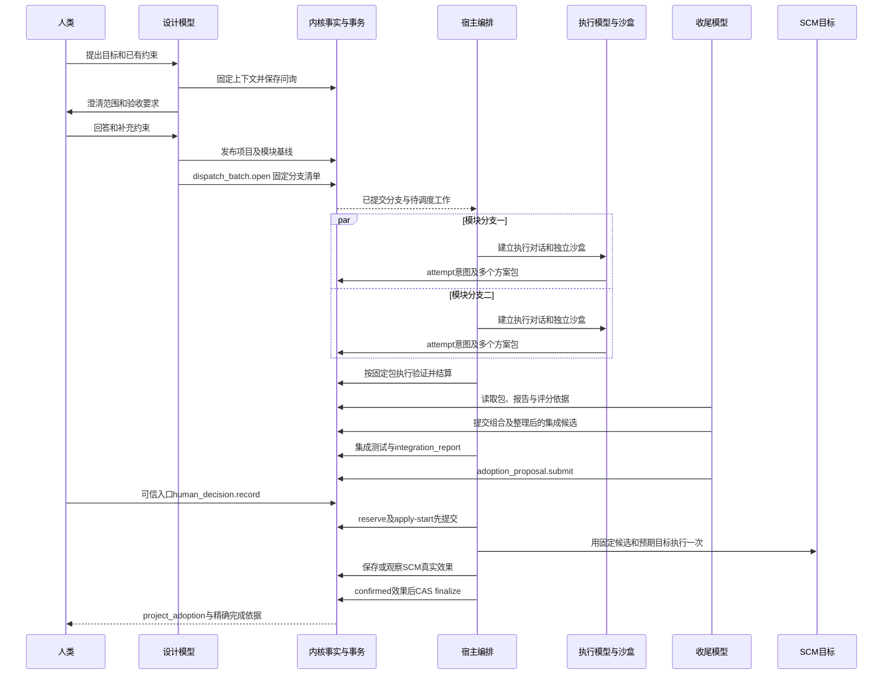
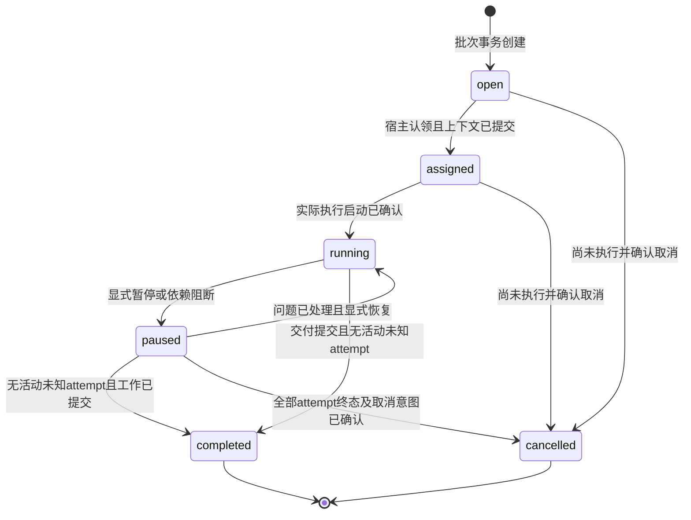
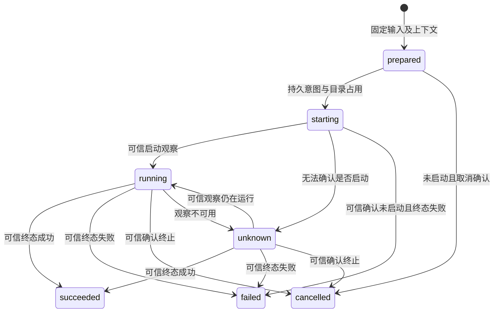
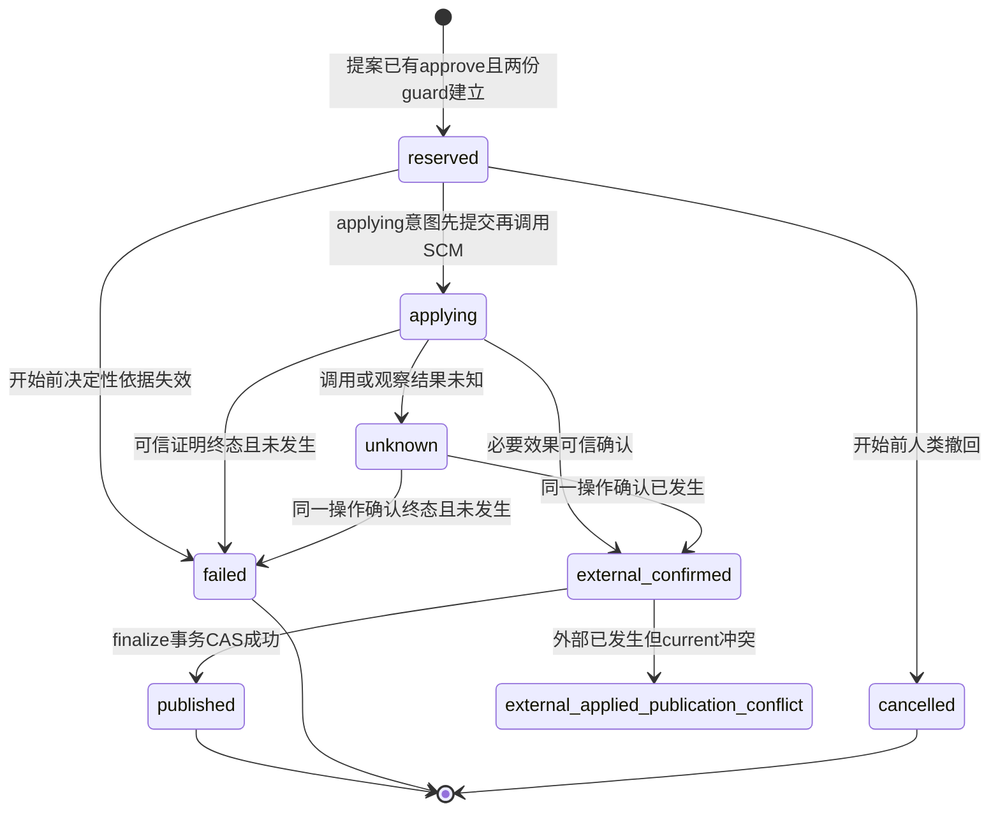
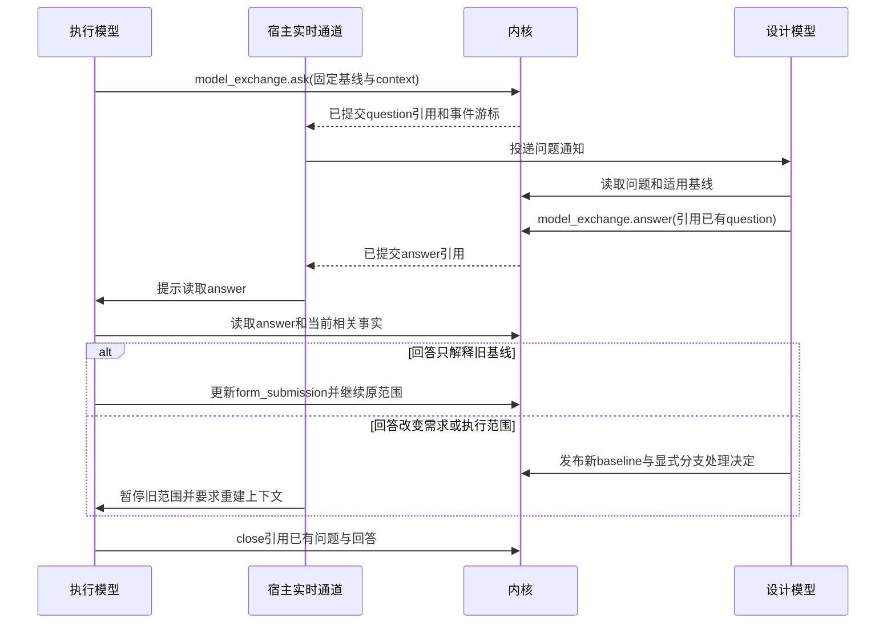

# R1 执行编排参考规格

文档版本：1.0.0；更新日期：2026-10-12（Asia/Shanghai）。本文是 **R1 参考实现规格（建议，可供直接实现，未实现/未行为验证）**，供实现者在没有前期对话的情况下构建执行流。完整入口见[从零复现蓝图](../reproduction-blueprint.md)，存储和事务由[数据规格](01-data-and-transactions.md)统一定义，上下文与评分由[上下文和评估规格](03-context-and-evaluation.md)统一定义。`release_approved=false`；本页不能作为新增功能已验收的证据。

## 1. 实现范围与决定来源

用户确定的执行流为：设计模型看整体架构和需求、问询理解、拆分范围与验收标准；分发并行执行对话；执行模型在沙盒中尝试多实现并提交模块包；表单通讯验收；收尾模型评分审阅、整理模块、保持低耦合高聚合，最终并入主库。项目整体与模块独立分别保存架构和需求，模块材料供执行流读取；模型间允许提问，表单允许实时更新。

**路线 A 已由用户选择**：模型准备评分、技术审阅及入库建议；人类确认具体版本是否最终采用；模型或编排执行已获授权动作。机器建议、角色字段或高分不授予审批权。原决定见[收尾身份](../model-review-identity.md)。

为使规格可复现，R1 建议采用单项目 SQLite、项目/模块逻辑分层、单层 fan-out、模块级多实现、固定组合后再集成验收。它们是参考实现的约束，不代替用户决定未来物理分库或多层嵌套。

R1 覆盖持久事实、建议 API、事务与外部效果的顺序，以及宿主必须提供的调度行为。模型服务、OS 沙盒、SCM 凭据、实时通道和实际运行启动器由宿主装配；内核不负责自行启动模型或后台工作线程。

当前源码依据为 `16410c9fbf4a8507445b4603e371e701614e4499`。既有 attempt、verification、approval、delivery 可以提供设计参照；新对象、状态和命令不因同名而属于冻结 v1，适配须明确翻译。

## 2. 公共引用、命令和可信身份

R1 新对象使用以下引用，必须精确解析；不接受“读最新再替换”作为版本解析：

```json
{"project_id":"p1","store_id":"s1","object_type":"solution_package","object_id":"pkg-parser-a","revision":1,"digest":"sha256:aaaaaaaaaaaaaaaaaaaaaaaaaaaaaaaaaaaaaaaaaaaaaaaaaaaaaaaaaaaaaaaa"}
```

`revision` 为正整数；`digest` 为 `sha256:` 加 64 位小写十六进制。上例重复字母只是格式占位，必须换成实际计算的摘要。对象 digest 对应数据规格定义的规范内容；包内 artifact 摘要校验实际字节。冻结 v1 的 ObjectRef 字段不同，适配器不能把这份 JSON 直接传入 v1 DTO。

所有建议写命令使用下述 envelope；调用名称在宿主调用接口中传递，身份由可信会话注入：

```json
{"command_id":"cmd-17","idempotency_key":"submit-parser-a-1","project_id":"p1","expected_heads":[{"object_type":"execution_branch","object_id":"branch-parser","pointer":"current","expected_revision":3}],"payload":{}}
```

`expected_revision=null` 表示预期指针不存在，正整数表示预期已发布 revision。上例对已存在分支作 CAS；创建新包时 object_id 由内核分配并在回执返回，不由调用方指定 pkg-parser-a。示例 payload 仅展示 envelope，不是一份可直接调用的包提交请求。命令不得把缺少预期版本解释为“覆盖任意最新值”。payload 的精确引用仍须核对 Store、项目、类型、摘要与权限。

幂等域、请求签名和回执格式以[数据规格](01-data-and-transactions.md)为准：相同主体/项目/键且语义请求相同返回原回执；同键不同语义拒绝。新尝试、新包或修改后的人审申请使用新键；超时重连先补查旧键，不能默认再执行。

可信会话包含主体、project/store scope、允许操作、provider 来源和人类身份证明。模型提供的 `role=designer/executor/reviewer` 只表达工作角色；`role=human`、表单复选框和对话“同意”均不能建立人类权限。

外部 provider 调用必须在持久意图提交之后、数据库写事务之外发生。引用 artifact 前先将真实字节原子发布到 ready 并复核摘要；失败时可留下无引用制品等待清理，不允许记录引用缺失字节的成功包。

## 3. 总执行时序



图中的评分与测试分别产生记录；模型意见不替代 verification，人的同意也不替代 SCM 效果。不同模块可以共同采用，不要求全项目所有分支互相竞争并只留一个包。

## 4. 设计侧：从问询到发布基线

已有项目的设计模型先读取当前 `project_adoption`、`project_baseline`、相关 `module_baseline` 及精确代码材料，保存 `context_manifest`。新项目没有当前采用记录时，宿主先保存用户原始目标和已有架构制品，创建初始 `project_baseline` P0，使用 readiness=clarifying 和明确的 blocking_questions；未澄清需求的 acceptance_ids 可以为空，缺口同时进入 context.gaps。P0 是设计输入，不是可执行任务，不能用不存在的 Git commit 填默认值。这样第一次设计请求也能引用已存在的项目基线，不出现“先有模型请求才有基线、先有基线才可请求”的循环。

问题用 `model_exchange` 保存，必要的用户问询也由宿主记录实际发言来源。设计模型将回答转成需求说明时列出已确认要求、假设和未决问题；无法确定验收目标、写范围或必要依赖时不得发布可执行分支。

`project_baseline` 使用数据规格的 title、architecture、requirements、module_ids、constraints、acceptance、readiness、blocking_questions、previous_ref；跨模块接口及初始代码材料写入版本固定的 constraints 制品。acceptance 是整体验收项清单，集成检查在此解析 id。SCM 目标在 `integration_candidate.target` 固定；设计阶段可在 constraints 中提出目标要求，但不添加未注册的顶层字段。`module_baseline` 使用 project_baseline_ref、architecture、requirement_ids、local_requirements、scope、acceptance、dependency_refs 等字段。它必须完整定义执行范围、依赖和验收；设计阶段 P0 的缺口不能混入可分发模块任务。

每个 `Acceptance` 有稳定 id、requirement_ids、kind、required 和 procedure；procedure 制品写明适用范围、成功判据、检查步骤及所需证据。性能目标必须写环境与阈值；不能只写“速度快”。无法机器验证的要求使用 human_review 并写明需何种可信人审，而不是让执行模型自行填 passed。

`project_baseline.publish` 和 `module_baseline.publish` 发布版本只是确定执行依据，不是正式采用或人类批准交付。它们必须由有设计权限的会话调用；来自模型问答的需求变更仍须按配置的需求确认规则处理。设计服务仅在 blocking_questions=[]、整体约束及模块接口/验收完整时允许 readiness=dispatchable，`dispatch_batch.open` 再次复查；不额外要求每次基线均经人类批准，路线 A 的人审针对最终正式采用。

执行范围使用规范化路径、允许的文件操作和依赖接口表达。宿主将逻辑范围映射到沙盒实际目录；禁止路径穿越和逃逸的检查在 parser/provider 接口实现，不能依赖模型承诺不越界。

项目或模块范围发生变化，追加新 baseline；旧 branch、attempt、package 保留旧引用。宿主暂停尚未启动的受影响分支，并由设计/收尾明确“继续旧任务、重分发或取消”，不能切换 current 就暗中改变运行依据。

## 5. 分发批次、分支及目录占用

`dispatch_batch` 使用 project_baseline_ref、module_baseline_refs、branch_ids、dispatch_constraints 和 status。调度参数版本、分发理由和跨分支约束放入 dispatch_constraints 制品；实际模型上下文在 branch.context_ref 与 attempt.context_ref 关联。R1 一次 open 在同事务内生成批次与分支身份并发布全部初始分支，避免半份分发；调用方给的是分支规格，不取得业务 object_id 的命名权。

分支清单按稳定 branch_id 排序；每个 `execution_branch` 使用 dispatch_ref、module_baseline_ref、strategy_label、execution_scope、acceptance_ids、root_lease_id、assigned_agent_id、context_ref、status。创建时后三个关联可为 null，assign 后持久 agent 与实际上下文关联；宿主另外保存外部对话身份映射，不把未注册 dialogue_ref 放进 payload。R1 一分支只归属一个模块；同模块可多分支，每分支可顺序尝试多个方案。

跨模块相互依赖不要求共享写目录。依赖接口来自固定基线，必要产物通过已就绪 artifact 引用共享；接口缺失时记录问题并等待或使用明确标注的测试替身。替身结果不能冒充真实依赖集成通过。



`completed` 表示该分支本次工作提交完毕，不表示任何包验收通过。允许“无成功实现、已保存失败证据”完成分支；批次汇合记录遗漏、失败和取消，不能要求所有候选成功才能查看结果。取消运行中的分支先置 paused、保存取消意图并要求 provider 终止；只要某个 attempt 仍 starting/running/unknown，分支保持 paused，不能新增 cancelling 或 outcome_unknown 状态。

不同 branch 的实际目录不得相同或互为祖先/后代；同分支不同并发尝试也必须有独立目录。R1 默认每个 attempt 新建目录，从固定代码基准恢复；同分支终态后顺序复用只是可选优化，必须保留此前包和执行范围校验。

目录分离不是 OS 沙盒。production 执行前必须验证 provider 实际支持的隔离级别、允许挂载、网络策略和可信来源配置；若请求 OS 限制却只有 `directory_only`，返回能力不足并且不调用 executor。

starting、running、unknown 以及尚未确认停止的取消请求一直占用目录。修改 root current、换 object_id、调度租约到期或宿主重启均不解除占用；只有可信终态结算才能释放 root_guard.active_attempt_id。`attempt.root_lease_id` 固定实际启动时的目录占用身份，不能从最新模块目录反推。

## 6. attempt 与多实现包

`attempt.prepare` 在短写事务验证固定材料，生成 attempt_id、operation_key、epoch 和 status=prepared，尚不建立外部执行效果。`attempt.start` 必须引用已有 prepared attempt，在短写事务复查分支、基线、scope、实际 context_ref、目录占用和 provider 能力，建立 root_guard 并追加 starting 意图和回执。随后宿主才调用 executor.start，返回 handle 的所有身份字段须对应已保存意图。prepared 不允许 provider 调用；宿主不能把 prepare accepted 解释为已启动。

结果来源绑定 provider_id、attempt_id、operation_key、handle 和 epoch。旧 epoch、跨分支、跨项目或不可信来源拒绝，并保存足以排障的拒绝事实；模型自行上传“我执行成功了”不能代替可信 provider 结果。冻结 v1 的 operation_id 由适配器翻译，不能在 R1 payload 混用两种字段。

attempt 状态闭集为 prepared、starting、running、succeeded、failed、cancelled、unknown。取消请求作为持久审计及宿主工作项保存，不添加未注册的 cancel_pending 字段；发出 cancel 的 accepted 回执不是已取消。provider start/poll 出错而不能证明没有效果时置 unknown，不再自动 start。



同一分支可以尝试 A、B 两种实现；每次真实执行有独立 attempt 和可定位日志。失败后修复创建新 attempt；保留旧失败、环境、输入、真实测试日志和费用未知原因，不能覆盖 stderr 或把未知用量补零。

`solution_package` 使用 module_id、module_baseline_ref、branch_ref、attempt_refs、manifest、package_digest、retention_state。branch.strategy_label 只表示分支工作策略，同分支各包的具体实现名称、代码基准、接口与打包器版本保存在 manifest.files 指向的说明制品及 dependency_refs，不添加未注册顶层字段。比较实际方案以精确 package_ref 区分，不能用可重名标签替代。引用旧包作为派生来源时必须指向已存在 revision。

模块 manifest 列出规范化包内路径、文件字节摘要、大小、模式和媒体类型；排除环境缓存、凭据及沙盒运行时文件。拒绝重复路径、大小写冲突、所有 symlink 和未就绪制品。完整包验证后才提交 package revision。

包内容在提交后固定；修复创建新 package 对象或 revision，不覆盖已被报告引用的字节。后验 `verification_report`、`implementation_review` 通过 package_ref 关联；不得回填包 manifest 后改变 digest，造成“报告引用包，包又引用尚不存在报告”的环。

提交包不要求已通过验收，失败实现也可以打包留存；包状态与采用状态分开。R1 默认在本轮设计比较期间保留全部已提交包及依据，后续清理需独立政策及授权，不能按“未选中”自动删除。

## 7. 验证、实现评分和收尾整理

验收以固定包和 module_baseline 的 acceptance.id 清单为输入。`verification.run` 先在宿主持久工作项保存 operation_key、固定包和验证配置；检查器在独立测试 root 执行，`verification.settle` 追加 verification_report，结果与环境、日志及验收 procedure 关联。R1 不另造未注册 verification_operation 对象；工作项格式与恢复规则见第 11 节。缺项或 unknown 不算通过。

`verification_report` 使用 package_ref、module_baseline_ref、acceptance_ids、check_results、evidence_refs、result、provider_id、operation_key、error；规则版本与环境模式从固定 procedure/evidence 制品读取，不能增写顶层 evidence_mode。human_review 的 passed 通过 CheckResult.human_decision_ref 引用可信 attest。模型审阅意见写 `implementation_review`，不能通过已有 `verification.record_review` 冒充人类复核。

`implementation_review` 可由数据处理者针对不同实现给分，必须引用具体 package、verification、rubric、context_manifest，并记录逐项依据、不确定性和比较范围。详见[评估规格](03-context-and-evaluation.md)；这与知识 ScoreEngine、skill 四维评分是不同机制。

评分仅作为比较及人审材料；不自动路由、重试、选包或批准。执行/收尾模型可以阅读它再提出明确建议，宿主不能看到最高分就隐式推进 adoption。skill 评价接口完全不接执行。

收尾按模块提出实现选择，跨模块固定组合。`integration_candidate` 使用 project_baseline_ref、module_package_refs、integration_attempt_refs、tree_manifest、tree_digest、target；接口映射通过 tree_manifest 的文件制品或 dependency_refs 中固定模块资料读取，不添加未注册顶层字段。同模块多个包仅在明确无路径冲突且接口组合规则允许时采用。

收尾发现杂乱或耦合问题，形成整理范围和理由；实际代码调整仍在沙盒进行，有新 attempt 和新包。原模块测试对新代码是否适用需逐项判断，受影响模块重新验收，再生成新的 integration_candidate。

集成测试针对组合后的精确候选，`integration_report.candidate_ref` 固定候选 tree_digest，project_baseline_ref 固定项目 acceptance；环境、依赖版本和真实执行记录留在 evidence_refs/procedure 制品，不添加未注册顶层字段。单包全 passed 不能代替组合通过；跨模块接口冲突、目录冲突及总体需求遗漏必须报告。

低耦合高聚合的读数来自版本化指标，模型说明职责与接口是否合理，人审最终确认。不得把导航父节点当技术层、依赖数少当高质量，或让“已去耦”标签免除集成验收；度量范围见[耦合边界](../coupling-metric-boundary.md)。

## 8. 建议 API 的前置、后置及并发条件

下列均为 R1 建议 API，当前没有注册这些新增接口。表中“同事务”指按数据规格将 revision、current、回执及相关工作项原子提交；外部调用另行执行。

| API | 必须满足的前置条件 | 成功后的事实或拒绝方式 |
| --- | --- | --- |
| `project_baseline.publish` | 有设计权限；材料就绪；current CAS；readiness 与缺口一致 | 新基线；允许 clarifying P0；不完整却声明 dispatchable 拒绝 |
| `module_baseline.publish` | 精确项目基线；完整范围、依赖及验收；模块 current CAS | 新 module_baseline；不隐式变更旧分支 |
| `dispatch_batch.open` | 项目 dispatchable 且阻断问题为空；所有模块基线存在；范围/验收/依赖完整 | 批次、open 分支及待调度工作项同事务产生 |
| `execution_branch.assign` | open 或授权恢复；分支 current CAS；宿主调度权；context 已提交 | assigned 且固定 agent/context；不同时分给两个当前持有者 |
| `execution_branch.pause/complete` | current CAS；complete 需提交交付表单、无活动/未知 attempt | paused 或 completed；包是否通过另查报告 |
| `attempt.prepare` | assigned/running 分支；固定基线/context；材料齐全 | 内核创建 prepared attempt 与 operation_key；不调用 provider |
| `attempt.start` | prepared attempt；assigned/running 分支；独立目录；能力符合；current CAS | starting 意图及 root_guard 先提交；外部启动后结算 |
| `attempt.settle/cancel/observe` | 可信来源或取消权限；operation_key/epoch 对应；current CAS | 追加真实状态；未知只观察；取消不是自动终态 |
| `solution_package.submit` | 分支归属正确；真实字节 ready；manifest 完整；包 current CAS | 不可变包；允许未通过实现；摘要不符拒绝 |
| `verification.run/settle` | 精确包和验收；可信检查器；持久工作项及租约 CAS | 工作意图和后验报告分别提交；未运行不 passed |
| `implementation_review.record` | 精确包/报告/评分标准；数据处理权限 | 新审阅依据；缺证据记录未知，不改变批准 |
| `integration_candidate.prepare` | 模块清单固定；路径/接口可组合；材料 ready | 新组合候选；记录来源；无依据的拼接拒绝 |
| `integration_candidate.test` | 候选 digest 完整；目标验证能力可用 | 测试意图与 integration_report；不直接采用 |
| `adoption_proposal.submit` | 固定候选；必需模块和集成验收 passed；审阅/整理依据齐全 | 新提案；待可信决定；没有额外 pending_human payload 状态 |
| `human_decision.record/revoke` | 可信人类会话；精确提案/检查；决定 current CAS | approve/reject/revoke/attest 事实；开始后撤回另存处置请求 |
| `adoption_operation.reserve` | approve 未失效；无项目未决采用；current 仍是提案基准 | reserved 操作、adoption_reservation 和 target_guard 同事务产生 |
| `adoption_operation.apply` | reserved；全部决定性依据未变；人审仍有效；SCM 条件未变 | applying 与 apply_started_seq 先提交；再执行固定外部动作 |
| `adoption_operation.observe` | 可信 SCM provider；精确 operation/target | 追加 observations；unknown 不自动写重试 |
| `adoption_operation.finalize` | external_confirmed；项目 current CAS；仍持有两份 guard | published operation 先追加；adoption 引用它；current 与 guard 同事务更新 |
| `form_submission.submit` | 稳定表单 ID；固定 schema 与 form_version；表单 current CAS | 追加完整提交快照；编辑暂态不冒充提交 |
| `model_exchange.ask/answer/close` | 授权通信范围；被引用问题/上下文已存在；current CAS | 追加交换；不改需求、执行或审批状态 |

设计权限不是人类批准权限；API 权限表须由宿主可信配置提供。表里同名 `attempt.start` 不表示可以绕过冻结 v1 schema；R1 和 v1 适配时仍需核对真实消费端。创建对象时内核分配身份，CAS 指向依赖的已有 branch/baseline；更新已存在对象才核对其 current，不能要求创建者预先传新 object_id。

## 9. 提案、人类决定与实际采用

`adoption_proposal` 使用 project_baseline_ref、module_package_refs、candidate_ref、integration_report_ref、implementation_review_refs、coupling_evidence_refs、rationale、target、expected_adoption_revision。expected_adoption_revision 指向固定 object_id=project、pointer=current 的正式采用水位；初次采用用 null 表示期望不存在。提案自身 digest 是人类所确认的整体依据。

`human_decision` 使用 subject_ref 引用该提案 revision/digest，decision 为 approve/reject/revoke/attest，basis_refs 和 target 固定确认依据，acceptance_ids 对批准/拒绝/撤回为空，对 attest 至少一项且全部来自精确包或候选基线。每个 CheckResult 必须被适用 attest.acceptance_ids 覆盖，不能一项人工检查的盖章通用于全部检查。human_principal_id/attestation_id 来自可信会话，reason/replaces_ref 保存理由与被替代决定。提案或决定性依据变化使尚未开始的操作不可 apply；新实现提交新提案和新决定。仅备注调整不扩大授权范围。



该图只使用 adoption_operation.status 闭集。提案自身不混装“待审/已批准”状态，审批进度由 human_decision 的可信决定与适用性派生；失败操作仍保留真实 error 和 observations。真实外部效果与 publication 冲突之间没有自动转为 published 的路径。

R1 的 TargetSpec 固定 provider_id、repository_id、target_ref、expected_external_revision、candidate_tree_digest、effect_kind、remote_id、mapping_spec。target_ref 使用完整 refs/heads/...；repository/remote 从宿主可信配置解析，模型不能将它替换成任意网络地址。包组合成固定代码树，mapping_spec 写明文件到 SCM 对象的映射；R1 拒绝 LFS、submodule、symlink 和会改字节的过滤器。

Git tree/commit hash 与包的 sha256 digest 不直接等价。provider 保存文件 manifest 到 Git tree 的验证依据、候选 commit OID、旧/新目标 OID、operation 标记及可信观察；“commit 创建成功”不等于“目标 ref 更新成功”。

effect_kind=local_commit 要确认本地候选 commit、映射及指定本地 ref 的条件更新，remote_id 必须 null；remote_ref_update 还必须确认非空 remote_id 指定远端的目标 ref 已按本次 operation 更新到候选 commit。provider 更新 ref 使用预期目标 compare-and-swap，不以普通强推代替；branch 被别人推进或目标只有相似字节时不能猜本操作已完成。无法区分则保持 unknown，外部映射参照[SCM 规格](../scm-effect-mapping.md)。

reserve 固定 `project_adoption/project/current` 的 expected_adoption_revision 并保存项目 adoption_reservation 和目标 target_guard；同项目第二次正式采用必须等待占用解决，模块执行和数据留存可以继续。调度租约到期不会释放 unknown 操作的任一 guard。

apply-start 的同事务检查是最后一次核对人审有效性、决定性基线和持有槽位；完成后保存冻结依据。开始后新基线和撤回不改写已启动操作，取消只是请求，实际结果仍需观察。finalize 只核对冻结引用/摘要的完整性、精确效果、guard 与原 current CAS，不重新因为业务基线变新而宣布已开始的人审失效。

必要外部效果 external_confirmed 后，EffectObservation 的 target、provider_operation_key、epoch、tree_digest 与 terminal 必须精确匹配冻结目标。finalize 在一笔事务先追加 status=published 的 operation revision，再追加 `project_adoption` 引用这个已存在 revision，CAS 发布 `project_adoption/project/current`，最后释放两份 guard。操作不反向引用将来 adoption，避免循环摘要。新采用记录通过 proposal/candidate/operation 引用链固定模块包、目标 OID、效果与人审；项目 current 在此之前不指向候选。

若 finalize 回执丢失，重放原键或查 operation；若记录证明同一 operation 已 published，返回原成功。这仅是已完成回执重放。若 current 被其他内容改变而外部效果已发生，保存 external_applied_publication_conflict 和实际外部事实，保持两份 guard 并人工协调；不得回滚事实、强改 current、修改原 expected CAS 或自动再次 SCM apply。人类确认既有效果后是否进行不再写 SCM 的新发布，须独立接口与验收，R1 不给自动恢复捷径。

## 10. 表单、模型问答与实时视图

R1 表单类型固定为设计澄清、分支进度、方案提交、验收反馈和收尾提案。每种 form_version 对应固定 schema 制品；表单 ID 稳定，`form_submission` 以该 ID 追加 revision 并用 current 指向最新已提交快照。

表单顶层使用 form_id、task_refs、module_baseline_refs、form_version、schema、fields、previous_ref、submitted_by。schema 引用实际字节，fields 是按它校验的完整规范值，必要时其中可有 context_ref；不能擅自增添顶层字段。实时编辑缓冲仅在宿主；并发补丁必须针对 expected revision，冲突返回旧/当前引用，由作者重读合并；R1 不默认把任意两个字段变更静默合并。

表单可呈现测试进度和意见，但“验收通过”“人类批准”“已采用”字段由关联的可信记录派生，模型不能直接修改它们来授予状态。需要执行动作时调用独立 API，表单提交不是通用执行触发器。

表单编辑暂态的生命周期规则（暂态仅存宿主，不进内核 DDL）：

| 情形 | 规则 |
| --- | --- |
| 按键暂态保留 | 宿主按表单暂态 TTL 保留；TTL 来自已校验宿主配置，不硬编码内核；暂态只用于展示与合并基线，不作为已提交事实 |
| 宿主崩溃恢复 | 未 flush 的按键编辑丢失可接受；恢复后表单 current 回到最近已提交版本，宿主可重新拉取宿主侧暂态快照（若有）重建编辑基线，内核不保留暂态 |
| 多宿主同表单编辑 | 编辑暂态归各自宿主；提交侧靠 `form_submission` current CAS 串行化，冲突返回旧/当前双方引用，后到者重读合并，不静默丢弃任一方字段 |
| 暂态与已提交边界 | 前端展示时“编辑中”与“已提交”分别标记；未 flush 对话不视为已留存上下文 |

model_exchange 的唤醒机制（谁、在什么触发下读 question 并投递）：宿主实时通道订阅内核提交事件（question/answer/close 各一次）是唤醒的权威依据；触发后宿主向目标角色（participant_role）的活跃会话投递“新 question/answer 待读”通知，通知只携带引用与事件游标，不携带未提交的权威字段。投递是至少一次，接收方按游标 + revision 去重。目标会话不活跃时通知挂起，不丢弃，恢复后从最后游标补读。R1 不把唤醒做成轮询异步留言：无事件则不投递，有事件则必达且可重放去重；“模型间交互提问”的实时性由宿主订阅通道保证，内核只保存可溯源的 question/answer/close 事实。



`model_exchange` 使用 exchange_id、kind、question_ref、answer_refs、participant_agent_id、participant_role、context_ref、body、status。question 的 question_ref=null 且 answer_refs=[]；answer 引用已有 question；close 引用已有问答。status 只取 open/answered/closed/cancelled，未解决而结束用 closed 并在 body 说明缺口，不发明 unresolved 状态。相关 branch/module 从 context.selected_refs 定位，多回答分别留存，不覆盖历史回答。

提问和回答都是意见事实。阻断问题由有编排权限的宿主显式 pause branch；问答本身不隐式取消已启动 subprocess。若回答改变范围，旧 attempt 的结果仍按旧基线结算，新工作需新基线/attempt。

宿主实时投递以提交事件为依据，至少一次传递；接收方按事件游标及 revision 去重，通知只携带引用而非未经提交的权威字段。既有 `events.read` 提供增量基础，R1 新投影和实时通道尚未实现。

断线重连先按最后游标增量补读，再固定查询水位读取当前表单/分支；游标不可用时全量重建投影并标明新的水位。前端可以展示编辑中和运行中，但分别标记暂态与已提交状态；不能把未 flush 的对话视为已留存上下文。

## 11. 宿主调度、恢复和外部未知

宿主负责模型对话创建、分支工作队列、provider 调用、观察、断线重连和日志 flush。创建对话应使用稳定 branch/operation 调度键；宿主必须保存或能查询创建结果，超时后先查询已有对话，不能制造多个独立执行者。调度参数如并发上限、租约时长、轮询间隔和人工通知期限来自已校验宿主配置，不硬编码到内核。

宿主队列的持久协调语义由编排规格拥有；R1 默认形态为宿主自有持久队列（work_id、kind、subject_ref、operation_key、epoch、request、status、holder、lease_until、attempt_count、last_error 存于宿主侧），内核不持有该表。当部署选择宿主与内核共享同一 SQLite 库时，内核启用可选协调投影，其 DDL 由数据规格拥有；status 闭集为 pending/leased/observe/finished；可变列仅限 status/holder/lease_until/attempt_count/last_error_json/updated_seq，request_json/subject_ref_json/operation_key/epoch/kind/created_seq 创建后不可变。镜像与宿主队列冲突时以宿主队列为调度权威并重新对齐，不以镜像放行外部重放；业务结论仍只从 attempt/report/operation 与审计读取，host_work 不替代权威事实。request_json 是固定请求，不允许 worker 按最新配置偷偷替换输入。如下 kind 是 R1 闭集，未知 kind 在入队时拒绝。

| kind | subject_ref 的类型 | request_json 必需字段 |
| --- | --- | --- |
| `attempt` | attempt 的 starting 意图 revision | provider_id、provider_spec:ArtifactRef、context_ref、scope、root_lease_id |
| `verification` | solution_package | provider_id、provider_spec:ArtifactRef、module_baseline_ref、acceptance_ids、test_root_id |
| `integration` | integration_candidate | provider_id、provider_spec:ArtifactRef、project_baseline_ref、acceptance_ids、test_root_id |
| `adoption` | adoption_operation 的 reserved revision | provider_id、provider_spec:ArtifactRef、proposal_ref、decision_ref、target |
| `artifact_repair` | 已存在且确定授权范围的 project_baseline 或包 | artifact_ref、repair_spec:ArtifactRef；仅修复字节发布状态 |
| `model_call` | context_manifest | session_id、turn_index、previous_call_work_id、role、provider_id |

每种请求全部列出必需字段，previous_call_work_id 可为 null，其余字段不可缺省；未知字段拒绝。公共 operation_key 和 epoch 从表列读取，不在 request_json 重复存一份。provider_spec/repair_spec 都指向固定且可读取配置字节；scope、target 和各 ref 使用章节 01 类型。model_call 的 role 为 design/execution/closing，须等于 context.consumer_role；session_id 是宿主持久会话身份，turn_index 为从零开始整数，previous_call_work_id 非 null 时须是相同 session 中已存在的更早调用。这些字段用于审计，不授予审批权；provider/model 参数与完整真实请求从 subject context_manifest 读取。

attempt/采用的业务意图与 pending 工作项同 UoW 创建。verification/integration 的首个检查意图使用不可变 audit_event 记录 `{work_id,kind,subject_ref,operation_key,epoch,request_digest}`，与 pending 同事务提交；终态报告、结果审计和 finished 同事务保存。artifact_repair 的 subject 只确定项目权限，不要求它先引用尚未 ready 的字节，避免修复意图的引用循环。模型请求先按章节 03 保存制品、context_manifest，再入队 model_call；model_call.started/observed 与 model_tool.prepared/result 的精确不可变事件字段归章节 03。host_work 是可变协调投影，业务结论只能从 attempt/report/operation 与审计读取。

领取使用短 `BEGIN IMMEDIATE` 事务及 `(work_id,status,epoch,holder)` CAS；核对 subject 精确引用、请求摘要、项目与 provider 权限，保存 leased、holder、lease_until 后提交，再调用 provider。持有者续租不改变 operation_key。首次外部调用前保存不可变 started 审计，崩溃后无法区分“尚未调用”与“已调用”的窗口按 observe 处理。较新调度持有者不得篡改已冻结 provider epoch；调度租约只决定谁处理观察，不产生外部重放权。

worker 在 provider 返回后以 operation_key/epoch 结算业务记录；调用次数 attempt_count 仅用于诊断，不能证明外部次数或允许重放。unknown 与非终态观察保持 observe；可信终态保存报告并 finished。provider 不支持查询/观察时，保存 unknown 与能力限制并提示人工，不能把 observe 工作重新改 pending 进行同一次外部 start/apply/model_call。

调度租约由 work_id、holder 和 lease_until 确定，受 CAS 更新；表列 epoch 是固定外部操作世代，不因调度换主而递增。租约只避免两个合作宿主同时调度同一工作项，不证明外部执行已停止。新持有者先读取持久意图和 provider handle；没有可信外部 fencing 与未发生证明时不得重发 start/apply。

启动时按状态索引读取未终态 work、attempt、采用操作及 guard，再核对最新状态与固定意图。无 apply_started_seq 的 reserved 可重新检查后继续；有 apply_started_seq 的 applying/unknown 只能观察已有操作；external_confirmed 未 published 的操作继续 finalize；已 published 只返回已有记录。冲突操作仍占用 guard，不能被普通调度恢复成 apply。

attempt、验证和 SCM 操作都有精确 operation_key（采用对象字段为 provider_operation_key）；poll/observe 是只读外部观察，结果以可信来源结算。宿主可以配置退避和人工通知期限，但期限仅产生“需关注”工作项，不把 unknown 自动转换为失败或未发生。

model_call 的流片段、完整响应与工具调用先保存实际 ArtifactRef，再保存观察审计；不能只留“模型已回复”标签。恢复时根据同 session/turn 的观察重建已看到消息与工具调用状态；每个改变内核事实的工具调用保存原 command_id 和回执，原键补查，不能重复副作用。provider 不支持观察时本调用保留 unknown；用户或编排显式发起新的调用需新 context/work/key，并说明前次未知，不能声称是同次确定恢复。

无法证明 start 是否发出时，R1 保守视为 unknown。若 provider 给出可信“该 operation 未启动且以后不会启动”或最终无效果的证据，可关闭原操作；需要重试仍创建新操作和新幂等键，并核对授权与目录/采用槽状态。

对人审批准后启动的采用，开始后的未知不能自动过期来放行另一写入。人工处理也不能凭文字说明伪造 effect_absent_final；必须保存真实外部观察，或选择保留未知并停用目标。补偿是新的独立动作，不删除旧效果。

## 12. 端到端例子：并行模块与替代实现

目标是增加“读取 CSV 并写入记录”的能力。宿主先保存 P0，设计模型问询人类，明确 UTF-8、100 MB 上限、列号错误定位、拒绝重复表头和现有 JSON 导入兼容；问题及答案分别留存，未确认的方言行为记为阻断问题，不能带问题派发。

澄清后发布 readiness=dispatchable 的 P1，constraints 固定起始代码 C0 和目标要求。M-parser1 属于 module.parser，定义 `Record` 迭代接口和 20 MB 内存阈值；M-writer1 属于 module.writer，定义批量写入、错误记录和事务验收。两模块共享精确 Record 接口，不共享写目录；B1 创建 parser、writer 两个并行分支，assign 固定各自实际上下文。

parser 执行模型在 sandbox/parser/a1 尝试 parser-memory，失败日志表明 BOM 处理不符；a2 修复并提交 PM2，正确性通过但内存验收失败。它在 a3 尝试 parser-stream，提交 PS1，覆盖所有必需检查。writer 分支提交 writer-batch 的 WB1。性能结果与实现评分均指向固定包、环境和同一验收标准，不把 PM2 高可读性分数当作内存 passed。

收尾建议 parser-stream + writer-batch；parser-memory 保存为未选方案，a1 的失败证据也保留。整理发现 writer 直接读取 parser 内部字段，收尾提出范围内重构，通过独立沙盒 attempt 生成 WB2 并重验；它依赖公开 Record 接口，而不是覆盖 WB1 或减少验收项以通过。

集成候选 I2 固定 PS1、WB2、整合 tree 和 TargetSpec：effect_kind=remote_ref_update、remote_id=origin、target_ref=refs/heads/main、expected_external_revision=C0。项目级检查覆盖错误定位、现有 JSON 兼容、事务失败回滚和真实两模块调用，生成 IR2。AP2 固定全部依据与当前采用 A0 revision；可信人类 HD2 以 decision=approve 绑定 AP2 digest 和目标。

宿主 reserve OP2，固定预期 A0 并建立两份 guard；apply-start 后 SCM 创建候选 C2，以 expected C0 更新 origin/refs/heads/main。响应超时，所以 OP2 暂记 unknown，不再次推送；observe 后确认 operation 标记、C2 字节映射和远端 ref 更新证据，追加 external_confirmed。

finalize 同事务先追加 published OP2，再保存 A2 引用它，CAS 从 A0 发布 A2 并释放 guard。用户看到正式采用 PS1/WB2；PM2 的 retention_state=retained，但它不在正式包清单；a1 可查为 failed。若观察仍无定论，A0 继续为当前采用，OP2 保持 unknown。若外部已发生而 CAS 冲突，保存 external_applied_publication_conflict，双方事实并存并进入人工协调。

## 13. 失败矩阵与恢复判据

| 失败点 | 必须保存的事实 | 允许的下一步 | 禁止的推断 |
| --- | --- | --- | --- |
| 缺需求/验收定义 | 问题、缺口及拒绝回执 | 补问并发布完整基线 | 默认需求已确认 |
| 基线或 current CAS 冲突 | 预期/实际引用和拒绝 | 重读、重建提案、新键 | 覆盖最新或复用旧批准 |
| 沙盒能力不足 | 实际能力与要求、拒绝 | 换可信 provider 后新请求 | 把目录隔离称 OS 隔离 |
| 对话创建超时 | 调度键、外部观察未知 | 查询已有对话、人工处理 | 再开多个执行者 |
| executor start/poll 报错 | 意图、handle、epoch、未知原因 | 观察已有 operation | 认定没运行并重 start |
| artifact 发布失败 | 未 ready、具体 I/O 原因 | 修复制品写入并复核字节 | 包已提交且可读取 |
| 包 manifest 摘要不符 | 实际/预期摘要、隔离记录 | 从可信字节重建新包 | 静默修正固定摘要 |
| 验证有失败或缺项 | 逐项结果、环境、日志 | 修复新包或补齐真实证据 | 评分高所以 passed |
| 评分依据缺失 | 对象范围、null/gaps 与限制 | 补充证据、新审阅记录 | 默认给高分或自动重试 |
| 整理后包变化 | 新包、影响项与旧依据 | 重验、集成、新提案人审 | 沿用旧批准修改字节 |
| 人类拒绝/开始前撤回 | 可信决定和绑定 digest | 不 apply，保留候选 | 模型替人批准 |
| SCM ref 已变化 | 预期/实际 OID，未应用证据 | 重建候选与人审 | 强推或自动重基后采用 |
| SCM 执行超时 | apply-start、operation、未知效果 | observe 同一操作 | 未发生或再次 apply |
| 外部 confirmed，finalize 冲突 | 真实效果与不同 current | 暂停目标、人工对账 | 删除外部事实或强改指针 |
| 表单并发提交 | 两份提交依据、CAS 拒绝 | 读取合并后新提交 | 静默丢弃一方字段 |
| 实时断线/游标失效 | 最后提交游标与缺口 | 增量补读或固定水位重建 | 编辑暂态已提交 |

## 14. 实现完成后的验证要求与本页检查

实现者至少需验证：批次创建原子性；独立目录并发；活动未知目录占用；跨项目/旧 epoch 结算拒绝；包字节固定且后验报告不改包摘要；未采用/失败留存；组合验收；模型不能批准；基线变化失效；外部未知不重放；confirmed 后 CAS 发布；表单冲突及断线补读。

每个场景要同时检查回执、revision/current、外部 provider 调用次数与实际字节。合成测试可证明代码行为，真实宿主还需验证人类身份、OS 沙盒、对话恢复、SCM 观察、凭据及 flush；不能让 R1 继承 G2 的接受。

本页建立时仅定向阅读六份架构说明以及 `AttemptService.attempt_start`、delivery 的 claim/apply-start/reconcile 源码位置，未执行运行 probe 或行为测试。源码存在独立目录多 attempt 基础，不能描述为仅允许单分支顺序重试；本参考规格的新增流程仍未实现。

具体文档静态检查结果由本轮[任务记录](../../records/tasks/2026-10-12-kernel-boundaries.md)拥有，包括链接/锚点、图块、公共字段、版本和差异检查。工具调用失败若有发生需注明失败阶段、原因和修复，不能把文档编辑成功写成执行流验收成功。
