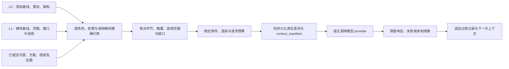
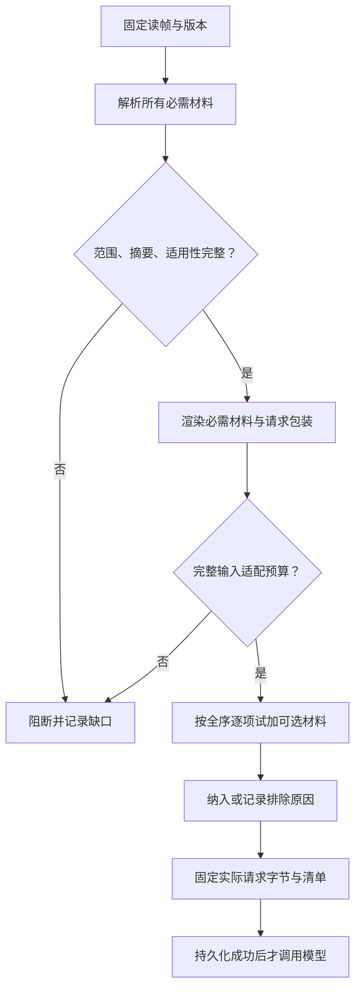
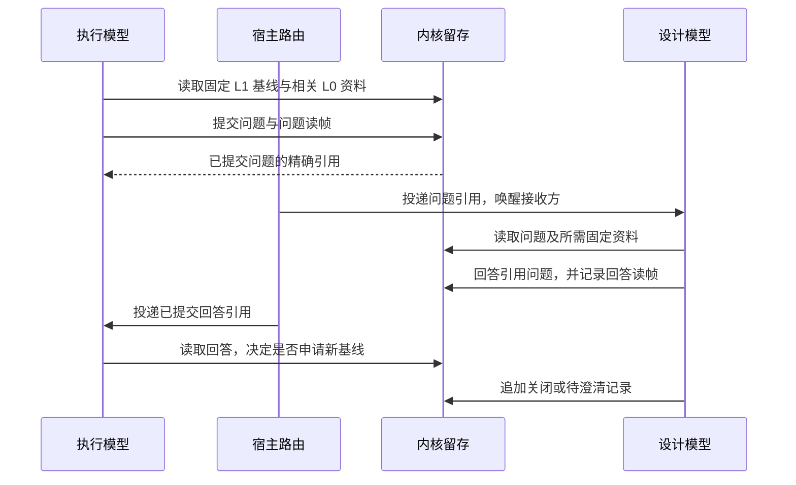
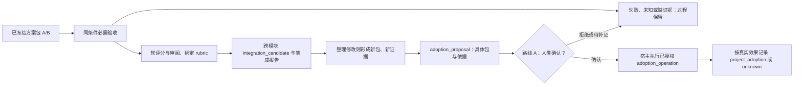
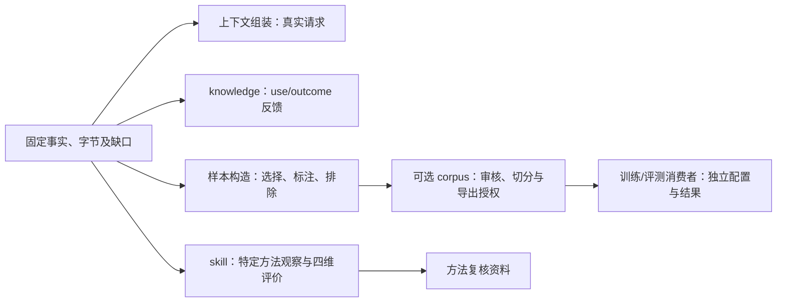

# 03：上下文工厂、方案评价与数据处理

文档版本：1.0.0；更新日期：2026-10-12（Asia/Shanghai）。源码基准：`16410c9fbf4a8507445b4603e371e701614e4499`。本文是 **R1 参考实现规格（建议，未实现/未行为验证）**，用于指导从零复现；不表示现内核已装配完整模型请求留存、方案评分、实时表单或主库采用流程。`release_approved=false` 不变。

阅读入口是[复现总纲](../reproduction-blueprint.md)。事务、精确引用和制品格式见[数据与事务](01-data-and-transactions.md)，任务与包的流转见[编排](02-orchestration.md)，开发次序和接受见[构建与验收](04-build-and-acceptance.md)。既有职责说明以[消费者一致性](../consumer-consistency.md)、[模型收尾身份](../model-review-identity.md)、[skill 成长](../skill-growth.md)及[训练数据职责](../training-data-boundary.md)为依据。

## 1. 本章的责任与三种输出

上下文工厂把固定事实和可读取材料组装为模型的实际请求；评价处理器把固定方案、检查证据和评价规则组装为比较依据；数据处理者保留方法观察及训练候选。三种输出可以相互引用，但不能互相替代。

| 输出 | 它能证明什么 | 它不能证明什么 |
| --- | --- | --- |
| `context_manifest` 与请求制品 | 哪些版本、材料及规则产生了这份可读取输入 | 模型必然输出相同内容、模型判断必然正确 |
| `verification_report` 与 `implementation_review` | 检查的实际结果，以及模型基于哪些证据作出评价 | 分数高即可入库、模型意见等于可信人类批准 |
| skill 观察、知识反馈、corpus 样本 | 指定用途下的数据处理观察及来源 | 改变执行权限、自动重试、自动批准或默认获得训练授权 |

R1 采用一个项目 SQLite 数据库，L0 是项目事实范围，L1 是模块事实范围，不是两个独立事务系统。存储格式遵循章节 01。下列精确引用是 **R1 新格式**，不能直接发送给冻结 `contracts/v1`；现有 DTO 使用 `revision_id`，没有这里的 `store_id`、数值 `revision` 和 `digest` 字段。

```json
{
  "project_id": "project-example",
  "store_id": "store-example",
  "object_type": "module_baseline",
  "object_id": "module-parser-baseline",
  "revision": 3,
  "digest": "sha256:1111111111111111111111111111111111111111111111111111111111111111"
}
```

`revision` 必须是正整数，摘要必须核对实际规范化内容。本文 JSON 中的重复十六进制数字是格式示例，不是已验收材料的真实摘要。外部文本、源码、请求、响应及日志按制品规则保存实际字节；`ArtifactRef={digest,size,media_type}`，路径由内核控制，不能由模型指定。不能只存一个无法读回内容的 hash。

## 2. L0/L1 的上下文合同

设计、执行、收尾三个角色读取不同范围，但共享相同的引用校验、权限与留存纪律。角色标签不授予人类权限；模型主要读库，问答补充信息。

| 角色 | 必需材料 | 可选材料 | 输出用途 |
| --- | --- | --- | --- |
| 设计模型 | 固定 `project_baseline`、项目需求及架构、已有模块目录与接口、当前待澄清问题 | 相关 L1 的历史方案、失败及经验 | 询问需求，拆分模块，给出范围、依赖、验收与分发基线 |
| 执行模型 | 固定 `module_baseline`、该分支需求与验收、允许修改范围、依赖模块公开接口、沙盒能力与限制 | 有权限的相关实现包、已提交问答、方法资料 | 在沙盒尝试一种或多种实现，提交包及证据 |
| 收尾模型 | 固定 L0/L1 基线、候选包、必需检查、集成证据、评价规则、依赖与职责资料 | 同条件历史比较、未采用方案、补充问题 | 审阅与评分、整理建议、准备具体采用提案 |

执行上下文无需复制整个项目的每条过程记录；它必须包含影响当前任务的项目约束。只给模块代码而漏掉项目禁止依赖、公共接口或验收条件，不属于有效 L1 上下文。依赖材料必须指向明确版本，不能让执行模型自行猜测“最新接口”。

新项目先由宿主把用户原目标与已有架构制品保存为 P0 `project_baseline`，`readiness=clarifying`，`blocking_questions` 可非空。设计上下文可读取 P0 以提出问题；它不要求先存在已澄清完成的需求，避免“必须先问清才能保存上下文、必须先有上下文才能问清”的循环。后续发布 `dispatchable` 且 `blocking_questions=[]` 的基线，模块范围、验收和依赖接口完整后，才能组装可执行分发上下文。

每次组装以已提交 `as_of_seq` 为读帧。同一查询及分页固定该水位；来源 revision 的提交序不得晚于读帧。源文件尚未提交时需另存其准确字节，源码 HEAD 不能代表当前工作树内容。跨项目材料只允许按显式授权的共享范围读取，不因语义相似自动注入。

固定旧基线不等于来源错误：分支可能仍合法地执行已派发版本。组装器要校验材料是否适用于这次分发基线，而不是一律替换成当前 head。若需求变更已使旧分发失效，应返回基线失效或待澄清；不得把新需求偷偷塞进旧上下文而继续声称依据未变。



## 3. 组装器的输入、预算与算法

实现一个无外部写入的组装函数，其输入包括读帧、角色、必需引用、有权限的候选材料、模板和排序版本、模型标识、参数、工具定义、计量器版本及预算配置。材料既有精确来源，又有经过核验的可读取内容。相同完整输入应产生同一实际请求字节与同一清单内容。

| 配置或输入 | R1 要求 |
| --- | --- |
| 必需材料 | 显式声明，缺失、无权、摘要不符、适用性失效或预算不足均阻断 |
| 可选材料 | 用来源类别、优先级、稳定键及精确版本构成全序，记录每次排除原因 |
| 渲染版本 | 固定模板、组装器、序列化方式与配置；版本不明时不宣称可再现 |
| 请求预算 | 计量实际 system/messages、工具定义、包装文字及传输字段中的模型输入 |
| 输出预留 | 从模型输入容量中扣除；预留量和估算余量由部署配置决定 |
| 计量模式 | `exact` 注明 tokenizer/计数接口版本；`estimated` 注明估算器及误差限制 |
| 敏感内容 | 按宿主的数据访问、脱敏与保留要求处理，不能在失败日志中额外泄露 |

现有 [ContextResolver](../../../src/project_kernel/knowledge/resolver.py) 已阻断必需材料缺失、过期和按所获 token 数超预算，并记录可选排除；这不等于它已实现本章完整组装。`SourceMaterial` 不含完整渲染正文，未提供 `token_count` 时 `_tokens` 估算的是来源身份字符串。它无法单靠该估算保证正文、工具定义与最终请求都适配窗口。

R1 必须在渲染实际请求后计量。严格计量配置缺少对应模型的可靠计数器时阻断；允许估算的配置须写明估算及余量，不能宣称硬容量保证。provider 因容量拒绝是一次实际调用失败，保留证据后调整配置或材料选择；不得静默删掉必需条件。

计量模式的 provider capability 声明：多数真实 provider 无法提供确定的 tokenizer 窗口容量（窗口按 token 计、工具定义折算规则各家不同），因此 R1 参考实现**默认 estimated + margin**，`exact` 仅对声明了稳定计数接口的 provider 开放。provider capability 声明必须写明以下字段，否则 budget 校验形同虚设：

| capability 字段 | 说明 |
| --- | --- |
| `meter_mode` | 该 provider 支持的计量模式 `exact`/`estimated`，R1 默认 `estimated` |
| `input_limit_source` | `input_limit` 的来源：provider 计数接口版本 / 部署配置声明 / 估算基线；不得省略 |
| `counter_spec` | 计量接口版本、工具定义折算规则与误差限制；`estimated` 必填，`exact` 注明 tokenizer 版本 |
| `exact_available` | 布尔；为 false 时该 provider 的 budget 只能走 estimated + margin，不得宣称硬容量保证 |

实施模型不得把 `exact` 当作可靠的默认路径；`exact` 的 `input_limit` 来源与 `counter_spec` 必须能追溯到 provider capability 声明，否则预算校验只能用于估算，超窗靠 provider 拒绝后调材料。

```python
def assemble_context(spec, read_view, artifact_reader, renderer, meter):
    assert read_view.project_id == spec.project_id
    assert read_view.store_id == spec.store_id
    assert read_view.as_of_seq == spec.as_of_seq
    require_known_versions(spec.template, spec.assembler, spec.ordering, meter)
    selected, excluded = [], []
    for ref in stable_sort(spec.mandatory_refs):
        source = read_view.get_exact(ref)                 # 不跟随新 head
        verify_scope_permission_digest(source, ref, spec)
        require_applicable_to_dispatch(source, spec.baseline_refs)
        selected.append(read_verified_material(source, artifact_reader))
    request = renderer.render(spec, selected)             # 含工具、包装及参数
    if meter.count(request) > spec.input_budget:
        return blocked("mandatory_budget_exceeded", selected, excluded)
    for ref in stable_sort(spec.optional_refs):
        checked = resolve_optional(ref, spec, read_view, artifact_reader)
        if not checked.ok:
            excluded.append((ref, checked.reason))
            continue
        trial = renderer.render(spec, selected + [checked.material])
        if meter.count(trial) > spec.input_budget:
            excluded.append((ref, "budget_exceeded"))
            continue
        selected.append(checked.material)
        request = trial
    request_bytes = renderer.serialize_actual_request(request)
    return assembled(request_bytes, selected, excluded, meter.describe())
```

伪代码的预算是 `model_context_limit - output_reserve - configured_margin`；这三个值需通过模型/部署配置解析，不硬编码通用常数。存储 `Budget.input_limit` 表示模型上下文总容量，通过条件是 `measured_input + output_reserve + margin <= input_limit`，不对同一预留重复扣除。计量接口接收完整请求并知道哪些字段消耗模型容量。排序必须包括打破同键平局的版本/摘要，不依赖 SQL 默认行序、集合顺序或文件遍历顺序。



材料摘要损坏时隔离/报错，不换成猜测内容；必需材料没有“跳过后算成功”的分支。可以提出缩小任务、增加预算或修订输入清单，但那是显式的新组装规格，保留原阻断记录。可选排除不掩盖必需缺口。

## 4. 请求留存、manifest 与再现

先保存请求字节制品，再在事务中追加 `context_manifest` 并关联需要消费它的分发、attempt 或交换记录。manifest 只引用已经存在的来源和请求制品，不把自身摘要写入自身内容。宿主在持久化成功后发起调用，并将实际响应或失败观察追加到相应过程记录。

下例是一份执行模型 manifest 的 **payload**；`schema_version="R1"` 和身份等元数据由章节 01 的 envelope 承载，不加到 payload。所有来源引用都必须已存在，`request_artifact` 摘要针对实际保存的 JCS 请求体字节，`rendered_digest` 等于该摘要。

```json
{
  "consumer_role": "execution",
  "as_of": 120,
  "project_baseline_ref": {"project_id": "project-example", "store_id": "store-example", "object_type": "project_baseline", "object_id": "project-baseline", "revision": 2, "digest": "sha256:aaaaaaaaaaaaaaaaaaaaaaaaaaaaaaaaaaaaaaaaaaaaaaaaaaaaaaaaaaaaaaaa"},
  "module_baseline_refs": [{"project_id": "project-example", "store_id": "store-example", "object_type": "module_baseline", "object_id": "module-parser-baseline", "revision": 3, "digest": "sha256:1111111111111111111111111111111111111111111111111111111111111111"}],
  "selected_refs": [
    {"project_id": "project-example", "store_id": "store-example", "object_type": "project_baseline", "object_id": "project-baseline", "revision": 2, "digest": "sha256:aaaaaaaaaaaaaaaaaaaaaaaaaaaaaaaaaaaaaaaaaaaaaaaaaaaaaaaaaaaaaaaa"},
    {"project_id": "project-example", "store_id": "store-example", "object_type": "module_baseline", "object_id": "module-parser-baseline", "revision": 3, "digest": "sha256:1111111111111111111111111111111111111111111111111111111111111111"}
  ],
  "artifact_refs": [{"digest": "sha256:bbbbbbbbbbbbbbbbbbbbbbbbbbbbbbbbbbbbbbbbbbbbbbbbbbbbbbbbbbbbbbbb", "size": 18000, "media_type": "text/markdown"}],
  "policy_digest": "sha256:cccccccccccccccccccccccccccccccccccccccccccccccccccccccccccccccc",
  "renderer_version": "renderer-r1.1",
  "compiler_spec": {"digest": "sha256:dddddddddddddddddddddddddddddddddddddddddddddddddddddddddddddddd", "size": 940, "media_type": "application/json"},
  "model_spec": {
    "provider_id": "configured-provider", "model_id": "configured-model", "model_version": null,
    "parameters": {"temperature": 0},
    "parameters_schema": {"digest": "sha256:eeeeeeeeeeeeeeeeeeeeeeeeeeeeeeeeeeeeeeeeeeeeeeeeeeeeeeeeeeeeeeee", "size": 500, "media_type": "application/json"},
    "version_unknown_reason": "provider does not expose immutable model version"
  },
  "budget": {"input_limit": 16000, "output_reserve": 3000, "measured_input": 8910, "counter_version": "meter-example-1", "mode": "estimated", "margin": 500, "counter_spec": {"digest": "sha256:ffffffffffffffffffffffffffffffffffffffffffffffffffffffffffffffff", "size": 800, "media_type": "application/json"}},
  "selection": [
    {"ref": {"project_id": "project-example", "store_id": "store-example", "object_type": "project_baseline", "object_id": "project-baseline", "revision": 2, "digest": "sha256:aaaaaaaaaaaaaaaaaaaaaaaaaaaaaaaaaaaaaaaaaaaaaaaaaaaaaaaaaaaaaaaa"}, "disposition": "included", "reason": "mandatory", "priority": 0},
    {"ref": {"project_id": "project-example", "store_id": "store-example", "object_type": "module_baseline", "object_id": "module-parser-baseline", "revision": 3, "digest": "sha256:1111111111111111111111111111111111111111111111111111111111111111"}, "disposition": "included", "reason": "mandatory", "priority": 10},
    {"ref": {"project_id": "project-example", "store_id": "store-example", "object_type": "solution_package", "object_id": "older-parser", "revision": 1, "digest": "sha256:9999999999999999999999999999999999999999999999999999999999999999"}, "disposition": "excluded", "reason": "budget_exceeded", "priority": 40}
  ],
  "request_artifact": {"digest": "sha256:2222222222222222222222222222222222222222222222222222222222222222", "size": 24810, "media_type": "application/json"},
  "rendered_digest": "sha256:2222222222222222222222222222222222222222222222222222222222222222",
  "gaps": []
}
```

预算、长度与模型参数仅用于说明字段，不是项目默认值。`compiler_spec` 制品保存组装器/模板/排序/适用性及权限政策的版本和配置；policy_digest 必须匹配其中保存的政策内容。counter_spec 保存计量器配置。selected_refs 必须与 selection 中 included 来源相符；gaps 是缺口，不用作隐藏必需材料错误的通过标记。

实际工具定义、system/messages 和非秘密参数均在请求制品中；清单中的摘要不能替代它们。provider 适配器若追加模型可见内容，应在调用前保存最终请求；不能只留适配前的简略模板。凭据与认证头由宿主在模型输入之外装配，不写入请求制品，模型可见正文仍按访问及保留规则保存。

调用恢复以宿主的持久 operation 标识及观察为依据，事务不跨越网络调用。崩溃后发现“请求已保存、响应未保存”时，事实是本地尚无响应，不证明 provider 未执行或未产生费用。宿主按 provider 的查询/幂等能力处理，无法确认时保留 unknown；不会由 skill 分析记录发起自动重放。

再现接口只重建原输入：读 manifest、核对制品、来源和组装版本，输出原始请求或验证重新组装的字节一致。缺少原始外部正文、旧模板或请求内容时返回不可再现及缺口，不用当前 head 补齐。重新请求模型是新的获授权调用，不能被称为纯读取再现。

“固定输入可再现”与“模型输出相同”分开。即使 temperature 为零，服务实现、模型版本、硬件和运行状态也可能不同；保存响应与可获得的模型版本元数据，但不声称能控制 provider 未公开的内部状态。模型意见记录为当时的一次意见事实。

### 4.1 模型调用、流片段与工具结果的持久格式

R1 不新增 `model_call` revision 类型。宿主以 `host_work(kind=model_call)` 的 `subject_ref=context_manifest` 管理待调用工作；实际调用与工具观察保存为不可变 `audit_event`。队列状态与结果引用是这些事件的可重建投影，不是可原地覆盖的权威日志。具体队列和领取字段由章节 02 定义。

每个调用固定 `work_id,operation_key,session_id,turn_index,previous_call_work_id,consumer_role`；turn_index 从 0 开始递增，同会话轮次唯一；前次 work 必须已存在且属于同会话。一次独立首轮 previous_call_work_id 为 null；设计、执行、收尾的 provider/model 参数取自该 manifest，不从队列临时替换。角色只用于审计。下一轮模型请求包括实际返回的工具内容并生成新 manifest，新 work 不改上一轮请求。

以下事件 payload 的字段均必需；`T|null` 表示必须出现但可为空。事件共用章节 01 的项目/Store、commit_seq 和 event_index envelope。`ArtifactRef` 对应已经 ready 的真实字节，事件写入和 host_work 投影更新同 UoW 提交。可信宿主/provider 才能提交观察，模型输出不自证真实调用或工具执行。

| event_type | payload 字段 | 接受条件 |
| --- | --- | --- |
| `model_call.started` | `work_id:Id; operation_key:Id; epoch:Revision; session_id:Id; turn_index:Seq; previous_call_work_id:Id\|null; consumer_role:design\|execution\|closing; context_ref:ObjectRef; provider_id:Id` | 固定工作项由 pending/leased 转为已开始；context/模型能力匹配；本事件持久化后才允许唯一持有者调用 provider |
| `model_call.observed` | `work_id:Id; operation_key:Id; epoch:Revision; observation_id:Id; observation_index:Seq; provider_request_id:string\|null; status:streaming\|completed\|failed\|unknown\|cancelled; terminal:boolean; completeness:complete\|partial\|unknown; response_refs:ArtifactRef[]; tool_calls:ToolCall[]; usage:Usage\|null; error:Failure\|null` | 引用已存在 started；身份匹配；同 work 的 observation_id 去重，index 单调递增；completed 必须 terminal 且 complete，取消须有真实终止证据 |
| `model_tool.prepared` | `work_id:Id; operation_key:Id; epoch:Revision; call_id:Id; tool_index:Seq; kind:command\|query; command_envelope:ArtifactRef\|null; query:QueryEvidence\|null` | 关联已留存 tool_call；参数/权限已验证；固定命令或查询二选一；同 call_id 的绑定不可改写；提交后才可调用工具 |
| `model_tool.result` | `work_id:Id; operation_key:Id; epoch:Revision; call_id:Id; tool_index:Seq; kind:command\|query; command_id:Id\|null; receipt_artifact:ArtifactRef\|null; query:QueryEvidence\|null; status:committed\|accepted\|rejected\|succeeded\|failed\|unknown; result_artifact:ArtifactRef; error:Failure\|null` | 关联已留存 tool_call；每个 call_id 至多一个最终结果，未知可追加后续观察；command/query 依据二选一且与状态匹配；不由原始参数授予工具权限 |

`ToolCall={call_id:Id,name:Id,arguments:ArtifactRef}`；arguments 保存 provider 实际返回的参数字节，包括无效 JSON 的原文。未完整的流片段只在 response_refs 保存，完整工具请求才进入 tool_calls。宿主校验工具名、参数和授权后才调度；解析失败留失败结果，不执行。流片段按 observed.observation_index 顺序保存原始正文、工具请求及完整响应制品；最终完整响应不能用模型后来生成的摘要代替。各事件 epoch 匹配 host_work 固定外部操作世代，request_json.role 必须等于 context.consumer_role，started 用 consumer_role 保存该审计角色。

`QueryEvidence={project_id:Id,store_id:Id,as_of:Seq,query_name:Id,query_version:Id,request_artifact:ArtifactRef,source_refs:ObjectRef[]}`；prepared 中 source_refs 可为空，result 中列出实际读取来源。command 的 prepared 保存规范化 `{command_name,envelope}` 制品，envelope 含完整命令身份、固定幂等键、预期版本与 payload；取得命令结果后 result 必须有匹配 command_id 及实际可信回执制品，query 为 null。回执尚不可获时 command_id 对应既存 prepared，receipt_artifact 为 null，status=unknown；继续按原键补查。query 结果有固定读帧、实际参数和来源，command_id/receipt_artifact 为 null。

参数/权限在工具入口前失败时不写 prepared、不伪造内核回执，result 的 command_id/receipt_artifact/query 均为 null，status=failed 且 error 必填，result_artifact 保留实际给模型的拒绝说明。这是无工具调用的校验失败，不能用于将已发命令结算为未发生。`accepted` 命令回执只是意图，不表示工具外部效果完成；下轮模型输入必须保留该含义。

result_artifact 保存宿主真正呈现给模型的工具结果字节。如果宿主裁剪日志，保留完整结果及裁剪规则/缺口，并把实际呈现版本另存为 result_artifact；不能只有完整日志却不知道模型看了哪段。按 tool_index 排序渲染工具结果，结果次序不能由并发完成时间隐式决定。

```python
def drive_model_call(work, host):
    context = host.read_exact_context(work.subject_ref)
    host.commit_started_and_claim_once(work, context)       # 短事务
    try:
        stream = host.model_provider.call(context.request_artifact, work.operation_key)
        for observation in stream:
            saved = host.publish_actual_response_artifacts(observation)
            host.append_observed_event_and_update_projection(work, saved)
    except ProviderCommunicationFailure as failure:
        host.record_failure_with_unknown_outcome(work, failure)
    # 工具命令另走可信入口；未明结果不自动重发
```

模型返回工具请求不等于工具已经执行。每个 call_id 生成固定工具命令/幂等键并在首次调用前持久化绑定；回执丢失查原命令，不能换键再次执行。只读查询也保存实际参数、水位与结果。工具结果、响应制品或观察持久化失败时不伪造“完整会话”；保留可恢复工作与缺口，必要时阻断下一轮。

上下文中的文档、schema/tools 定义、模型回答及工具返回是待处理材料，不是可信人类授权。外来正文即使声称“已批准”或要求跳过权限，也只保留为内容；实际工具入口仍依据可信会话、项目/Store、允许命令和既有具体确认独立校验。

宿主重启后先按原 work/operation 查询 provider。provider 不支持查询且无法确认原调用时保留 unknown；流已断不能声称完整响应。显式重开模型调用要新 work/context，并记录旧调用未知及已发工具状态；不得沿用模型重生成的工具请求去重放上一轮未知副作用。关闭 flush 未证实的片段保持缺口，不因本地进程退出自动终结。

## 5. 读库、表单与模型问答

实时传输由宿主处理，已提交内容由内核留存。前端可以显示编辑中的值与发送进度，并分别标注暂态/已提交；按键不必全部转成权威 revision。执行模型读取的任务范围和验收来自固定基线，实时表单显示变了不等于原任务依据已被合法替换。

`form_submission` 保存明确提交的值、作者、关联模块/分支、已读基线及处理结果。宿主处理重复提交与送达；提交方带上所编辑的精确版本，版本冲突须告知并重新确认。涉及已确认需求的变更先形成新基线，再处理受影响分支、评分与采用提案。

`model_exchange` 以稳定 `exchange_id` 关联问题、回答与关闭记录。每次提交记参与方、角色、模块/分支、原文制品及当时读帧。问题不引用未来回答；回答引用已有问题；关闭或总结 revision 引用当时已存在的问题和回答。回答可能是建议，必须经过需求确认流程才成为新需求。



重复投递不重复产生回答事实；迟到回答保留关联原问题和旧基线，不能自动应用到后来的分支。无回答、取消、权限不足与送达失败各自可见；“已提交”不等于“对方已读”。宿主需要等待策略，但内核不凭等待时间猜测答案。

现有 [events_read](../../../src/project_kernel/data/queries/service.py) 已按 `(commit_seq, event_index)` 游标读取固定上界内的审计事件。R1 可用它提示重读；它不是任意字段 diff 或实时推送。每轮增量使用明确的固定 `as_of_seq`；断线重连恢复游标并重新取得权威对象，不能把暂态直接拼进旧模型请求。

## 6. 多方案评价：验收在前，软评分另记

同模块的备选实现与不同模块的并行实现分开比较。前者按相同任务比较候选；后者各自满足模块条件后进入集成，不能在所有项目分支中只挑一个“全局胜者”。未采用的包、失败和不完整证据可以留存，留存不代表验收通过或主库采用。

先冻结 `solution_package` 的实现内容、源码/制品清单与基线引用，再产生测试报告和审阅记录。报告单向引用固定包；不能把后来生成的 report/review 引用塞回已摘要固定的包，否则包内容变化使之前测试与评分失去对象。修正或去耦修改代码时形成新包并重新核验影响范围。

| 层次 | 内容 | 决策纪律 |
| --- | --- | --- |
| 必需验收 | 固定验收 ID、检查版本、包摘要、真实执行结果和证据 | failed、unknown、必需项未运行均不得标为通过；不以平均分补偿 |
| 软评价 | 性能、维护成本、架构符合度、解释完整度等有定义的维度 | 每项注明证据、限制和信心；无证据为 null |
| 集成接受 | 多模块包在固定项目基线上组合后的测试与依赖检查 | 单包通过不能推导组合通过；组合引用固定版本 |
| 路线 A 授权 | 人类确认具体包集合、基线、依据与采用范围 | 模型意见或分数不授予入库许可 |

R1 比较组必须固定需求/验收、测试集、provider/环境版本、资源与时间预算、种子/数据、失败判定和评价 rubric。不同环境、额外人工作业或预算差异保留为条件差异，不能默认公平排名。涉及真实性能时记录执行样本与统计方式；模型主观估计不能冒充测量值。

三套评分的结构防混（schema 层约束，不依赖散文纪律）：

| 评分机制 | 对象 | 可被消费于 |
| --- | --- | --- |
| `implementation_review` 软评价 | 方案包/维度 | 方案比较、集成候选、阅读辅助（不驱动执行/不授予批准） |
| knowledge `ScoreEngine` 加权分 | knowledge use/outcome 事件 | 知识检索排序与质量信号（检索次数不是质量信号） |
| skill 四维观察 | 数据处理侧 skill 记录 | skill 适用性/改进（不接执行、不接路由、不接自动重试） |

schema 层硬约束：`implementation_review.evaluator` 只接受 `ModelSpec`（provider/model/参数），**不可**引用 knowledge 记录或 skill 记录作为评价者或评分依据；knowledge/skill 记录也不得被方案比较、路由决策或自动重试消费。三套量表独立（`0..4` 与 `0/1/2/null` 不互代），互不引用。这一约束写进 R1 schema 的 `evaluator` 类型字段，使"防混"在接口形状上就接不进，而非靠实现者自觉。



软评分可对失败方案作研究性分析，但必须标为不具备采用资格，不能混入通过方案的默认排行榜。用软总分作阅读辅助也不能跨越必需闸门。审批、集成和外部效果结算按章节 02 处理。

以总指南的 CSV 导入例说明：`module.parser` 有 `parser-memory`、`parser-stream` 两种实现，`module.writer` 有 `writer-batch`。parser 两包必须使用同一数据集、公开解析接口和资源条件进行比较；writer 与 parser 职责不同，不能放进同一个实现排名。

| 假设观察，不是本轮实测 | 必需验收 | 软评价 | 后续处理 |
| --- | --- | --- | --- |
| `parser-memory` 必需检查通过，无性能实测 | passed | 性能 null，其他维度仅在有证据时评分 | 可准备与 writer 的集成候选；性能维度暂不能比较 |
| `parser-stream` 性能已测，但一项必需检查结果未知 | unknown | 保留性能测量和限定意见，不把未知检查补零 | 保留过程包并补观察，不能因性能好获得采用资格 |
| `writer-batch` 自身验收通过 | passed | 按 writer 的 rubric 独立评价 | 与合格 parser 组合后仍需整体 CSV 导入集成检查 |

即使 parser 与 writer 单独都通过，也要验证解析错误处理、批次提交和结果一致性等项目验收。最终人类确认的是具体 parser/writer 包集合与集成依据，不是“任选当前最高分方案”的动态表达。

## 7. Rubric、null、信心与跨轮比较

每个 `implementation_review` 固定 rubric ID/版本及实际字节，评价者模型/提示版本、输入 manifest、包引用、检查报告、度量和限制。规则先于本轮评价确定，不因偏爱某实现事后改权重。可记录维度分，不强制总分；若提供总分，必须声明计算方式、缺失值及适用范围。

下面是 **rubric 示例**，不是现有内核默认规则。量表及维度定义可由项目配置；`0..4` 不与 skill 的 `0/1/2/null` 混用。置信等级描述这次证据支持程度，不是模型正确概率。

```json
{
  "rubric_id": "module-review-example",
  "version": "1.0.0",
  "scale": {"min": 0, "max": 4},
  "dimensions": [
    {"id": "architecture_fit", "meaning": "符合固定项目分层、公开接口及模块职责", "evidence_required": ["dependency_report", "requirement_mapping"]},
    {"id": "measured_performance", "meaning": "在声明工作负载和资源约束下的实测表现", "evidence_required": ["benchmark_runs"]},
    {"id": "maintenance_cost", "meaning": "在声明审阅范围内的修改与理解成本", "evidence_required": ["source_review", "change_examples"]}
  ],
  "missing_evidence": "null",
  "confidence_values": ["low", "medium", "high"],
  "aggregate_policy": "none",
  "mandatory_acceptance": "separate_gate"
}
```

给每个数值维度定义可检查的评分锚点，例如哪些证据支持 0/2/4，不能只给模糊名称后让模型任意填数。各项数值附证据引用与理由；无测量的性能为 null，不能填中间值。若比较组要求性能必须可比较，而一包缺失测量，组级比较状态为 incomplete。

```python
def review_implementations(group, package_reader, check_reader, metric_reader):
    require_fixed_rubric_and_comparison_spec(group)
    outputs = []
    for package_ref in stable_sort(group.package_refs):
        package = package_reader.verified_exact(package_ref)
        reports = check_reader.for_exact_package(package_ref, group.check_versions)
        acceptance = evaluate_required_checks(group.acceptance, reports)
        comparability = compare_conditions(reports, group.environment_and_budget)
        metrics = metric_reader.for_exact_inputs(package, group.metric_versions)
        opinion = obtain_recorded_model_review(package, reports, metrics, group)
        validate_scores_evidence_null_and_limits(opinion, group.rubric)
        outputs.append(review(package_ref, acceptance, comparability, opinion))
    return outputs                                      # 数据产物，不执行采用
```

`obtain_recorded_model_review` 是显式宿主模型调用，其真实请求/响应按前文保存，不是纯函数或自动批准。无效结构、缺失证据或矛盾评分被记录为本次评价失败，不能包装成有效 review。允许重新评价时另留请求与新意见，不能覆盖旧模型观点。

比较键至少包含模块任务、需求/验收版本、测试集、环境与预算、rubric/计量规则。不同轮次没有同键时默认不可直接排名；可重新在同条件下测试和评价，或明确报告差异而不合并。某轮给更长时间、更多人工修正产生的收益，应同时报告成本；不能把它当作同预算算法改善。

下列 `implementation_review` 内容示例展示“验收通过，但缺少可评分的性能实测”。包、报告、上下文和度量制品均先存在，review 后写入。`not_measured` 不生成默认数值；review 不包含人类许可。

```json
{
  "package_ref": {"project_id": "project-example", "store_id": "store-example", "object_type": "solution_package", "object_id": "parser-memory", "revision": 1, "digest": "sha256:3333333333333333333333333333333333333333333333333333333333333333"},
  "verification_refs": [{"project_id": "project-example", "store_id": "store-example", "object_type": "verification_report", "object_id": "parser-memory-required", "revision": 1, "digest": "sha256:4444444444444444444444444444444444444444444444444444444444444444"}],
  "context_ref": {"project_id": "project-example", "store_id": "store-example", "object_type": "context_manifest", "object_id": "parser-memory-review-context", "revision": 1, "digest": "sha256:5555555555555555555555555555555555555555555555555555555555555555"},
  "rubric": {"digest": "sha256:6666666666666666666666666666666666666666666666666666666666666666", "size": 1100, "media_type": "application/json"},
  "rubric_version": "1.0.0",
  "comparison_spec": {"digest": "sha256:7777777777777777777777777777777777777777777777777777777777777777", "size": 900, "media_type": "application/json"},
  "evaluator": {"provider_id": "configured-provider", "model_id": "configured-model", "model_version": null, "parameters": {"temperature": 0}, "parameters_schema": {"digest": "sha256:eeeeeeeeeeeeeeeeeeeeeeeeeeeeeeeeeeeeeeeeeeeeeeeeeeeeeeeeeeeeeeee", "size": 500, "media_type": "application/json"}, "version_unknown_reason": "provider does not expose immutable model version"},
  "status": "incomplete",
  "unknown_reason": "required evidence for performance comparison is absent",
  "dimensions": [
    {"name": "architecture_fit", "value": null, "max": 4, "basis_refs": [], "explanation": "no versioned architecture review supplied", "confidence": null, "unknown_reason": "not_reviewed"},
    {"name": "measured_performance", "value": null, "max": 4, "basis_refs": [], "explanation": "not_measured", "confidence": null, "unknown_reason": "benchmark absent"},
    {"name": "maintenance_cost", "value": null, "max": 4, "basis_refs": [], "explanation": "no source/change-cost review supplied", "confidence": null, "unknown_reason": "not_reviewed"}
  ],
  "recommendation": "undetermined",
  "limitations": ["model opinion is not human authorization", "no dimension ranking is supported"],
  "comparison_set": [{"project_id": "project-example", "store_id": "store-example", "object_type": "solution_package", "object_id": "parser-memory", "revision": 1, "digest": "sha256:3333333333333333333333333333333333333333333333333333333333333333"}],
  "reviewer_agent_id": "closing-model-example"
}
```

上述为 review payload，必需验收状态由所引用 verification 读取，不另写可能漂移的副本；模块归属由 package 解析。review 为 rubric 声明的每一维提供值或 null 与理由。rubric 与 comparison spec 的制品均须可读回真实内容；模型提示版本由 context 的 compiler_spec 固定。即使已有 passed 检查，集成调度仍按分支计划及授权处理，不由数据处理接口调用执行。

## 8. 低耦合、高聚合与路线 A

度量提供有版本的依据，模型解释架构取舍，人类确认采用。固定代码与规则下的依赖数可以是客观读数，“职责是否集中”仍需明确项目定义及证据。文档 `registry.depends_on` 是声明图，不保证等于运行依赖；导航父子关系也不等于技术分层。

| 观察 | 实现办法 | 必须声明的限制 |
| --- | --- | --- |
| 声明依赖数及方向 | 固定 registry 字节、解析规则与层级规定 | 未声明依赖、陈旧文档不能自动发现 |
| 代码导入与环 | 固定源码，采集 import 图，检查项目层级与环 | 动态装载、进程和网络依赖可能缺失 |
| 公开接口变更影响 | 记录消费者与受影响检查，比较固定包 | 少接口不必然更易维护，隐藏全局依赖仍可能存在 |
| 模块职责集中 | 需求—公开能力—代码—验收映射，加审阅理由 | 依赖低不能证明高聚合，具体判据需项目定义 |

若整理使共享能力或接口变化，应更新相关模块基线，产生新包，并对消费者与集成重验；不能只编辑审阅文字便声明去耦完成。阈值和权重是项目配置或经批准的评价规则，不设“依赖超过 N 必须拆分”的通用业务常数。

路线 A 已选：模型准备评分、报告和采用建议；可信人类确认精确包集合与基线、需求/验收、审阅及集成证据；宿主执行授权范围内的动作。人类确认前包字节或决定性依据变化，须新提案和新确认；已经开始的外部动作按其结算生命周期处理，不能凭审批变更猜测效果或自动重放。实际人类入口和防伪证明是宿主接入要求。

## 9. 三套评分和 skill 接口的限定用途

| 机制 | 对象和含义 | 当前状态或限制 |
| --- | --- | --- |
| 方案评价 | 固定实现包在固定验收、环境与 rubric 下的证据和意见 | R1 建议，当前没有本章方案评分服务 |
| knowledge `ScoreEngine` | adopted use/outcome 事件的加权、去重、纠正/回滚负向反馈及版本化衰减 | 源码已有；不等于包质量、skill 四维分或用户水平，未装配核心 RPC |
| skill 四维评价 | 具体方法版本在一次请求与前提下的观察 | 文档数据处理约定，禁止接入执行、审批、路由、重试、自动晋升或训练奖励 |

skill 的评分单位是 `(skill_id, skill_version, 本次请求与前提, 来源版本, 观察范围)`。没有真实调用只有静态修改时，记录修订或风险发现，不生成“成功复用”。不同版本、任务、环境或验证深度不默认合并；不建立用户能力分数。

| 维度 | 0 | 1 | 2 | null |
| --- | --- | --- | --- | --- |
| `correctness` | 方法导致实质错误或违反已确认要求 | 可用但有证据显示需要局部纠正 | 本次范围内符合要求且无需实质纠正 | 无观察或不能支持程度 |
| `applicability` | 声称适用但关键前提不成立或选错方法 | 范围有歧义，需额外判断 | 声明条件明确覆盖本次情形 | 无适用观察 |
| `reuse_benefit` | 相较明确对照增加工作或无预期收益 | 局部收益但明显需要人工补充 | 有证据显示减少重复工作、错误或读取负担 | 无可靠对照 |
| `maintainability` | 过重、过时或成本妨碍本次使用 | 存在可识别成本但仍可使用 | 本次内容易维护和读取 | 未观察维护或读取成本 |

四维不取平均，不设万能总分；每个非空值必须有证据和限制。外部 provider 超时不自动使 correctness=0，须判断方法是否正确处理失败、权限和未知效果。`null` 表示无充分观察，不是零分也不是通过。具体流程和评估模板由[skill 成长](../skill-growth.md)及[评估模板](../../records/skills/assessment-template.md)拥有。

数据处理接口只接受观察资料，输出评估记录、适用范围与复核建议。可在文档中形成 `review_required`、必要时 `suspended`、修订后 `trial/not_validated` 和有证据的复核决定；这些是方法管理记录，不是 Kernel 运行状态。低分不会触发命令、撤销业务审批、重跑 provider 或自动提升任何权限。

## 10. 实际调用失败必须完成的分析

失败分析覆盖真实 skill 使用及其相关工具/provider/RPC 失败。静态风险、假设与旧评价单列；错误码是症状，不代替根因。完整意味着下面各项均回答，证据不足时明确 unknown 和下一观察问题，不能为了“完整”猜出根因。

| 项目 | 必须留存或回答 |
| --- | --- |
| 现场与适用性 | 请求、预期/实际、方法/工具版本、输入与来源范围、环境、前提及是否符合 scope |
| 阶段与时间线 | 选择、解析/校验、持久意图、外部效果、观察、结算、记录各阶段的成功/失败/未知 |
| 证据 | 原错误/堆栈、回执、operation_id、读帧与明确状态；仅保留必要的非敏感材料 |
| 因果分析 | 候选原因、支持与反证、已排除条件；区分方法、输入、provider、配置和环境，假说需标识 |
| 根因与缺口 | 已确认原因或 unknown、缺少证据、可区分候选原因的下一观察及责任方 |
| 影响与恢复 | 受影响输出/记录/外部效果、是否需纠正或撤回；未知效果不假定未执行 |
| 修正与复验 | 方法修订或范围收窄、重试授权与安全状态、实际执行检查及结果、未执行检查 |

方法复核原因可为 `method_defect`、`scope_mismatch`、`stale_assumption`、`caller_misuse`，允许组合或未确定；运行原因另述。调用误用不是默认归责，若方法范围本身易误解应一并修订。分析报告给出建议，不授予未知写入的重放许可。

```json
{
  "skill_id": "context-selection-example",
  "skill_version": "trial-1",
  "observation_type": "actual_call_failure",
  "stage": "provider_observation",
  "symptom": "request timeout after persisted invocation intent",
  "confirmed_cause": null,
  "hypotheses": [{"cause": "provider response delayed", "support": "timeout observed", "counter_evidence": null, "status": "unconfirmed"}],
  "external_effect": "unknown",
  "evidence": ["task-record:request-timeout-example"],
  "next_observation": "query provider using existing operation_id if supported",
  "correction": "retain unknown; no automatic replay",
  "verification": {"performed": ["checked persisted intent"], "not_performed": ["provider outcome query"]},
  "scores": {"correctness": null, "applicability": null, "reuse_benefit": null, "maintainability": null}
}
```

上例是失败记录格式示意，不是发生过的调用。其概要保留“阶段与症状、已确认/未知原因、影响、修正、复验状态”；实际记录还需完整版本、请求、范围与证据入口。不能把本地文档写完或方法编辑完成当作 provider 故障已解决。

## 11. Corpus 与训练消费

事实留存不是自动训练标签。命令拒绝不必然是负样本，失败不必然是方法缺陷，applied 不必然是高质量实现。样本构造器读取固定事实范围，明确任务单元、输入/输出、构造与标注版本、排除原因；可选 corpus 接受候选样本，处理审核、切分、dataset manifest 和独立导出授权。



同一任务的备选实现、修复、相关问答与反馈用稳定 lineage/group 归组，不能仅换 sample_id 就跨 train/eval/test。既有 [splits.py](../../../src/project_kernel/corpus/splits.py) 支持确定性项目/任务 lineage 切分，但不能自动识别所有语义近重复；跨任务重复检测及数据质量由构建规则补充。来源撤回或标签纠正另留影响处理记录，不覆盖旧事实或默认继续导出。

当前 `enable_corpus=False`，G2-K 未单独接受；knowledge 未装配核心 RPC。用户学习画像只用于项目内的描述式记录，不自动进入 corpus。skill 四维分不能直接转训练奖励，样本/导出许可也不能代替业务采用许可。

## 12. 从零复现的检查场景

以下是 R1 的待实施接受例，本文只写规格，没有执行这些行为。每例同时断言记录、读帧、实际字节及权限条件，不能仅测返回结构。

| 场景 | 应观察到的结果 |
| --- | --- |
| 前端从水位 120 刷新到 125，旧上下文固定 120 | 旧请求逐字节可读回；新 head 不混入旧来源；模型输出不被要求相同 |
| 必需需求缺失、摘要错误或正文超预算 | 明确阻断并记录原因；provider 未被调用；不裁掉需求或用新 head 顶替 |
| 省略可选历史方案 | manifest 保留排除及预算依据；必需范围不受影响 |
| 正文很大而来源身份很短 | 实际请求计量能阻断或明确估算限制；不能只计来源 ID 便声称适配 |
| 请求留存后宿主崩溃，尚无本地响应 | 恢复可找到原请求与 operation；外部状态未明保持 unknown，不自动重放 |
| 表单、问答重复投递或迟到 | 权威提交不重复；旧基线回答不改写新需求；暂态与已提交内容可区分 |
| 一个候选必需检查失败但软分最高 | 包与失败报告均留存，采用资格失败，软分不使它通过 |
| 两个包运行环境、预算或 rubric 不同 | 比较状态显示差异/不可比较；不输出未声明的公平总排名 |
| 去耦修改包内容 | 新包、新报告/审阅绑定新摘要；旧包和旧评分保留，人工确认不沿用到新内容 |
| 模型给出入库建议但无人类确认 | 不执行采用；模型角色不能调用人类面复核或伪造确认 |
| 外部工具超时，skill 方法影响未观察 | 全面记录候选原因及缺口；不默认 correctness=0，不触发重试 |
| 同任务的两个实现与修复进入 corpus | lineage 固定到同一 split；未经独立审核/授权不导出 |

当前源码只为部分事实读取、来源选择、身份和留存纪律提供基础。实现 R1 后需分别执行单元、跨模块集成及真实宿主检查；历史合成 G2、静态阅读和文档链接核对都不能替代上述新增行为接受。
