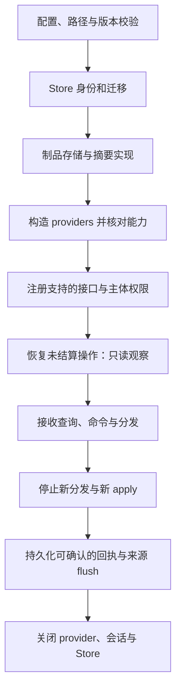
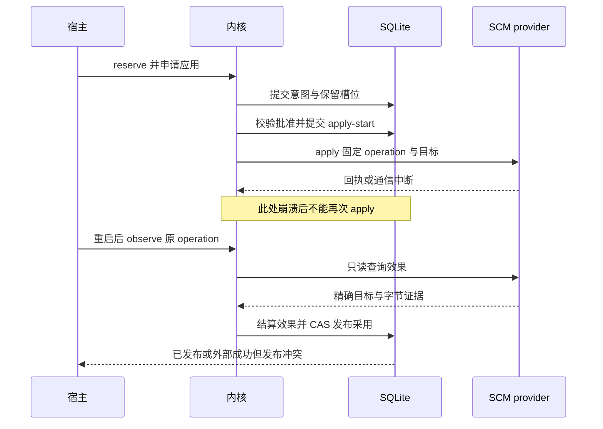

# R1 实施顺序、宿主接入与验收

文档版本：1.0.0；日期：2026-10-12（Asia/Shanghai）。返回[总指南](../reproduction-blueprint.md)。本文为 R1 参考实现规格，未实施、未行为验收；下述场景都是待运行的接受条件，不能登记为本次通过。

## 1. 从空目录开始的技术基线

R1 参考实现使用 Python 3.12+、SQLite、UTF-8 JSON 和内容寻址制品目录；模型 SDK 与 SCM 客户端留在宿主/provider。现有仓库使用 `jsonschema`、`jcs` 与 `packaging`，可复用相应依赖职责；新实现须固定实际依赖版本并留锁文件。本文不要求复刻特定模型供应商，也不依赖前端才能完成最小闭环。

| 部件 | R1 必需能力 | 起步实现 |
| --- | --- | --- |
| 持久库 | 外键、写事务、幂等唯一性、CAS、历史水位 | 每项目一个 SQLite 文件；进程独立连接，显式事务；配置 busy timeout |
| JSON 校验与规范化 | 明确版本、拒绝非法字段/数值、稳定摘要 | JSON Schema 校验后按第一章规则规范化，统一计算摘要 |
| 制品存储 | 临时写入、字节校验、就绪发布、不可变读取 | 项目专属目录；staging 与 ready 分离，禁止路径逃逸 |
| 领域服务 | 纯状态转换和前置条件判断 | 不引入数据库、模型 SDK 或外部 I/O |
| 命令入口 | 可信主体、结构校验、幂等、回执 | 先同进程有类型 API；对外入口另校验 wire 数据 |
| 上下文工厂 | 固定来源、模板、预算和真实模型请求 | 使用固定输入构造器；先以记录式模型替身验收请求内容 |
| 宿主调度 | 会话角色、任务队列、并发额度、取消与恢复 | 一个宿主进程管理多个隔离执行者；队列和映射需可恢复 |
| 执行与检查 | 可声明且可验证的隔离、资源和检查能力 | 合成测试 provider 与真实 provider 使用同一消费接口，各自标 mode |
| 代码管理 | 固定仓库/目标/前置对象、apply 与 observe 分离 | 先本地临时仓库测试，再接测试 remote；真实授权来自可信入口 |
| 人审入口 | 身份绑定、固定提案、确认/拒绝/撤回 | 本地人工 UI 或有认证的接口；不能从模型参数推断人类身份 |

数据库与制品目录必须有明确项目/Store 身份；启动时不因文件同名就绑定。所有资源限额都来自经过验证的配置，时间戳采用 UTC，显示日期可使用宿主时区；业务先后顺序由提交序而非机器时钟决定。

## 2. 建议源码职责树

以下是新实现的职责布局示例，不是当前仓库已有文件列表。扩展现有代码时按原模块所有权映射，不为照搬目录而大规模迁移现有实现。

```text
project_kernel_r1/
  contracts/             R1 数据格式、引用、错误和版本协商
  domain/                基线、分支、验收、人审、采用纯规则
  application/           每个命令的事务与效果编排
  data/
    store/               表、迁移、UoW、回执、历史指针
    queries/             固定水位投影、分页与索引读取
    processing/          评分、度量、skill 分析等数据处理
  context/               材料选择、预算、请求与 manifest
  artifacts/             制品写入、校验与固定 manifest
  interfaces/            可信 machine/human 入口及版本分发
  provider_ports/        执行、检查、SCM、证据接口
  bootstrap.py           显式构造并校验实际能力
host_r1/
  sessions/              模型调用、工具结果与真实请求留存
  scheduling/            分发、并发、等待、取消、恢复
  interaction/           表单暂态、提交、问答投递
  providers/             OS 沙盒、检查器、SCM 适配
tests/
  domain/ store/ context/ orchestration/ providers/ acceptance/
schemas/r1/              打包分发的 R1 JSON Schema 资源
```

每个能力同时有定义、实现者与消费端。不要只定义 `SCMProvider` 然后在验收中假定它已被组合根注入；启动能力清单必须来自实际装配。

## 3. 启动、关闭与能力声明

启动顺序为：校验配置和数据根 → 打开身份及项目库 → 事务化校验/迁移 → 打开制品存储 → 构造 providers → 注册实际可用命令 → 建立可信入口 → 恢复待观察操作 → 接受新分发。恢复未知外部操作时先观察，不能重放 apply。



关闭超时的操作保持 pending/unknown 并留恢复入口，不伪造终态。会话来源 flush 是否完成必须有提供者证明；“已关闭本地连接”不足以证明真实宿主数据已完整归档。

启动能力描述至少包含协议/数据版本、已注册接口、provider 类型与版本、实际 sandbox 级别、支持的 SCM 目标种类、是否具有外部 fencing/幂等、检查类型及限制。R1 不允许将接口已注册与 provider 已就绪混为一个布尔值；调用失败区分未支持入口和缺少所需能力。

## 4. 分阶段建设与完成判据


| 切片 | 要交付的完整能力 | 完成判据 |
| --- | --- | --- |
| S0 | R1 schema、类型、摘要规则、身份模型、错误分类 | JSON 示例可校验；不合法引用/未知必需字段/不兼容版本被拒绝；v1 与 R1 显式区分 |
| S1 | 账本、head/history、幂等、CAS、制品就绪与查询 | 同 key 重放无重复写；冲突不覆盖；中途崩溃不出现已发布却缺字节的包 |
| S2 | 项目/模块基线、context manifest、真实请求记录 | 历史上下文在新提交后仍可恢复；mandatory 缺失或预算不足阻断 |
| S3 | 一分支多 attempt、多方案包、模块验收与公平评分 | 分数绑定精确包；失败留存；修改包产生新版本；高分失败包不可获准 |
| S4 | 两模块并行、范围隔离、表单 CAS、模型问答 | 交互重复投递无重复效果；范围变更不悄然改旧执行；unknown 占用不被释放 |
| S5 | 固定组合候选、集成测试、整理、人类路线 A | 包清单和集成字节固定；伪人类输入拒绝；改包或关键基线后旧确认不可使用 |
| S6 | SCM intent/apply-start/observe/finalize、当前采用 | 外部效果证实后原子发布；超时无重推；发布冲突显示真实已发生效果 |
| S7 | 真实模型、沙盒、真实测试 SCM、关闭/重启恢复 | 用真实 provider 覆盖核心失败场景，记录实际保证与剩余差距 |

每个切片同时实现消费端与负向验收，再进入依赖它的切片。可并行工作不等于跳过顺序依赖，例如 UI 可以用固定 schema 做展示，但不能先宣称已接通不存在的收敛命令。

## 5. 多代理实施分工

首轮由主代理固定 R1 词汇、字段和错误语义，再按下表分发。共同类型的修改由指定所有者提交；其他代理提出修改请求，禁止同一时间各自复制并演化一套引用类型。

| 代理职责 | 可独立修改范围 | 输入与输出 | 汇合前必须核对 |
| --- | --- | --- | --- |
| 数据代理 | store、artifacts、queries | 输入对象规格；输出持久化与读写接口 | 幂等作用域、CAS、摘要、historical as_of、索引维护 |
| 编排代理 | domain、application、host scheduling | 输入已固定数据接口；输出状态与调度闭环 | 外部调用不持写锁、unknown 恢复、并发资源占用 |
| 上下文与数据代理 | context、processing | 输入精确读取接口；输出请求 manifest、评分与分析 | mandatory、全请求预算、实际输入留存、skill 不接执行 |
| 接入与验收代理 | providers、interfaces、acceptance | 输入 provider/权限定义；输出真实接入证据 | 可信人类、真实隔离、SCM 对象映射、重启与 flush |
| 主代理 | schema 所有权、组合根、跨模块审阅与文档 | 汇总独立成果，解决语义冲突 | 全部消费端更新，证据与声明相符 |

代理任务表单至少提供 `task_ref`、规格版本、允许修改范围、禁止改动的冻结材料、依赖接口版本、验收条件、产物清单和待澄清问题。多个模型的审阅共识不能替代路线 A 的人类决定。

## 6. 端到端复现场景

使用独立临时项目与临时 SCM 目标，准备一个有精确字节摘要的 CSV 输入集合。演示项目不可复用生产凭据或正式主库。以下阶段既可用合成 provider 测事务，也需在 S7 用真实宿主重做相应部分。

1. 建立项目身份、Store 和初始项目采用指针（若尚无采用记录，以“不存在”作为 CAS 前置条件）。
2. 宿主保存用户原始目标与已有架构，创建 readiness=clarifying 的初始项目基线 P0；设计模型以固定 P0 构建首个上下文并提出必须澄清的问题，记录回答及其是否已成为确认需求。
3. 发布 readiness=dispatchable 且无阻断问题的项目基线，以及 `module.parser/module.writer` 两个模块基线，固定共享 Record 接口、修改范围与模块/集成验收条件。
4. 构建两份执行 context manifest，留存实际模型请求；分发对应执行对话。
5. 执行 parser-memory、parser-stream 和 writer-batch；各自记录能力、attempt、命令意图、结果、资源与未知项，生成固定方案包。
6. 对两个解析方案在相同数据与资源条件下测试，产生模块 verification 与评分；写入模块独立验收。
7. 收尾比较包并准备 parser-stream + writer-batch；如整理改动代码，重新封包并补模块测试。
8. 形成 integration_candidate，固定组合字节、包清单、构建环境和目标 SCM 前置对象；集成测试产生报告。
9. 形成 adoption_proposal；可信人类查看同一份提案内容，批准或拒绝。拒绝保留事实，不改变当前采用。
10. 对获准提案 reserve → apply-start → SCM apply；观察精确对象与批准内容的对应关系。
11. 外部效果证实后 finalize；原子追加 project_adoption 并更新 current。任何 CAS 冲突保留原指针并进入显式冲突处理。
12. 查询当前采用、历史水位、未选包、失败及评分来源；重建原模型请求；关闭并重启，确认回执重放与恢复不重复执行。

### 必须交付的场景证据

| 证据 | 内容 |
| --- | --- |
| 输入清单 | schema/规格版本、配置、源码与依赖版本、fixture 字节与摘要 |
| 角色输入 | 每个实际模型请求、context manifest、材料引用与预算说明 |
| 过程账本 | 命令、回执、branch/attempt、表单与问答、失败/unknown |
| 方案材料 | 包内容、manifest、测试报告、评分规则与评分依据 |
| 收尾材料 | 组合候选、集成报告、整理差异、人审提案和可信决定 |
| 外部效果 | SCM 身份、期望前置对象、operation、回执/观察和对象字节映射 |
| 采用结果 | 最终 current 指针与精确 adoption revision、未选包留存状态 |
| 恢复结果 | 故障点、重启前后账本、apply 调用次数和仍未确定的事项 |

## 7. 行为接受矩阵

下列 `R1-AC-*` 是未来实现的验收编号，本次全部为 **not_run**。验证每项时记录 mode、provider、输入版本、实际断言及证据路径；不要只写“测试绿了”。

| ID | 场景与操作 | 必须观察到的结果 |
| --- | --- | --- |
| R1-AC-01 | 同主体、同 key、同输入重复命令 | 返回原业务回执；无新增业务 revision、无重复 provider 写入 |
| R1-AC-02 | 同 key 改 payload/预期版本 | 幂等冲突；原回执可读取，原效果不变 |
| R1-AC-03 | 两个写者以同 head 提交 | 仅一个 CAS 成功；另一个明确冲突，不丢失先提交内容 |
| R1-AC-04 | 后续提交后读取旧水位、多页读取期间有新提交 | 不混入新 revision；token 不能跨项目、Store、过滤条件重放 |
| R1-AC-05 | 包字节缺失或被篡改 | 不允许作为可用候选；保留损坏/缺口与引用，不能用当前文件替代 |
| R1-AC-06 | mandatory 材料缺失或总请求超预算 | 组装阻断并指明原因，不静默删验收标准或范围约束 |
| R1-AC-07 | 相同 manifest、材料、组装器与参数重建请求 | 规范化请求相同；不宣称模型输出必然相同 |
| R1-AC-08 | 两模块并行，另一分支尝试写越界路径 | provider 拒绝越界；对应失败留存；独立合法分支能继续 |
| R1-AC-09 | running/unknown root 被新分支请求复用 | 明确拒绝；改对象 ID、租约超时或改 current 不释放实际占用 |
| R1-AC-10 | 同分支提交两种实现 | 两包各有独立摘要与证据；一个被选不删除另一个历史 |
| R1-AC-11 | 必需验收失败的包获得很高模型分 | 仍不能成为可批准采用提案 |
| R1-AC-12 | 两方案测试环境/数据版本不同 | 评分明确不可直接比较或报告缺口，不输出假公平排名 |
| R1-AC-13 | 两表单编辑者提交相同 base revision | 一个提交成功，另一个得到冲突并能读取双方材料 |
| R1-AC-14 | 问答重复投递、回答迟到、取消后回答 | 保留实际事件和时序；不覆盖旧问题，不以送达冒充已阅读 |
| R1-AC-15 | 收尾整理改变候选字节 | 新候选与受影响证据；旧提案/批准不可应用新字节 |
| R1-AC-16 | 模型伪造 human 标识或审批工具参数 | 可信入口拒绝；人工身份不由 payload/role 决定 |
| R1-AC-17 | 人审前后项目决定性基线变化 | apply-start 前再次检查，旧批准不可用；已开始操作按既有生命周期处理 |
| R1-AC-18 | 两个提案同时 reserve 同一项目采用槽位 | 只有一个获得占用；unknown 操作继续阻断新写入 |
| R1-AC-19 | SCM 已写成功但响应丢失 | unknown 后只读观察能结算；apply 不重复调用 |
| R1-AC-20 | observe 网络失败或暂时找不到目标 | 保持 unknown，并在证据中说明暂未观察到目标；不能推断 absent_final |
| R1-AC-21 | 本地 commit 成功但批准目标是 remote 更新 | 不宣称交付完成，须取得批准目标的真实效果证明 |
| R1-AC-22 | Git tree/hash 与包 digest 不同算法或字节规则 | 使用固定映射验证，禁止直接相等比较或复制期望摘要充当证据 |
| R1-AC-23 | 外部效果成功但本地 current CAS 冲突 | 记录外部已成功/本地未发布，禁止自动重写 SCM |
| R1-AC-24 | 错 epoch/错 operation/错目标回执 | 不能结算当前操作；保留拒绝与原证据 |
| R1-AC-25 | 崩溃发生在各持久化/外部调用间隙 | 按下一节恢复，无缺失意图写入、无伪成功、无自动重放未知写 |
| R1-AC-26 | skill 使用错误、环境故障与未知根因 | 记录阶段/证据/原因/影响/修正，未知保持空；不评分用户、不触发重试 |
| R1-AC-27 | 试图把 skill 分数接审批或调度 | 接口/依赖检查拒绝这类消费；方案比较不能借 skill 评价代行 |
| R1-AC-28 | 导出训练候选包含同任务多个尝试 | 同 lineage 不跨 split；未知失败不自动生成负标签；缺审核/授权拒绝导出 |
| R1-AC-29 | wheel 在没有源码树的隔离环境启动 | schema/模板/版本资源可解析；缺资源时测试失败，不能依赖仓库父路径 |
| R1-AC-30 | 真实宿主关闭、flush 失败与重启 | 明确来源完整性缺口，重启可查询/观察；不凭本地退出证明完整 |
| R1-AC-31 | production 采用混入 test 检查或模型自报通过 | 可信 provider 来源与 mode 核验拒绝，制品摘要相同也不放行 |
| R1-AC-32 | 模型调用 started 后崩溃、工具 prepared 后执行但回执丢失 | 原请求、响应片段及实际呈现的工具结果可读取；按 prepared 固定的 command/key 补查，工具不重复执行；模型 provider 无 observe 时保持 unknown |
| R1-AC-33 | 人工仅确认一个检查，其他人工项未审 | attest.acceptance_ids 之外的项目保持未通过，不得扩大人工确认范围 |
| R1-AC-34 | 模块多分支并发写时项目查询与增长后类型索引 | 模块写不阻塞项目查询超过配置锁等待阈值；数据增长后类型索引路径不退化为全表扫描，两行为分开实测并记录 |
| R1-AC-35 | 迁移适配（详见[05 章](05-migration.md) R1-AC-M） | 同快照重放幂等、quarantine 不造值、live 快照 digest 不符即拒、granularity=directory 对人审可见、内核不持有 git 但 local_backup 登记 backup_manifest 并 tree/digest 双向核验（mismatch 保留缺口）、baseline_init 幂等、backup_target 与 git 允许性一致，均 not_run |

## 8. 崩溃点与恢复动作



| 故障点 | 恢复依据 | 允许动作 |
| --- | --- | --- |
| 意图提交前 | 无持久操作、无外部调用 | 同 key 重试命令；不得声称 provider 已执行 |
| 意图后、apply-start 前 | 有准备记录、未开始 | 重新读取批准/基线/槽位，按原操作协议继续或取消 |
| apply-start 后、调用前后无法区分 | 已开始记录，没有确定效果 | 只读 observe 或人工升级；本地时间不能证明未执行 |
| 外部成功、结果尚未入库 | operation 可关联外部证据 | 观察并补结算；不能另建 operation 重做同目标 |
| 结果入库、采用指针未发布 | 真实结果与预期 current 已留存 | finalize 重放或显式冲突处理，不再调用 apply |
| 全部成功、响应丢失 | 持久回执与 adoption current | 读取原回执，返回原结果 |
| 制品暂存后、包未提交 | staging/ready 有字节，账本无包引用 | 作为孤立制品记录，按独立保留政策清理；不自动发布包 |

出现人工升级不会自动把 unknown 变为 false。人类可以决定停止继续工作，但只有足以证明外部执行终结或被可靠 fence 阻断的证据，才能释放会造成重复写入的占用。

## 9. 真实 provider 必须证明的事情

真实执行 provider 需证明工作路径、读写范围、外部资源、进程树和取消行为与能力声明相符；`directory_only` 只能声明目录隔离。未提供网络隔离或资源限额时，配置不得要求并宣称该保证已经满足。

真实检查 provider 需固定候选内容、检查定义、工具版本、输入和输出证据；模型“我测试过”不能当作检查器执行结果。资源用量未知时保留 unknown，不能补零使方案看起来更省。

SCM provider 固定仓库身份、remote、目标 ref、期望前置对象、操作种类与完成判据，处理文件 mode、符号链接、换行/filter、LFS、submodule 与排除规则；支持范围不足时拒绝目标，不能默默忽略文件。具体映射由[SCM 设计](../scm-effect-mapping.md)拥有。

执行、检查和 SCM provider 必须提供错误分类与只读观察能力，查询不足时如实返回 unknown。模型 provider 可以声明不支持观察；断线后该调用保持 unknown，新的调用须显式创建新的 work/context，不能重发已准备或已执行的工具副作用。幂等键、租约、进程句柄和外部 fencing 的作用分别写清；一个 operation_id 不能被声称具有所有这些保证。

## 10. 与现有 kernel_next 的衔接

| R1 职责 | 当前参照入口 | 扩展时需补的部分 |
| --- | --- | --- |
| 事务与账本 | [store](../../../src/project_kernel/data/store/store.py)、[uow](../../../src/project_kernel/data/store/uow.py)、[records](../../../src/project_kernel/data/store/records.py) | 新对象/索引的同事务维护，性能查询与新版本资源 |
| 基线与派发 | [design](../../../src/project_kernel/application/design/service.py) | 项目/模块架构需求、分发批次与显式分支关联 |
| 执行 | [attempt](../../../src/project_kernel/application/attempt/service.py) | 分支范围、真实宿主会话与包的关联 |
| 验收/审批/效果 | [delivery](../../../src/project_kernel/application/delivery/service.py) | 模块/组合候选、路线 A 采用提案、SCM 目标及采用结算 |
| 查询 | [queries](../../../src/project_kernel/data/queries/service.py) | 新类型投影、历史查询限制修复、避免全量 attempt 扫描 |
| 制品与归档 | [archive](../../../src/project_kernel/evidence/archive.py) | 包内容与报告引用分离、固定组合候选 |
| 上下文 | [resolver](../../../src/project_kernel/knowledge/resolver.py) | 完整真实请求预算与留存，不只材料摘要 |
| 装配 | [bootstrap](../../../src/project_kernel/bootstrap.py) | 新版本入口、真实 provider、可信身份与能力声明 |

现有 `contracts/v1` 与既有验收证据保持冻结。若沿用现有仓库开发，新增 R1 schema 放在独立版本命名空间，通过显式适配器映射旧类型；不能以 `revision_id` 能转成整数为前提，也不能把 R1 的 `sha256:` 前缀直接传给只接受十六进制 digest 的 v1 字段。跨版本转换失败应明确拒绝。

新的 schema、模板等运行资源必须随发行物安装，用包资源 API 定位；不要延续当前仓库相对 `contracts/v1` 路径的部署限制。构建 wheel 的隔离安装测试属于真正实施阶段的必要验收，本次没有构建。

## 11. 最终交付判定

文档可复现需要对象、命令、状态、事务、效果、上下文、验收之间没有互相冲突的解释。运行可复现则还需要源码、固定依赖、可执行 fixture 和实际测试证据。生产适用进一步需要真实宿主/权限/provider 的验收，三种声明分别记录。

R1 完工报告须列出：实现的切片及版本；真实支持能力；实际运行过的 R1-AC 条目和证据；合成与真实执行的区别；故障恢复演示；未支持配置；未解决的性能或安全约束。所有未运行项保持 not_run，不能继承当前 G2 的历史 accepted 状态。
