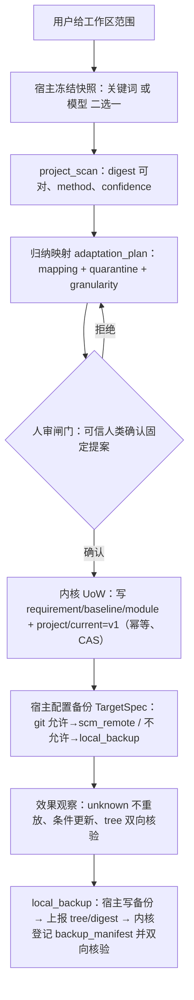
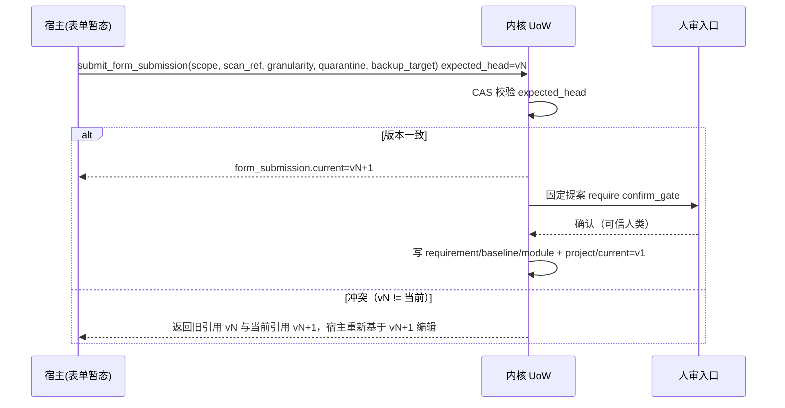

# R1 迁移适配接口规格（05）

文档版本：1.0.0；日期：2026-10-13（Asia/Shanghai）。返回[总指南](../reproduction-blueprint.md)。本文为 R1 参考实现规格，未实施、未行为验收；下述场景都是待运行的接受条件，不能登记为本次通过。与 [01 数据与事务](01-data-and-transactions.md)、[02 执行编排](02-orchestration.md)、[04 实施与验收](04-build-and-acceptance.md) 同构。

## 0. 定位与不变式

本章定义"把其他进行中项目适配进内核执行流"的接口族。它区分三种动作：

- **扫描/匹配 = 宿主侧**：冻结范围字节，产出不可变快照；
- **归纳映射 = 模型辅助 + 人审闸门**：机器产候选映射，可信人类确认固定提案后才落业务对象；
- **版本初始 + 备份目标 = 内核侧**：走既有 UoW 幂等/CAS，内核只声明目标与观察效果，**绝不代跑 git 或备份命令**。

必须守住的不变式：事实不可覆盖（revision 追加）、读取可定位（digest 对可复算字节）、权限只来自可信人类入口、一命令一持久语义（幂等键重放）、CAS 带前置版本、外部意图先于外部动作、未知不重放。

## 1. 迁移适配命令族

命名 `migration.adapt`，区别于既有 `legacy.import`（记录型：导入历史事实到 revision 账本）。`migration.adapt` 是**适配型**：把进行中项目的工作面/架构/文档挂进执行流，而非只记历史。

命令 payload（闭集）：

| 字段 | 类型 | 说明 |
| --- | --- | --- |
| `target_ref` | ObjectRef | 源项目不可变扫描快照（store_id/revision/digest 齐全） |
| `scan_ref` | ObjectRef | 架构归纳快照 `project_scan` |
| `adaptation_plan_ref` | ObjectRef | 映射计划 `adaptation_plan` |
| `mode` | enum | `record`（历史事实）/ `live`（进行中工作面，依赖冻结快照） |
| `trust_producer` | string | 可信扫描方 principal；不在 trusted 名单即拒 |

行为纪律：

- `live` 模式要求源项目先由 provider 导出**可复算冻结字节快照**，内核只认快照 digest，不认实时目录；digest 对不上即拒绝（R1-AC-M03）。
- `record` 模式复用 `migration/legacy` 的幂等导入 90%（source_digest 去重、quarantine 隔离）。
- 同快照重放不加 revision、不加 audit、不加 commit（幂等）。
- 映射推进用 head CAS（带前置版本）。

## 2. 两级回退，产出同一对象

"用没用模型"只是快照的 `method` 字段差异，下游归纳契约不变：

| 路径 | 方法 | 产出 | confidence 基线 |
| --- | --- | --- | --- |
| 无模型：规则/关键词匹配 | `method=keyword` | `project_scan` | 低 |
| 有模型：架构分析 | `method=model` | 同 schema 的 `project_scan` | 按模型声明 |

`project_scan` 字段闭集（不可变）：

| 字段 | 说明 |
| --- | --- |
| `scan_id` / `source_store_id` / `workspace_scope` | 身份与范围（范围路径，提交时锁定） |
| `method` | `keyword` / `model` |
| `model_spec` | 模型路径时引用的 ModelSpec；keyword 路径为 null |
| `confidence` | 0..1，标注该扫描的归纳可信度基线 |
| `module_candidates` | 候选模块节点（L1），每项含 `name`/`path`/`granularity` |
| `requirement_candidates` | 候选需求映射（能分析到就填，分析不了为空） |
| `dataflow_candidates` | 候选数据流关联（同上） |
| `unmapped_items` | 无法映射项清单（进 quarantine） |
| `snapshot_digest` | 冻结字节的 sha256: digest，可对 |

## 3. 粒度降级与显式标注

- 能分析到需求/数据流：映射到 `requirement` / `baseline` 层级。
- 分析不了：按目录树映射为模块节点（L1），**不硬造语义**。
- 降级映射在 `adaptation_plan` 显式标 `granularity=directory`，人审时一眼看出"这个模块只是文件夹，不是真归纳出的需求"（R1-AC-M04）。

`adaptation_plan` 字段闭集（不可变）：

| 字段 | 说明 |
| --- | --- |
| `plan_id` / `scan_ref` / `target_ref` | 引用固定 |
| `mapping_entries` | 每项 `{source_key, source_digest, classification, target_object, granularity}` |
| `granularity` | 整体粒度 `requirement` / `dataflow` / `directory` |
| `quarantine_items` | 无法映射项，**不得造默认值**，人工勾选"忽略/补映射"（R1-AC-M02） |
| `baseline_init` | 初始版本=1，幂等可重放（R1-AC-M05） |

## 4. 备份目标与版本初始（内核不代跑 git）

`migration.adapt` 在 UoW 内写 `project/current` 指针 = 初始版本 v1（幂等）。内核**从不持有 git 仓库、不执行 `git init/commit`**，只声明目标与观察效果（R1-AC-M06）。本地备份由用户选择形态 **B**：内核登记不可变 `backup_manifest`，对本地备份做 tree/digest 双向核验；内核仍不读备份文件字节做业务写入，只把备份完整性事实存进账本。

| `backup_target` 取值 | 条件 | 内核记录 |
| --- | --- | --- |
| `scm_remote` | 允许 git | `TargetSpec(effect_kind=scm_remote)`，宿主配置 SCM provider |
| `local_backup` | 不允许 git 时的本地备份 | `TargetSpec(effect_kind=local_backup)` + 不可变 `backup_manifest`，宿主配置本地备份 provider |
| `none` | 不备份 | 无 TargetSpec |

不允许 git 时，表单 `backup_target` 强制为 `local_backup` 或 `none`（R1-AC-M07）。所有 TargetSpec 走 [04 章 S6](04-build-and-acceptance.md) 效果映射纪律：外部意图先持久化、unknown 不重放、远端 ref 条件更新、tree 与包 digest 双向映射。

`TargetSpec` 字段闭集（不可变声明 + 可变观察水位）：

| 字段 | 说明 |
| --- | --- |
| `target_id` / `project_id` / `effect_kind` | 身份与效果类别 |
| `declared_ref` | 声明的外部目标（远端 ref / 本地备份目录标识） |
| `observed_revision` / `observe_state` | 外部效果观察水位；unknown 不重放 |
| `package_digest` | 与方案包 digest 双向映射，tree 核验 |

`backup_manifest` 字段闭集（不可变；local_backup 形态专有）：

| 字段 | 说明 |
| --- | --- |
| `manifest_id` / `target_spec_ref` / `baseline_ref` | 绑定到具体 TargetSpec 与项目基线 |
| `entry_tree` | 本地备份条目清单，每项 `{path, mode, digest}`，digest 为 `sha256:` 前缀 |
| `tree_digest` | 对 `entry_tree` 规范化（JCS）后的摘要，与宿主侧备份 tree 双向核验 |
| `verified_at` / `verify_state` | 内核观察到的备份完整性状态；`verified/mismatch/unknown`，mismatch 不得当作已备份 |

纪律：`backup_manifest` 记录“内核观察到的备份完整性事实”，不是备份执行者——实际写备份文件仍由宿主 provider 完成；kernel 只把 host 上报的 tree/digest 与期望树比对并登记。`verify_state=mismatch` 时保留缺口，不自动补写、不把未核验备份当作成功（R1-AC-M06、R1-AC-M09）。

## 5. 导入表单（宿主暂态 → 提交 CAS）

遵循 [02 章第 10 节](02-orchestration.md) 表单纪律：编辑暂态归宿主，提交才成 `form_submission.current` 版本；并发 CAS 冲突返回旧/当前双方引用。

| 字段 | 归属 | 说明 |
| --- | --- | --- |
| `workspace_scope` | 表单（宿主暂态） | 范围路径；提交时锁定 |
| `scan_method` | 表单 | `keyword` / `model`；决定 confidence 基线 |
| `scan_ref` | 提交（内核对象） | 冻结快照 digest；重放校验 |
| `mapping_granularity` | 表单 | `requirement` / `dataflow` / `directory`（降级显式） |
| `quarantine_review` | 表单 | 无法映射项，人工勾选"忽略/补映射" |
| `baseline_init` | 提交（内核） | 初始版本=1，幂等 |
| `backup_target` | 表单（宿主） | `scm_remote` / `local_backup` / `none`；不允许 git 强制后两者 |
| `confirm_gate` | 人审 | 固定提案确认后落 requirement/baseline/module |

## 6. 导入流程

人审闸门是**唯一不可省环节**：自主分析再快，"把源项目映射成内核模块/需求"是业务语义决策，必须可信人类确认固定提案（路线 A）。

## 7. 表单提交 CAS 时序

## 8. 验收条件（R1-AC-M，全部 not_run）

| 编号 | 场景 | 预期 | 状态 |
| --- | --- | --- | --- |
| R1-AC-M01 | 同快照重放 `migration.adapt` | 不加 revision/audit/commit，幂等返回原回执 | not_run |
| R1-AC-M02 | adaptation_plan 含无法映射项 | quarantine 项保留清单，不得造默认值 | not_run |
| R1-AC-M03 | live 模式快照 digest 对不上冻结字节 | 拒绝，不落任何对象 | not_run |
| R1-AC-M04 | 降级映射 `granularity=directory` | 人审界面显式可见"仅为目录" | not_run |
| R1-AC-M05 | baseline_init 幂等重放 | project/current=v1 不重复推进 | not_run |
| R1-AC-M06 | 内核尝试代跑 git/备份 | 不存在该路径；TargetSpec 只声明+观察，本地备份写文件仍由宿主完成 | not_run |
| R1-AC-M07 | 不允许 git 时表单 backup_target=scm_remote | 表单校验拒绝，强制 local_backup/none | not_run |
| R1-AC-M08 | 关键词与模型两路产出的 project_scan | 同 schema，下游归纳契约不变 | not_run |
| R1-AC-M09 | 本地备份 tree/digest 与期望不符 | backup_manifest.verify_state=mismatch，保留缺口，不自动补写、不宣称已备份 | not_run |

## 9. 与 01/02/04 章的衔接

- **01 章**：需增补 `project_scan`、`doc_digest`、`adaptation_plan`、`TargetSpec`、`backup_manifest` 入对象闭集与 DDL；前四者均为不可变 revision，`TargetSpec.observed_revision/observe_state` 为运行协调列（可变，需明确白名单）；`backup_manifest` 不可变，仅 `verify_state` 为观察水位列。
- **02 章第 10 节**：需加导入表单（§5 字段）与提交 CAS 时序（§7）。
- **04 章 S6/S7**：需加迁移验收（§8 全部 R1-AC-M）；S6 补 TargetSpec 效果映射的备份/SCM 双目标形态。

## 修订记录

| 版本 | 日期 | 内容 |
| --- | --- | --- |
| 1.0.0 | 2026-10-13 | 建立迁移适配接口规格 |
| 1.1.0 | 2026-10-13 | 按用户裁决：本地备份取形态 B，内核登记不可变 backup_manifest + tree/digest 双向核验；新增 R1-AC-M09；01 章衔接增 backup_manifest |
