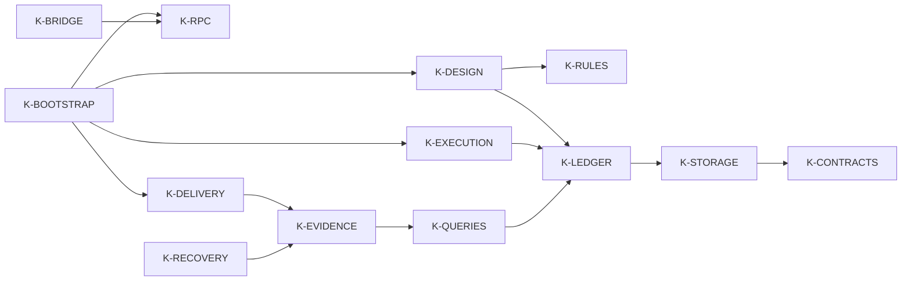

# 内核模块树

按你要了解的能力选一个节点，再进入它的源码、需求、验收和变更记录。23个节点分为核心用例、项目数据和可选能力三组；下表的“查找主题”帮助定位具体问题，完整需求和验收字段保留在节点详情。

## 导航树

```text
K-ROOT 独立内核
  K-CORE 核心用例与调用接口
    K-BOOTSTRAP 显式组合根
    K-CONTRACTS 冻结协议、类型与摘要
    K-RPC 可信调用与来源入口
    K-BRIDGE Node 协议客户端
    K-DESIGN 需求、方案与派发
    K-RULES 声明式约束
    K-ENVIRONMENT 环境事实
    K-EXECUTION 执行尝试与取消
    K-DELIVERY 验收、审批、交付与收尾
  K-DATA 项目事实与数据
    K-STORAGE 项目 SQLite 存储
    K-LEDGER 不可变账本与命令事务
    K-IDENTITY 项目身份与绑定
    K-EVIDENCE 制品、来源与归档
    K-RECOVERY 备份与受控恢复
    K-QUERIES 水位查询与追溯
  K-EXTENSIONS 可选能力与记录工作流
    K-LEGACY test-only 旧数据迁移
    K-KNOWLEDGE 可选上下文与知识 library
    K-CORPUS 默认关闭的语料能力
    K-RECORDS 持续总结与学习记录
```

## 节点入口

| ID 与详情 | 本节点负责什么 | 查找主题 |
| --- | --- | --- |
| [K-ROOT](nodes/root.md) | 总体范围、三组导航和发布限制 | 项目覆盖什么，哪些阶段尚未开放 |
| [K-CORE](nodes/core.md) | 用例和调用接口分组 | 从需求到交付的主要能力 |
| [K-BOOTSTRAP](nodes/bootstrap.md) | 显式服务/provider 装配，独立 machine/human/identity 入口 | 宿主需要提供哪些依赖 |
| [K-CONTRACTS](nodes/contracts.md) | Schema、DTO、枚举、JCS/digest、冻结 ports | 协议版本、数据格式与精确摘要 |
| [K-RPC](nodes/rpc.md) | 分帧、协议路由、可信句柄、来源入口 | 调用身份、RPC 错误与已知解析问题 |
| [K-BRIDGE](nodes/bridge.md) | Node 分帧、请求匹配、超时与原 key 补查 | Node 如何调用，超时后如何查询 |
| [K-DESIGN](nodes/design.md) | task、需求/方案草稿确认、冻结 packet | 如何保存需求、确认方案与准备派发 |
| [K-RULES](nodes/rules.md) | data rules、preview、publish、未知事实 | 如何预览和发布项目附加规则 |
| [K-ENVIRONMENT](nodes/environment.md) | 实测环境报告及明确未知/缺失 | 环境信息是否完整、可信 |
| [K-EXECUTION](nodes/execution.md) | attempt 意图、root、provider、结算和取消 | 执行目录、尝试状态、取消与未知结果 |
| [K-DELIVERY](nodes/delivery.md) | 验收、选择、快照、审批、交付效果及收尾 | 候选如何通过验收、获批并交付 |
| [K-DATA](nodes/data.md) | 事实/数据分组 | 项目事实如何保存和追溯 |
| [K-STORAGE](nodes/storage.md) | 打开/迁移/身份/关闭与协作维护租约 | SQLite 生命周期与维护期间的写入限制 |
| [K-LEDGER](nodes/records.md) | revision、head、CAS、audit/outbox/receipt、UoW | 业务版本、幂等回执与原子提交 |
| [K-IDENTITY](nodes/identity.md) | provision/reconcile、绑定及授权范围 | 项目身份创建、绑定与隔离 |
| [K-EVIDENCE](nodes/evidence.md) | 制品字节、来源完整性、manifest/sink/repair | 输出是否真实，归档缺口如何处理 |
| [K-RECOVERY](nodes/recovery.md) | 一致备份、隔离恢复、test 离线替换 | 备份与受控恢复的适用范围 |
| [K-QUERIES](nodes/queries.md) | as_of、coverage、overview、trace、重建 | 按历史水位查询、查看总览与追溯 |
| [K-EXTENSIONS](nodes/extensions.md) | 可选和文档能力分组 | 哪些扩展可用，哪些仍需单独接受 |
| [K-LEGACY](nodes/legacy.md) | 可信不可变 snapshot 的 test 导入 | 如何处理 test 范围的旧数据 |
| [K-KNOWLEDGE](nodes/knowledge.md) | 上下文预算与可选知识反馈 API | 知识库能力与尚未接入 RPC 的限制 |
| [K-CORPUS](nodes/corpus.md) | 可选样本、审核、导出观察和清理计划 | 默认关闭的语料功能及导出授权 |
| [K-RECORDS](nodes/continuous-records.md) | 任务/项目总结、术语/错误、学习画像和 skill | 找项目进展、学习资料与技能成长方法 |

验收状态请进入节点详情和[原条件裁决](../acceptance/G2-round4/checks.json)核对，导航分组不代表整个模块都已通过。独立核心的历史 G2 为 `accepted_g2`，当前 `release_approved=false`；各可选能力的开放限制见[内核现状](../architecture/current-state.md)。

## 依赖关系



箭头表示部分运行依赖。例如执行使用账本保存事实，账本依赖存储；导航树中的父子关系只帮助查找。完整的 `depends_on` / `related_to` 在节点正文和[结构化索引](registry.json)，关系含义见[关系规则](relationships.md)。K-RECORDS 是文档工作流，不是运行服务。

## 继续阅读

围绕一个模块深入时，可按[上下文选取流程](context-selection.md)挑选资料。节点详情保留源码及文档版本、更新时间、需求、验收、限制和变更；没有关联可以为空，一个文件、需求或验收可以关联多个模块。当前没有独立前端或对话映射。

[持续记录](../records/README.md)提供项目与任务总结；[技能成长](../architecture/skill-growth.md)说明如何把工作经验改进为可复用方法。维护节点的具体步骤由[项目 skill](../../.agents/skills/kernel-maintain-records/SKILL.md)拥有，文档不会在后台自动更新。

[内核设计、问题治理与无界面接入计划](../architecture/kernel-design-and-growth.md)集中说明完整设计闭环、模型输出垃圾治理、低耦合/可成长边界和 headless agent 接入分期。它是设计与维护基线，不替代节点的实际实现状态或历史验收。

## 版本与来源

模块目录版本：1.5.0；更新时间：2026-10-15（Asia/Shanghai，日期精度）。本次设计补充参照源码：项目1.0.0、`16410c9fbf4a8507445b4603e371e701614e4499`；RPC 修复和维护的主分支同步事实由 RPC 任务记录拥有。节点各自保留其检查源码版本，未修改源码判断的节点仍可引用原基准；本次只新增设计与维护导航。

模块文档的原要求与建立结果见[持续记录需求](../requirements/2026-10-10-continuous-records.md)和[原维护任务](../records/tasks/2026-10-10-kernel-maintenance.md)；当前阅读与布局改进见[新需求](../requirements/2026-10-10-clean-layout-and-skill-growth.md)和[任务记录](../records/tasks/2026-10-10-layout-and-skill-growth.md)。

当前协议修复和主分支交付见[RPC 需求](../requirements/2026-10-10-rpc-resilience.md)及[RPC 任务](../records/tasks/2026-10-10-rpc-resilience.md)，更新记录不新增历史 G2 接受。

## 消费与接入设计补充

[消费者一致性](../architecture/consumer-consistency.md)由 K-QUERIES/K-KNOWLEDGE 拥有，[SCM 效果映射](../architecture/scm-effect-mapping.md)归 K-DELIVERY，[训练数据职责](../architecture/training-data-boundary.md)归 K-CORPUS。[skill 评分与失败总结](../architecture/skill-growth.md#数据处理接口与评分范围)保留在数据处理文档工作流，通过 K-DATA/K-RECORDS 导航；不改变现有 23 节点或执行依赖。

## 从零实现完整目标流程

[R1 总指南](../architecture/reproduction-blueprint.md)组织可供模型独立阅读的详细规格：[数据与事务](../architecture/reproduction/01-data-and-transactions.md)、[执行编排](../architecture/reproduction/02-orchestration.md)、[上下文与评分](../architecture/reproduction/03-context-and-evaluation.md)、[实施与验收](../architecture/reproduction/04-build-and-acceptance.md)。它们给出字段、伪代码、架构图和故障场景；规格建立时新增能力尚未实现；后续独立 R1 S0–S7 切片见任务记录，8 项真实宿主验收仍 not_run，本次发布不包含该参考代码。已有 v1 能力继续由各节点及内核现状定义。
