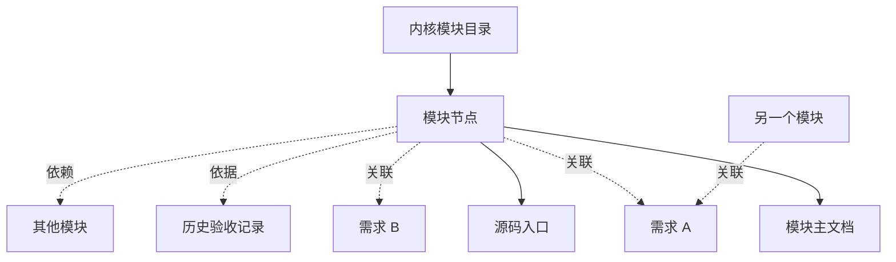

# 模块树、关系图、规则与技能

这份资料用当前项目说明模块树与关系图如何帮助查找资料，以及项目规则和 skill 分别能做什么。阅读不需要先掌握图论，可按下面的问题选读；示例不代表用户的知识熟悉程度。

| 想弄清什么 | 阅读位置 |
| --- | --- |
| 模块节点有什么用 | [先认识模块节点](#先认识模块节点) |
| 为什么树之外还需要关系图 | [树负责导航，图表达关系](#树负责导航图表达关系) |
| 文档日期是否表示重新验收 | [版本与更新时间回答不同问题](#版本与更新时间回答不同问题) |
| 项目规则能否越过审批 | [项目规则与核心权限](#项目规则与核心权限) |
| 技能如何随经验改进 | [Skill 与记录各自保存什么](#skill-与记录各自保存什么) |

## 先认识模块节点

模块节点表示一项清晰职责，并拥有稳定 ID、版本、更新时间、源码入口、关联需求和验收。节点不是文件夹的别名；例如持续记录节点 [K-RECORDS](../../modules/nodes/continuous-records.md)关联多个 Markdown 文件，运行交付模块也可能关联业务服务和 provider 文件。实际关系以[模块目录](../../modules/README.md)为准。

从节点阅读上下文时，先理解职责和状态，再读当前需求及必要源码。要核对“通过了吗”，进入验收主记录；要理解“为什么报错”，进入问题记录。这样可以按任务选取材料，不必每次读取整个仓库。

## 树负责导航，图表达关系

树是一条主要入口到子职责的导航路径，每个节点可以有一个主要导航父节点。图允许任意两个节点按明确含义连接，例如“依赖”“引用需求”“由证据支持”。同一节点即使只有一个导航位置，也可以有多个依赖或证据链接。

图中实线是阅读入口示意，虚线是有名称的关联；它展示关系含义，不是完整源码依赖图。需求 A 可由多个模块共同满足，一个模块也可承担需求 A 和 B，这就是多对多。尚无验收、源码或对话对应时，关联可以为空并说明原因；当前没有对话映射。

## 版本与更新时间回答不同问题

记录版本回答“这份记录修订了几次”，更新时间回答“最近何时维护”，源码提交回答“结论依据哪一份实现”。业务 revision 和 Schema 版本又属于运行数据和协议。四者不能互相替代；文档今天更新，不表示源码今天发生改变，更不表示今天重新验收。

例如原 [G2 报告](../../acceptance/G2-round4-report.md)拥有历史接受范围；今天新增的项目摘要引用它，只能说明该范围曾获接受。当前发现的 RPC 问题引用今天的静态审查，不会自动成为原报告的新条件。

## 区分事实、推断和建议

| 类型 | 项目例子 | 合适记录方式 |
| --- | --- | --- |
| 已确认事实 | 用户明确要求画像不要评分；历史 G2 为 accepted_g2 | 标出来源、日期或原验收链接 |
| 静态判断 | JSON 解析路径未捕获 RecursionError | 标出源码版本和静态发现，不称为新运行故障 |
| 未确认推断 | 从用户询问模块树推测其图知识水平 | 不进入当前画像；确有需要时明确标“未确认” |
| 建议 | 使用节点入口选取任务上下文 | 写适用条件，不当作现有 RPC 或自动服务 |

用户会继续学习，画像描述也会改变。“正在学习”和“需要例子”都可以是用户确认后的描述；它们不是能力分数，也不决定用户能否执行某操作。具体记录见[用户学习画像](../user-learning-profile.md)。

## 项目规则与核心权限

可插拔规则可以表达项目附加限制，例如“缺少某类环境事实时要求人工确认”。规则应给出版本、使用条件和解释，缺失事实不应被默认为满足条件。当前领域规则的 `deny`、`require_human`、`warn` 是限制或提示，没有允许覆盖核心拒绝的效果；实际实现参见 [domain/design/rules.py](../../../src/project_kernel/domain/design/rules.py)。

核心项目隔离、可信人审、证据真实性和外部效果规则由内核负责。项目规则不能用“allow”跳过它们，也不能把文字画像变成审批身份。插件规则的可配置性与核心约束是否可关闭是不同问题。

## Skill 与记录各自保存什么

skill 保存可复用的工作方法。例如，维护摘要时需要理解读者要找什么、找到拥有该事实的主文档，再决定摘要需要保留哪些结论和链接。任务记录保存一次工作的目标与结果，项目摘要提供当前入口，用户画像保存可纠正的描述。

同一方法在不同任务中的效果可能不同。若一份文档准确但难找，可以改进它的导航；若例子容易让读者误解，可以补充适用条件。保留有用经验、修正不适用的部分，才能让技能随项目成长；字段和模板只是辅助，不能替代判断。

技能可以依据实际效果评价或评分，评价对象是方法，用户画像仍不评分。详细方法见[技能成长](../../architecture/skill-growth.md)。当前项目 skill 由 Codex 工作流应用，尚无内核运行服务、自动维护或对话同步。

遇到不熟悉的术语，可继续读[术语与错误资料](../terms-and-errors.md)及其源码/审查链接；需要更多示例时维护学习材料，不从提问反推能力。

## 修订记录

| 记录版本 | 更新时间 | 内容 |
| --- | --- | --- |
| 1 | 2026-10-10 | 建立树与图、关系、来源和规则的项目学习资料，无用户能力判断 |
| 2 | 2026-10-10 | 增加按问题阅读的入口与成长式技能说明，区分技能评价和用户画像 |
