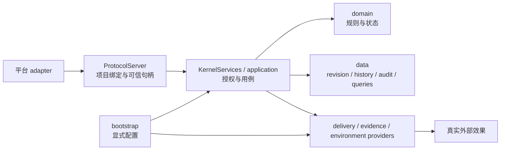
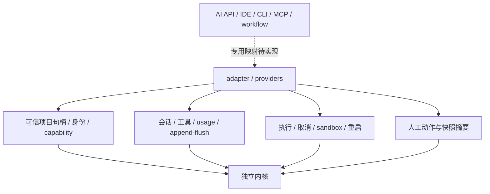
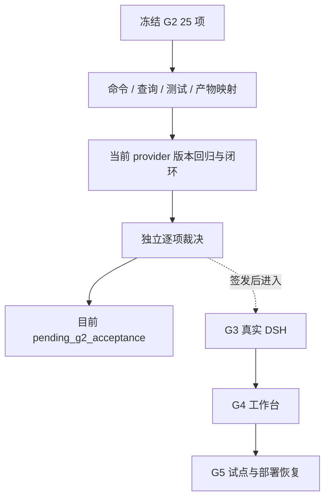

# 内核平台适配与 G2 评估

日期：2026-10-09（Asia/Shanghai）。范围：独立项目 `D:/deepseekhannes/kernel_next` 的当前代码、现有验收资料，以及只读的冻结设计 `D:/deepseekhannes/kernel/design-v1-20261008/07-验收与迁移发布.md` 和 `acceptance-matrix.json`。本评估不修改冻结文件，也不把历史测试结果作为当前实现的通过证据。

## 结论与阶段口径

内核可以作为独立项目保留。它提供项目作用域、不可变版本、幂等回执、可信人工入口、审批摘要和未知效果语义，外部执行及交付通过 provider 接入。准确表述是“具有可适配不同 AI 平台的事实模型、端口和协议基础”；当前没有完成所有平台兼容，也没有任何真实平台的端到端验收证明。

G2 保持 `pending_g2_acceptance`。交付 provider 的组合根装配、观察失败与不重复副作用回归已完成；当前源码通过 555 项不重复 Python 测试及 14 项 Node 协议测试。冻结 AC12–32、AC37–38、AC43、AC45 已关联当前实际用例，仍须逐项确认条件与公开入口产物是否充分并记录独立裁决。第二轮结果只对应第二轮快照。

冻结 G2 的 AC43 明确要求 test 模式、隔离项目 A/B、真实临时 subprocess、失败修复与重验、人工测试身份批准、真实 bundle、归档与总览。因此 test 身份和 `directory_only` 执行器可以成为该范围的证据，但不能升级为生产身份或操作系统沙盒保证。真实 DSH、工作台和生产恢复没有完成，不能直接作为 G2 阻断理由。

| 阶段 | 冻结范围 | 当前判断 |
| --- | --- | --- |
| G2 | P02–P07/P10 核心集成；AC12–32、AC37–38、AC43、AC45；P13 报告 | 当前用例映射已落盘，逐项证据充分性与独立裁决待完成，保持 pending |
| G2-K | P08/P09；AC33–36 | 可选知识/语料单独验收；语料默认关闭 |
| G3 | P11；AC39–40；真实 DSH 配置及命令回执 | 后续独立适配项目，未执行真实宿主验收 |
| G4 | P12；AC41–42；真实浏览器走查 | 后续工作台，未执行 |
| G5 / 部署恢复 | AC44 真实试点、能力启停与重启；生产维护流程 | 后续按明确部署目标验收；当前受控恢复仅 test stores |

## 当前实现与 Provider

[`bootstrap.py`](../../../src/project_kernel/bootstrap.py) 直接装配 machine/human ProtocolServer 与 KernelServices，没有动态 provider registry。冻结 [`ports/ports.py`](../../../src/project_kernel/ports/ports.py) 是服务接口声明；当前应用使用的效果接口另位于 [`provider_ports.py`](../../../src/project_kernel/internal/provider_ports.py) 和 [`delivery_provider_ports.py`](../../../src/project_kernel/internal/delivery_provider_ports.py)，不能把两套接口当作同一个已实现接口。

[`DeliveryService`](../../../src/project_kernel/application/delivery/service.py) 处理授权、固定目标、快照、claim、epoch、事务和效果结算；[`BundleDeliveryProvider`](../../../src/project_kernel/evidence/delivery_provider.py) 承担文件写入、目标定位和字节校验。组合根支持显式 `delivery_provider=`，或通过 `bundle_exporter=` 创建文件 provider；二者同时配置是错误，缺失 provider 返回能力不可用。应用层仍有直接 Store/SQL 访问，本轮外部效果拆分不等于所有数据访问已迁出应用层。

交付 `apply()` 和效果 `observe()` 分离。无法确认观察结果时保持 `unknown`，原 command receipt 和已有 sink receipt 不丢弃；重放、查询和 reconcile 不重复写入目标。成功证据必须匹配操作身份和固定清单摘要，最终无效果必须有终态或合法 fence 证据。自定义交付 provider 不自动拥有归档、备份或恢复能力；这些配置和证据独立保留。

## 平台适配矩阵

| 平台 | 可复用的内核能力 | 需要宿主提供及验收 | 当前证据与表述 |
| --- | --- | --- | --- |
| DeepSeek / OpenAI-compatible | 项目作用域、attempt、来源事实、审批、回执和查询 | 请求/tool call、流式事件、模型身份、usage、取消、重连、工具结果 | 无真实 API 调用；可适配 |
| Anthropic | 同上 | content blocks、tool_use_id、停止/取消、usage、身份与安全事件 | 无真实 provider；可适配 |
| Gemini / Vertex | 同上 | parts/function calling、candidate、区域凭据、异步任务与取消 | 无真实 provider；可适配 |
| CLI / DSH | 执行、来源、环境、制品、交付端口及人审入口 | Session/Jobs、append/flush、真实工具生命周期、沙盒、身份、人审回调、重启对账 | G3 未执行；适配基础已具备 |
| IDE / Copilot / Claude Code | 项目绑定、审批队列、timeline、回执 | 编辑器或 CLI 会话、可信登录身份、workspace 映射、diff、交互证明、权限和取消 | 无扩展或宿主走查；可适配 |
| Workflow | operation、receipt、outbox、审批与对账 | worker 身份、节点重试/超时、租约、外部连接器及效果查询 | 无真实 connector；可适配 |
| MCP | 可复用项目授权与调用服务 | initialize、tools/list-call、schema 映射、progress/cancel、session、客户端人审 | 当前是自有 stdio JSON-RPC；没有 MCP adapter |

模型 API 不能天然提供可信人类批准、项目绑定、artifact digest 或主机 flush。适配器应记录实际身份、来源和结果，不把模型文字或工具调用视作批准或完成。每个宿主必须独立验证会话、工具事件、取消、沙盒、身份和人审回调；不能从协议共性推导“兼容所有平台”。

## G2 证据与裁决

[逐项证据映射](g2-evidence-map.md)列出 25 项冻结 G2 标准的公开命令/查询、现有测试和范围限制。`docs/acceptance/G2/checks.json` 是历史模块映射，第二轮 `checks.json` 是整改复核记录；它们不是 provider 拆分后的当前签字。第三轮的[状态](../../../docs/acceptance/G2-round3/status.json)、[命令](../../../docs/acceptance/G2-round3/commands.md)、[检查表](../../../docs/acceptance/G2-round3/checks.json)、[摘要清单](../../../docs/acceptance/G2-round3/artifact-manifest.json)与[校验结果](../../../docs/acceptance/G2-round3/verification-result.json)已落盘。

组合根证明必须使用合法 payload、可核查业务结果，或与部署配置一致的能力不可用；空 payload 的 schema 拒绝只证明校验，不能证明业务接线。纯规则和 service 测试也不能自动替代 RPC 证据。AC29 需要一致备份、恢复 fence 和历史保留证据；AC43 需要完整 test 核心闭环；AC45 需要显式临时根与归档隔离。所有结论均以本轮实际执行结果为准。

本评估是代码和证据索引审查，没有执行新的平台验收。测试命令、退出码、JUnit/Node 原始输出及数量由[第三轮报告](../../../docs/acceptance/G2-round3-report.md)登记；不能引用本评估作为付费模型、真实 DSH、前端或生产恢复的证据。

## 项目与后续规划

独立内核仓库保存 Python 核心、冻结 contracts、协议桥、test fixtures 与验收资料。DSH 兼容层和工作台在另一项目维护，通过版本化协议、schema bundle digest 与适配矩阵交付。仓库快照提交与 GitHub 同步属于交付操作，不表示内核已经实现 Git provider。

目标用户知识树只保留规划：后续按全局、项目、阶段、方案和错误复盘管理来源、版本、置信度、人工评价、撤回及过期。它没有在本阶段实施；项目事实不能自动提升成全局知识，训练、生产导入及语料上传均未执行。

继续顺序见[后续计划](../../plans/2026-10-09-kernel-remediation-next.md)：先固定当前测试与逐项 G2 裁决，再进入 G3/G4；保持未知状态、审批、项目隔离、不可变证据和恢复语义。
